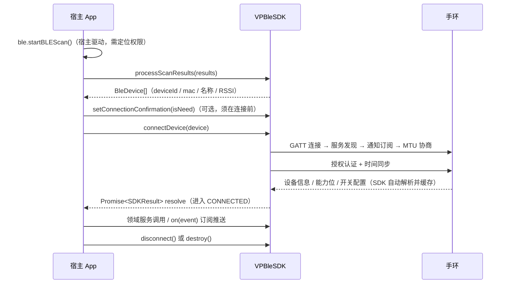

# VPBleSDK for HarmonyOS API 文档

**`@veepoo/vpble-sdk` v1.2.0** · 适用于 HarmonyOS（ArkTS）

本手册是 SDK 的完整 API 参考，目标读者为集成工程师。阅读本手册**无需查看 SDK 源码**：每个接口均给出完整签名、参数取值、返回数据字段、调用时序与示例。

配套文档：

| 文档 | 内容 |
|---|---|
| [QUICKSTART.md](QUICKSTART.md) | 5 分钟跑通：装包 → 权限 → 初始化 → 扫描 → 连接 |
| [INTEGRATION.md](INTEGRATION.md) | 集成关键点、依赖、日志、常见报错排查 |
| [PERMISSIONS.md](PERMISSIONS.md) | 权限声明与后台模式 |
| **API.md（本手册）** | 完整 API 参考：全局约定 + 全部领域接口 + 附录 |

## 版本记录

| 版本 | 日期 | 主要变更 |
|---|---|---|
| 1.0.0 | 2026-07-23 | 首个第三方交付版本：VPBleSDK 单例 + 29 领域服务 + RCSP 桥接 + HRV 分析器 + 完整数据模型 |
| 1.1.0 | 2026-09-12 | 新增微体检、女性生理周期服务；LogSink 日志引流；连接/重连稳定性修复 |
| 1.2.0 | 2026-10-09 | 新增 PTT 测量、杰理 OTA 完整支持、跌倒检测；⚠️ 两处破坏性变更（见 CHANGELOG） |

> 接口条目中的「自 v1.1.0 起支持」等标注表示该接口的引入版本；未标注的为 1.0.0 起提供。

## 目录

**第一部 全局说明**

- [1. 架构与数据流](#1-架构与数据流)
- [2. 初始化与连接生命周期](#2-初始化与连接生命周期)
- [3. 调用通则](#3-调用通则)
- [4. 错误处理模型](#4-错误处理模型)
- [5. 事件总线总表](#5-事件总线总表)
- [6. 设备能力位对照表](#6-设备能力位对照表)
- [7. 日志](#7-日志)

**第二部 领域 API**

- [8. 扫描与连接](#8-扫描与连接)
- [9. 设备信息与电池](#9-设备信息与电池)
- [10. 日常数据](#10-日常数据)
- [11. 心率](#11-心率)
- [12. 血氧](#12-血氧)
- [13. 血压](#13-血压)
- [14. 体温](#14-体温)
- [15. 睡眠](#15-睡眠)
- [16. ECG 心电](#16-ecg-心电)
- [17. HRV](#17-hrv)
- [18. 血糖](#18-血糖)
- [19. 血液成分](#19-血液成分)
- [20. 身体成分](#20-身体成分)
- [21. 压力 / 皮电 / 手动测量 / 微体检 / 自动测量 / 健康辅助](#21-压力--皮电--手动测量--微体检--自动测量--健康辅助)
- [22. 运动](#22-运动)
- [23. 表盘](#23-表盘)
- [24. 消息通知](#24-消息通知)
- [25. 闹钟与健康提醒](#25-闹钟与健康提醒)
- [26. 联系人](#26-联系人)
- [27. 天气与世界时钟](#27-天气与世界时钟)
- [28. 设备开关设置](#28-设备开关设置)
- [29. 设备控制](#29-设备控制)
- [30. 女性健康与蓝牙通话](#30-女性健康与蓝牙通话)
- [31. PTT 脉搏波传导时间](#31-ptt-脉搏波传导时间)
- [32. 4G 与专项设备](#32-4g-与专项设备)
- [33. OTA 固件升级](#33-ota-固件升级)

**附录**

- [附录 A：枚举总表](#附录-a枚举总表)
- [附录 B：数据模型字段表](#附录-b数据模型字段表)
- [附录 C：授权与功能门控说明](#附录-c授权与功能门控说明)

---

# 第一部 全局说明

## 1. 架构与数据流

SDK 以 `VPBleSDK` 单例为唯一入口，内聚 BLE 连接、认证、协议解析与约 30 个领域服务。蓝牙扫描由宿主 App 驱动，SDK 负责扫描结果过滤；连接成功后设备信息、能力位与开关配置由 SDK 自动解析并缓存。



**核心对象获取方式**（全文示例统一使用）：

```ts
import { VPBleSDK, BleDevice, SDKEventType } from '@veepoo/vpble-sdk';

const sdk = VPBleSDK.getInstance();          // 唯一入口单例
sdk.bloodOxygenService();                    // 领域服务：sdk.<xxx>Service()
sdk.getConnectedDevice();                    // 当前连接设备模型 VPDevice | null
```

## 2. 初始化与连接生命周期

### 2.1 连接状态机

`ConnectionState`（见[附录 A](#附录-a枚举总表)）：

```
UNINITIALIZED → READY → BINDING → CONNECTED → DISCONNECTING → DISCONNECTED
                                  ↑______________重连______________|
```

- `BINDING` 覆盖整个连接后初始化阶段（服务发现 / 订阅 / MTU / 授权认证），此阶段**不可下发业务命令**。
- SDK 内置 15 秒 BINDING 看门狗：系统蓝牙关闭、设备离线等导致原生连接无回调时，超时后自动置为 `DISCONNECTED`，允许再次发起连接。
- `isNativeLinkUp()`（自 v1.1.0）用于区分「原生链路尚未建立」与「链路已建立、初始化进行中」——上层重连策略需要此区分时使用，普通场景用 `getState()` 即可。

### 2.2 初始化

```ts
const result = sdk.init({
  mtuSize: 20,              // 可选，BLE MTU（字节），默认 20
  requestTimeout: 5000,     // 可选，单次请求超时（毫秒），默认 5000
  maxRetries: 3,            // 可选，最大重传次数，默认 3
  enableEncryption: false,  // 可选，加密通信，默认 false（绑定后自动启用）
  debugMode: false,         // 可选，等价于 logging.level=DEBUG，输出报文级日志
  context: this.context,    // 可选，UIAbilityContext，用于日志落盘（建议传入）
  logging: {                // 可选，日志配置，见第 7 节
    enable: true,
    level: LogLevel.INFO,
    consoleOutput: true,
  },
});
if (!result.success) {
  // result.error.code === SDKErrorCode.ALREADY_INITIALIZED 表示重复初始化
}
```

约束：

- `init()` 在 SDK 生命周期内**只能调用一次**；重复调用返回 `ALREADY_INITIALIZED` 失败，需先 `destroy()`。
- 若使用 `Logger.setSink()` 或 `logging` 配置，应在 `init()` **之前**设置（见第 7 节）。
- 未初始化（`UNINITIALIZED`）时调用任何业务接口会被拒绝（`NOT_INITIALIZED`）。

### 2.3 连接

```ts
const result = await sdk.connectDevice(scanDevice); // scanDevice: BleDevice
if (result.success) {
  // 进入 CONNECTED：设备信息 / 能力位 / 开关配置已就绪
  const dev = sdk.getConnectedDevice();
} else {
  // result.error.message 含失败原因（超时 / 认证失败 / 断开等）
}
```

- `connectDevice()` 的 Promise 在**整个连接流程（含授权认证）完成后**才 resolve；期间任何环节失败都会 reject 并自动断开。
- 连接前可调用 `setConnectionConfirmation(true)` 要求设备端弹框确认（自 v1.1.0；默认不需要确认）。
- 设备端主动断开、蓝牙关闭等会触发 `SDKEventType.CONNECTION_STATE_CHANGED`（payload `{oldState, newState}`）并进入 `DISCONNECTED`；**SDK 不自动重连**，重连策略由宿主实现（可参考 demo 工程）。
- OTA 升级期间设备会重启进入 DFU 模式产生「伪断连」，该阶段由 SDK 内部接管回连，宿主应据 `OtaUpgradeState.isUpgrading` 屏蔽自身重连逻辑（见第 33 节）。

### 2.4 断开与销毁

```ts
sdk.disconnect();  // 断开当前连接，状态推进到 DISCONNECTED，可再次 connectDevice()
sdk.destroy();     // 销毁 SDK：释放连接/协议引擎/事件监听/日志，回到 UNINITIALIZED；单例被置空
```

- `disconnect()` 是同步立即断开（主动释放 GATT 资源，不等待系统回调）。
- `destroy()` 后如需再次使用，须重新 `init()`（会得到新的单例实例）。

## 3. 调用通则

以下约定适用于第二部全部领域接口，各接口条目不再重复。

### 3.1 前置状态

- 除「初始化 / 扫描处理」外，全部领域接口要求 **`CONNECTED` 状态**。未连接时调用返回失败（`TRANSPORT_DISCONNECTED` / `NOT_BOUND`）。
- 需要设备支持对应功能的接口，请先按[第 6 节能力位](#6-设备能力位对照表)判断（`sdk.getConnectedDevice()?.featureList`），对不支持的设备调用会得到设备返回的错误或无效数据。

### 3.2 监听先于启动

**推送型接口（测量类）的事件监听必须在 `start*()` 之前注册**：

```ts
// ✅ 正确顺序：注册 → 启动 → （多次回调）→ 停止 → 注销
service.onXxxPush(listener);
await service.startMeasurement();
// ... 测量过程中多次回调 ...
await service.stopMeasurement();
service.offXxxPush(listener);
```

先启动后注册会丢失启动阶段的回调帧（如 ECG 的指令应答与进度）。

### 3.3 两种事件通道

| 通道 | 注册方式 | 适用 |
|---|---|---|
| 全局事件总线 | `sdk.on(SDKEventType.X, cb)` / `sdk.off(...)` | 设备端主动上报的状态变更（27 类，见第 5 节） |
| 服务内单槽监听 | `service.onXxxPush(cb)` / `service.offXxxPush(cb)` | 一次测量的过程数据（进度/波形/结果） |

- 单槽监听：一个服务同时只有一个活跃监听槽位，重复注册以前一次为准；页面退出时务必 `off` 注销。
- 页面生命周期建议：`aboutToAppear` 注册 + `aboutToDisappear` 注销；若需锁屏后仍接收，改用 `aboutToAppear/aboutToDisappear` 对的组件级事件订阅。

### 3.4 连接期缓存 vs 主动读取

连接流程中，设备会主动推送一批配置（B8 开关、消息推送开关、BT 状态等），SDK 已解析缓存到 `VPDevice`（`sdk.getConnectedDevice()`）。此类配置**读取走缓存、变更走事件**，不要在连接成功后串行逐个发读取命令拖慢连接后的首屏。

### 3.5 多包读取与进度

历史数据类接口（日常数据、血氧全天、ECG 历史等）为多包传输：接口提供 `onProgress` 回调或进度字段（0~100）。部分接口支持断点续传（如血氧全天数据的 `packageSeq`——首次传 0，续传传上次收到的最大序号），详见各接口条目。

### 3.6 并发约束

- 同一服务内的**同命令并发调用会串包**（如表盘的市场信息读取），同类请求必须串行 `await`。
- 测量进行中（设备正忙）发起新的测量会得到「设备忙」类错误；先 `stop` 上一次测量。

### 3.7 后台保活

蓝牙长连接在后台需要宿主申请长时任务（continuousTask）。断线重连、前后台切换的重连建议参考 demo 工程实现。

## 4. 错误处理模型

SDK 有两种返回形态：

| 形态 | 结构 | 适用 |
|---|---|---|
| 操作结果 | `SDKResult { success: boolean; error?: SDKError }` | 连接、断开等生命周期操作（`connectDevice` 等） |
| 业务结果 | `Promise<XxxResult>`，其中含 `success: boolean`、`data?: T`、`errorMessage?: string`、部分含 `ack?: number` | 各领域服务接口 |

业务失败时优先读 `errorMessage`（人类可读，含设备返回原因）；`ack` 为设备应答码，非 0 表示设备拒绝/异常。

`SDKError.code`（`SDKErrorCode`，生命周期操作使用）：

| 枚举值 | 数值 | 含义 |
|---|---|---|
| NOT_INITIALIZED | 0x0001 | 未初始化，先调用 `init()` |
| TRANSPORT_DISCONNECTED | 0x0002 | 传输层未连接 / 连接中断 |
| REQUEST_TIMEOUT | 0x0003 | 请求超时 |
| MAX_RETRIES_EXCEEDED | 0x0004 | 重传次数耗尽 |
| PROTOCOL_PARSE_ERROR | 0x0005 | 协议解析错误 |
| CHECKSUM_MISMATCH | 0x0006 | 校验失败 |
| ENCRYPTION_ERROR | 0x0007 | 加密错误 |
| NOT_BOUND | 0x0008 | 未绑定设备 |
| UNKNOWN_COMMAND | 0x0009 | 未知命令 |
| INVALID_PARAM | 0x000A | 参数错误（含状态机守卫拒绝） |
| ALREADY_INITIALIZED | 0x000B | SDK 已初始化（重复 `init()`） |
| INVALID_STATE | 0x000C | 状态异常 |
| ENGINE_DESTROYED | 0x000D | 引擎已销毁（自 v1.1.0） |

## 5. 事件总线总表

通过 `sdk.on(SDKEventType.X, callback)` 订阅、`sdk.off(...)` 注销。回调收到对应 payload（`ESObject`，按表中断言为具体类型后使用）。

| 事件 | payload 类型 | 触发时机 |
|---|---|---|
| CONNECTION_STATE_CHANGED | `{ oldState: ConnectionState; newState: ConnectionState }` | 连接状态机变迁 |
| HEALTH_DATA | 对应业务模型 | 健康数据推送 |
| DEVICE_INFO | 设备信息模型 | 设备信息推送 |
| BATTERY_UPDATE | `BatteryInfo` | 电量（主动读 + 设备主动上报） |
| PTT_STATE_CHANGE | `{ pttState }` | 设备进入/退出 PTT 模式上报（自 v1.2.0） |
| FIND_DEVICE_STATE | `FindDevicePush` | 查找设备过程上报（查找中/已找到/超时退出） |
| FIND_PHONE_REQUEST | `FindDevicePush` | 设备请求查找手机（App 侧应响铃/震动） |
| PHOTO_CONTROL | `PhotoControlPush` | 手环快门键触发拍照/退出 |
| SCREEN_BRIGHT_CHANGED | `ScreenBrightConfig` | 设备端修改熄屏时长 |
| RAISE_TO_WAKE_CHANGED | `RaiseToWakeConfig` | 设备端修改抬手亮屏 |
| ALARM_CHANGED | `AlarmClockItem[]` | 设备端增删改/开关文字闹钟（SDK 已刷新全表并回执） |
| REMINDER_CHANGED | `HealthReminderConfig` | 设备端修改健康/久坐提醒 |
| HEALTH_ALARM_CHANGED | `HealthAlarmThresholdResult` | 设备端修改心率/血压/体温/血氧报警阈值 |
| SPO2_AUTO_CHANGED | `SpO2AutoResult` | 设备端修改血氧自动监测配置 |
| UI_STYLE_CHANGED | `UIStyleResult` | 设备端切换表盘/UI 风格 |
| FOURG_SERVICE_CHANGED | `FourGServicePush` | 4G 配置设置回执 / 设备端主动上报 / 读取完成（自 v1.1.0） |
| MESSAGE | 消息模型 | 收到消息推送 |
| ALERT | 告警信息 | 收到告警推送 |
| PROTOCOL_ERROR | `SDKError` | 协议解析错误 |
| TRANSPORT_ERROR | `SDKError` | 传输错误 |
| RCSP_INIT_COMPLETE | 无 | JL RCSP 会话初始化完成 |
| RCSP_MANDATORY_UPGRADE | 无 | JL RCSP 强制升级通知 |
| CONFIG_CHANGED | 内部信封 | 设备开关配置变更推送——**集成方请改用类型化回调 `configService.onSwitchConfigChange()`**（见 28.4） |
| MSG_SWITCH_CHANGED | 内部信封 | 消息推送开关配置变更——**集成方请改用类型化回调 `configService.onMsgSwitchChange()`**（见 28.5） |
| BT_STATUS_CHANGED | 内部信封 | 蓝牙通话状态变更——**集成方请改用类型化回调 `btService.onBtStatusChange()`**（见 30.3） |
| OTA_PROGRESS | OTA 进度 | OTA 升级进度更新 |
| HEALTH_ASSISTANCE | 健康辅助状态 | 健康辅助状态变更 |

> 字段级 payload 结构见[附录 B](#附录-b数据模型字段表)对应模型。

## 6. 设备能力位对照表

连接成功后，设备能力缓存在 `sdk.getConnectedDevice()?.featureList`（`DeviceFeatureList`）。所有功能入口的**支持性判断都以该对象为准**：字段为 `0` 表示不支持，非 0 表示支持（部分字段非 0 值本身携带细分型号语义，见备注）。

判断范式：

```ts
const dev = sdk.getConnectedDevice();
if ((dev?.featureList?.bloodGlucose ?? 0) > 0) {
  // 支持血糖，进入血糖页面 / 使能血糖入口
}
if (dev?.featureList?.b3AutoMeasure === 1) {
  // 支持多功能定时自动测量（否则仅有开/关式自动测量）
}
```

**包 1（基础健康与提醒）**

| 字段 | 含义 | 取值 |
|---|---|---|
| bloodPressure | 血压 | 0=无；1=有(默认校准)；2=有(自动评估)；3=气泵无采集；4=有(支持扩展读取)；5=气泵+采集 |
| alcohol | 饮酒 | 0=无；1=旧算法(心率+运动量)；2=新算法 |
| healthReminder | 健康提醒 | 0=无；1=久坐提醒；2=健康提醒 |
| skinType | 肤色档位 | 0=2 档；2=4 档 |
| wechatSport | 微信运动 | 0=无；1/2=有 |
| camera | 拍照 | 0=无；1=App 启动设备拍照；2=系统拍照通道 |
| fatigue | 疲劳度 | 0=无；1=有 |
| bloodOxygen | 血氧 | 0=无；其他=有（细分型号，见血氧章节） |
| messageNotifyPackets | 信息提醒包数 | 0=4 包；n=最大 n 包 |
| heartRateAlert | 心率报警 | 0=无；1=有 |
| wristScreen | 翻腕亮屏 | 0=老式抬手亮屏；1=有；2=无 |
| femaleProject | 女性项目 | 0=无；1/2/3=有（语言差异） |
| screenBrightness | 屏幕亮度调节 | 0=无；1=有 |
| c3Command | 扩展设置通道 | 0=无；1=有 |
| accuracyFlag | 距离精度 | 0=旧精度(1 位小数)；1=新精度(3 位小数) |
| highEndBP | 高端血压 | 0=无；1=有 |
| newAlarm | 新版闹钟 | 0=无(3 组老闹钟)；其他=有（最多 20 组） |
| heartRateFunction | 心率 | **0=有(默认)**；1=无；其他=传感器类型。注意此字段与其他字段相反：0 为有 |

**包 2（测量与数据能力）**

| 字段 | 含义 | 取值 |
|---|---|---|
| countdown | 倒计时 | 0=无；1=有 |
| dailyDataDays | 日常数据可读天数 | 0=3 天；1~7=1~7 天 |
| messagePushRemarkPackets | 信息推送备注包数 | 0=1 包；n=n 包 |
| hidFunction | HID | 0=无；1=有 |
| sportModeCount | 运动模式存储次数 | 0=无；n=最多 n 次 |
| uiStyleCount | UI 风格数量 | 0=不支持；n=最多 n 种 |
| respiratoryRate | 呼吸率 | 0=不支持；1=血氧手环；2=ECG 测量 |
| hrv | HRV | 0=不支持；1=血氧手环；2=ECG 手环；3=全天 HRV |
| weather | 天气 | 0=不支持；其他=支持 |
| newUploadProtocol | 上传方式 | 0=默认 5 分钟上传；其他=细分类型 |
| a5CommandImproved | 时间同步完善版 | 0=旧；1=新 |
| screenOnDuration | 亮屏时长设置 | 0=无；1=有 |
| sleepFlag | 睡眠 | 0=普通睡眠；1=精准睡眠；2=无睡眠 |
| clearDataFlag | 清除数据方式 | 0=旧；1=新；2=G 系列恢复出厂 |
| ecgFunction | ECG | 0=无；其他=有（细分型号） |
| sportModeType | 运动模式类型 | 0=普通；其他=多运动类型 |
| lowPowerOptimization | 低功耗优化 | 0=无；1=有 |
| tpType | 触摸类型 | 0=无；1=有 |

**包 3（表盘/定位/血糖等）**

| 字段 | 含义 | 取值 |
|---|---|---|
| transferFlowType | 表盘传输方式 | 0=旧流程；1=新流程 |
| moreWatchfaceCount | 预置表盘数量（高位） | 0~15 |
| customWatchfaceCount | 自定义表盘数量（低位） | 0~15 |
| agingTest | 老化测试 | 0=无；1=有 |
| contactsType | 通讯录 | 0=无；1=10 个；2=10 个+SOS；3=20 个+SOS |
| guidePage | 引导页 | 0=无；1=有 |
| music | 音乐控制 | 0=无；1=有 |
| bodyTemp | 体温 | 0=无；1=仅手动；2=手动+自动；其他=细分型号 |
| findBand | 手机查找手环 | 0=无；1=有 |
| agps | 星历（AGPS） | 0=不支持；1/2=不同星历源 |
| gps | GPS | 0=无；1=有 |
| geomagnetism | 地磁 | 0=无；1=有 |
| resetPassword | 密码设置入口 | 0=有密码设置；1=App 不显示 |
| micTest | 麦克风测试 | 0=无；1=有 |
| broadcastPacket | 广播包 | 0=无；1=有 |
| bloodGlucose | 血糖 | 0=无；1=无校准；2=单校准；4=多校准；其他=细分型号 |
| chipSeries | 芯片系列 | 0=Nordic/汇顶；1=杰理；2=炬芯；3/4=中科；5=Nordic54L |
| metFunction | 梅脱 | 0=无；2=有 |
| pressure | 压力 | 0=无；2=有 |

**包 4（成分/4G/AI 等）**

| 字段 | 含义 | 取值 |
|---|---|---|
| bloodComposition | 血液成分 | 0=无；1=血脂+尿酸；2=支持单项校准；3=同 2+扩展读取 |
| bodyComposition | 身体成分 | 0=无；1=有 |
| worldClock | 世界时钟 | 0=无；1=有 |
| tempAlarm | 体温报警 | 0=无；1=有 |
| wallet | 钱包/收款码 | 0=无；按位：支付宝/微信/QQ |
| businessCard | 名片 | 0=无；按位：微信/QQ/Facebook/Instagram |
| game | 游戏 | 0=无；1=有且可设置时长 |
| aiQA | AI 问答 | 0=无；1=非中国大陆；2=中国大陆 |
| aiWatchface | AI 表盘 | 0=无；1=非中国大陆；2=中国大陆 |
| distanceCalorieGoal | 距离/卡路里目标 | 0=无；1=有 |
| videoWatchface | 视频表盘 | 0=无；1=有 |
| b3AutoMeasure | 定时自动测量协议 | 0=仅开/关式；1=支持定时模式 |
| daSportControl | App 控制运动 | 0=不支持；1=支持 |
| photoAlbum | 相册相片表盘 | 0=不支持；1=支持 |
| lteFunction | 4G | 0=不支持；1=支持 |
| electronicCard | 电子名片 | 0=不支持；1=支持（与钱包/名片互斥） |
| healthAssessment | 健康辅助评估 | 0=不支持；按位表示支持项 |
| microCheckup | 微体检 | 0=不支持；1=支持；2=无 ECG；3=仅设备端测量 |

**包 5（专项）**

| 字段 | 含义 | 取值 |
|---|---|---|
| imagePush | 图文推送 | 0=不支持；1=支持 |
| skinElectric | 皮电 | 0=不支持；1=支持 |
| safetyGuard | 安全守护 | 0=不支持；1=支持 |
| screenType | 屏幕类型 | 1=无屏手环；2=戒指；3=方屏；4=圆屏 |
| barometer | 气压计 | 0=不支持；1=支持 |
| touchICType | 触摸 IC | 0=不支持；1=两点式侧边触摸 |
| newProductionTest | 新产测协议 | 0=不支持；1=支持 |
| pttFunction | PTT | 0=无；1=支持（自 v1.2.0） |
| receivedPacketCount | 实际收到的能力包数 | 1~5 |

## 7. 日志

SDK 日志有三条相互独立的输出通道：

| 通道 | 开关 | 说明 |
|---|---|---|
| 文件落盘 | `logging.enable`（默认 true） | 写入 `<filesDir>/vpble/log/vpble.log`，按大小×个数滚动轮转（默认 5MB×5）。客户反馈问题时可直接取该文件回传 |
| hilog 双写 | `logging.consoleOutput`（默认 true） | 输出到系统 hilog |
| LogSink | `Logger.setSink(cb)`（默认不注册） | 把 SDK 日志按行引流到宿主自身日志系统（自 v1.1.0） |

```ts
import { VPBleSDK, Logger, LogLevel } from '@veepoo/vpble-sdk';

// 深度集成（推荐）：日志汇入宿主统一日志，并关闭 SDK 自带落盘与 hilog
Logger.setSink((level: LogLevel, tag: string, msg: string) => {
  myLogger.write(`[${LogLevel[level]}] ${tag}: ${msg}`);   // 注意：回调内只做内存入队，勿做磁盘 IO
});

sdk.init({
  context: this.context,        // 提供落盘目录；不传且未设 logDir 时自动降级 console-only
  logging: {
    enable: false,              // 关 SDK 文件落盘
    consoleOutput: false,       // 关 hilog 双写
  },
});
```

- `Logger.setSink()` 必须在 `init()` **之前**调用。
- 独立交付场景（未深度集成）：保持默认即可，SDK 自带文件轮转，无需注册 sink。
- `debugMode: true` 或 `logging.level: LogLevel.DEBUG` 可获取完整报文级日志（二选一）。

---

# 第二部 领域 API

## 8. 扫描与连接

### 8.1 获取扫描过滤条件

**前提与调用时序**：`init()` 之后、启动扫描之前调用；用于构造系统扫描过滤器。

**调用入口**：

```ts
const uuids: string[] = VPBleSDK.getInstance().getScanFilterUUIDs();
```

**参数**：无参数。

**返回与回调**：`string[]` —— SDK 设备广播的服务 UUID 列表，供 `ble.startBLEScan` 的 `filter.serviceUuids` 使用。

**示例**：

```ts
import { ble } from '@kit.ConnectivityKit';

const filter: ble.ScanFilter = {
  deviceId: undefined,
  serviceUuids: VPBleSDK.getInstance().getScanFilterUUIDs(),
};
await ble.startBLEScan([filter], { dutyMode: ble.ScanDuty.SCAN_MODE_LOW_POWER });
```

**错误与注意**：扫描由宿主驱动，需要定位权限（见 PERMISSIONS.md）；扫描结果必须交给下一节的 `processScanResults()` 过滤，直接使用系统扫描回调会混入其他厂商设备。

### 8.2 处理扫描结果

**前提与调用时序**：系统扫描回调到达后调用；可在扫描期间反复调用（每轮扫描回调一次）。

**调用入口**：

```ts
processScanResults(results: Array<ble.ScanResult>): BleDevice[]
```

**参数**：

| 参数 | 类型 | 必填 | 说明 |
|---|---|---|---|
| results | `Array<ble.ScanResult>` | 是 | 系统扫描回调返回的本轮结果 |

**返回与回调**：`BleDevice[]` —— 本轮扫描到我司设备的列表（仅包含新增或 RSSI 变化的设备）：

| 字段 | 类型 | 说明 |
|---|---|---|
| deviceId | `string` | 系统蓝牙的**虚拟地址**，`connectDevice()` 建连用 |
| mac | `string` | 设备**真实 MAC**（解析自广播数据），UI 展示与去重用 |
| deviceName | `string` | 设备名称 |
| rssi | `number` | 信号强度（dBm，负值） |
| connectable | `boolean` | 是否可连接 |

**示例**：

```ts
ble.on('BLEDeviceFind', (results: Array<ble.ScanResult>) => {
  const devices = VPBleSDK.getInstance().processScanResults(results);
  // 展示用 mac 去重；连接用 deviceId
  for (const d of devices) {
    console.info(`found ${d.deviceName} mac=${d.mac} rssi=${d.rssi}`);
  }
});
```

**错误与注意**：

- `deviceId` 是随机虚拟地址、**每次广播可能变化**；去重与落库一律用 `mac`。
- 一个设备可能被多轮扫描重复上报，展示层按 `mac` 去重。

### 8.3 连接设备

**前提与调用时序**：`init()` 完成、状态为 `READY` 或 `DISCONNECTED`；需要连接确认的机型先调用 `setConnectionConfirmation(true)`（见 8.5）。

**调用入口**：

```ts
connectDevice(device: BleDevice): Promise<SDKResult>
```

**参数**：

| 参数 | 类型 | 必填 | 说明 |
|---|---|---|---|
| device | `BleDevice` | 是 | 扫描阶段得到的设备对象（使用其 `deviceId` 建连，扫描信息保留到设备模型） |

**返回与回调**：`Promise<SDKResult>` —— **整个流程（GATT 连接 → 服务发现 → 订阅 → MTU → 授权认证）完成后**才 settle。成功后设备信息/能力位/开关配置已缓存，可直接调用领域服务。

**示例**：

```ts
const r = await VPBleSDK.getInstance().connectDevice(device);
if (r.success) {
  const dev = VPBleSDK.getInstance().getConnectedDevice();
  console.info(`connected: ${dev?.deviceNumber}, chip=${dev?.featureList?.chipSeries}`);
} else {
  console.error(`connect failed: ${r.error?.message}`);
}
```

**错误与注意**：

- 失败常见原因：设备不可达（15s 超时）、认证失败、系统蓝牙关闭。
- 状态机不允许时（如正在 BINDING）返回失败而不抛异常；先 `disconnect()` 再重连。
- 连接成功后**不要**紧接着串行发一串读取命令做"首屏同步"——连接期设备推送的配置已在缓存，见第 3.4 节。

### 8.4 断开与销毁

**前提与调用时序**：任意非 `UNINITIALIZED` 状态可调用。

**调用入口**：

```ts
disconnect(): void
destroy(): void
```

**参数**：无参数。

**返回与回调**：无。`disconnect()` 同步断开并把状态推进到 `DISCONNECTED`（不等待系统异步回调）；`destroy()` 释放全部资源并回到 `UNINITIALIZED`，单例置空。

**示例**：

```ts
VPBleSDK.getInstance().disconnect();   // 用户主动解绑/退出登录
VPBleSDK.getInstance().destroy();      // 彻底退出 SDK 时
```

**错误与注意**：手动 `disconnect()` 后 SDK **不会自动重连**；重连由宿主策略驱动（建议参考 demo 的重连实现：重新扫描获取新鲜 `deviceId` 后再连接，避免用陈旧地址直连失败）。

### 8.5 连接确认开关（自 v1.1.0）

**前提与调用时序**：必须在 `connectDevice()` **之前**设置。

**调用入口**：

```ts
setConnectionConfirmation(isNeed: boolean): void
```

**参数**：

| 参数 | 类型 | 必填 | 说明 |
|---|---|---|---|
| isNeed | `boolean` | 是 | true=连接时设备端弹框，用户确认后才完成认证；false=不需要确认（默认） |

**返回与回调**：无。

**示例**：

```ts
sdk.setConnectionConfirmation(true);
await sdk.connectDevice(device);  // 设备端弹框，用户按确认后连接才完成
```

### 8.6 连接状态查询

**前提与调用时序**：任意时刻可用。

**调用入口**：

```ts
getState(): ConnectionState
isNativeLinkUp(): boolean        // 自 v1.1.0
getConnectedDevice(): VPDevice | null
getConnectedDeviceId(): string
connectDeviceIsJL(): boolean | null
hasJlRcspService(): boolean
isRcspInitialized(): boolean
getConnectDeviceRssi(callback?: (rssi: number) => void): void   // 自 v1.1.0
negotiatedMtu: number            // 属性
```

**返回与回调**：

| 方法 | 返回 | 说明 |
|---|---|---|
| `getState()` | `ConnectionState` | 连接状态机当前状态 |
| `isNativeLinkUp()` | `boolean` | 原生 GATT 链路是否已建立（BINDING 期间也可为 true，用于重连策略细分） |
| `getConnectedDevice()` | `VPDevice \| null` | 当前连接设备模型（设备号/固件版本/能力位/开关配置/电池缓存等） |
| `getConnectedDeviceId()` | `string` | 当前连接使用的地址 |
| `connectDeviceIsJL()` | `boolean \| null` | 是否杰理芯片设备（`chipSeries === 1`）；未连接返回 null |
| `hasJlRcspService()` | `boolean` | 是否存在 JL RCSP 桥（表盘/OTA 传输前提） |
| `isRcspInitialized()` | `boolean` | RCSP 会话是否初始化完成（表盘传输前建议确认） |
| `getConnectDeviceRssi(cb)` | `void` | 异步回调返回当前信号强度（dBm）；链路未就绪时静默忽略，不抛异常 |
| `negotiatedMtu` | `number` | 实际协商的 MTU 字节数 |
| `authService` | `AuthService` | 授权认证服务对象——认证已由 `connectDevice()` 内聚完成，集成方**无需直接调用** |
| `rcspBridge` | `RcspBridge \| null` | JL RCSP 桥接层原始对象——常规表盘/OTA 请使用 `dialService` / `otaService`，仅在实现 SDK 未覆盖的 RCSP 扩展能力时才直接使用 |

**示例**：

```ts
sdk.getConnectDeviceRssi((rssi: number) => {
  console.info(`rssi=${rssi}dBm`);
});
```

## 9. 设备信息与电池

**调用入口**：`VPBleSDK.getInstance().deviceService`

### 9.1 读取电池信息 — `getBatteryInfo()`

**前提与调用时序**：设备已连接。表盘传输、OTA 前建议先读电量做门槛（OTA 建议电量 ≥ 30%，低电时禁止大文件传输）。

**调用入口**：

```ts
deviceService.getBatteryInfo(): Promise<BatteryInfoResult>
```

**参数**：无参数。

**返回与回调**：`Promise<BatteryInfoResult>`，`data` 为 `BatteryInfo`：

| 字段 | 类型 | 说明 |
|---|---|---|
| hasPercentage | `boolean` | 设备是否上报电量百分比 |
| level | `number` | 电量百分比 0~100，仅 `hasPercentage` 为 true 时有效 |
| levelGrade | `number` | 电量格数 0~4，`hasPercentage` 为 false 时用它展示 |
| lowBattery | `boolean` | 是否低电 |
| powerMode | `number` | 电源模式：0=正常 1=充电中 2=低压 3=充满（`BatteryPowerMode`） |
| bat | `number` | 原始电量值 |
| sleeping | `boolean` | 是否睡眠中 |
| voltage | `number` | 电池电压（毫伏） |

读取成功后 SDK 会同时发出 `SDKEventType.BATTERY_UPDATE` 事件；设备端主动上报电量也走该事件（见第 5 节）。

**示例**：

```ts
const r = await VPBleSDK.getInstance().deviceService.getBatteryInfo();
if (r.success && r.data) {
  const pct = r.data.hasPercentage ? `${r.data.level}%` : `${r.data.levelGrade}/4 格`;
  console.info(`电量 ${pct}, lowBattery=${r.data.lowBattery}`);
}
```

**错误与注意**：失败时 `errorMessage` 含原因；`lowBattery` 为 true 时建议阻止表盘/OTA 等大功耗操作。

## 10. 日常数据

**调用入口**：`VPBleSDK.getInstance().healthService`

日常数据 = 步数/距离/卡路里汇总（`getStepData`）与 5 分钟粒度的全指标历史（`getHealthData`）。**iOS/Android 同款约定：测量类操作前，请先确保当日/往日日常数据读取完毕，否则设备可能返回"设备忙"。**

### 10.1 设备可查天数 — `getMaxStorageDays()`

**前提与调用时序**：连接成功后即可（读能力缓存，不通信）。

**调用入口**：

```ts
healthService.getMaxStorageDays(): number
```

**参数**：无参数。

**返回与回调**：`number` —— 设备端可存储/可查询的日常数据天数（1~7，默认 3，来自能力位 `dailyDataDays`）。用于决定 App 侧循环读取几天的数据，替代硬编码。

**示例**：

```ts
const days = VPBleSDK.getInstance().healthService.getMaxStorageDays();
for (let d = 0; d < days; d++) {
  await VPBleSDK.getInstance().healthService.getStepData(d);
}
```

### 10.2 查询步数/距离/卡路里 — `getStepData()`

**前提与调用时序**：设备已连接；`day` 不得超过 `getMaxStorageDays()`（超出抛 `INVALID_PARAM`）。

**调用入口**：

```ts
getStepData(day: HealthQueryDay = HealthQueryDay.TODAY): Promise<StepDataResult>
```

**参数**：

| 参数 | 类型 | 必填 | 说明 |
|---|---|---|---|
| day | `HealthQueryDay` | 否 | 0=今天(默认)、1=昨天、2=前天（见[附录 A](#附录-a枚举总表)） |

**返回与回调**：`Promise<StepDataResult>`，`data` 为 `StepData`：

| 字段 | 类型 | 说明 |
|---|---|---|
| steps | `number` | 步数 |
| distance | `number` | 距离，**米**（显示层再换算 km） |
| calories | `number` | 卡路里，**0.1 千卡**（显示层 ÷10） |

**示例**：

```ts
const r = await VPBleSDK.getInstance().healthService.getStepData(HealthQueryDay.TODAY);
if (r.success && r.data) {
  console.info(`步数${r.data.steps} 距离${(r.data.distance / 1000).toFixed(2)}km 卡路里${(r.data.calories / 10).toFixed(1)}kcal`);
}
```

**错误与注意**：设备忙时返回 `success=false, errorMessage='Device is busy'`；distance/calories 为协议原始单位，**不要在持久化前换算**，显示层再除。

### 10.3 查询日常健康数据（5 分钟粒度全指标）— `getHealthData()`

**前提与调用时序**：设备已连接；`day` 受 `getMaxStorageDays()` 限制；`position` 取值 [1, 288]（对应一天 288 个 5 分钟片），**增量读取游标**——首次传 1，之后传上次读取到的最新位置可实现增量同步；非当天数据为幂等读取，当天的数据 App 应自行控制读取时机。

**调用入口**：

```ts
getHealthData(
  day: HealthQueryDay = HealthQueryDay.TODAY,
  position: number,
  onProgress?: (progress: number) => void,
): Promise<HealthDataResult>
```

**参数**：

| 参数 | 类型 | 必填 | 说明 |
|---|---|---|---|
| day | `HealthQueryDay` | 否 | 0=今天(默认)、1=昨天、2=前天 |
| position | `number` | 是 | 起始位置 1~288（5 分钟片序号）；增量读取游标 |
| onProgress | `(progress: number) => void` | 否 | 多包传输进度 0~1 |

**返回与回调**：`Promise<HealthDataResult>`：

| 字段 | 类型 | 说明 |
|---|---|---|
| success | `boolean` | 是否成功 |
| position | `number` | 本次读到的最新位置（可作为下次增量游标持久化） |
| data | `HealthData` | 见下 |

`HealthData`：

| 字段 | 类型 | 说明 |
|---|---|---|
| sportSummary | `DailySportSummary` | 当日汇总：`totalSteps`/`totalDistance`(**米**，显示层 ÷1000 转 km)/`totalCalories`(**0.1 千卡**，显示层 ÷10 转 kcal) |
| fiveMinuteData | `DailyFiveData[]` | 5 分钟分片数组，每个分片含步数/距离/卡路里/心率(PPG/ECG)/血压/血氧/体温/HRV/压力/血糖/血液成分/呼吸率/睡眠状态等约 40 个字段，详见[附录 B](#附录-b数据模型字段表) |

**示例**：

```ts
VPBleSDK.getInstance().healthService.getHealthData(HealthQueryDay.TODAY, 1, (progress: number) => {
  console.info(`日常数据同步 ${Math.round(progress * 100)}%`);
}).then((result) => {
  if (result.success && result.data) {
    console.info(`总步数 ${result.data.sportSummary.totalSteps}, 分片数 ${result.data.fiveMinuteData.length}`);
  }
});
```

**错误与注意**：

- 数据有效性：分片 `time === 0xFFFF` 表示无效片（无数据时段），展示/聚合前应过滤。
- 单位：`sportSummary` 与 `fiveMinuteData[].distance`/`calories` 均为协议原始单位，与 `StepData` **同一套口径**（距离=**米**、热量=**0.1 千卡**，显示层 ÷1000/÷10 换算），不存在第二套口径。
- 多包传输耗时较长，建议展示进度；期间避免并发发其他命令。

### 10.4 查询睡眠数据 — `getSleepData()`

**前提与调用时序**：设备已连接；`day` 受设备可查天数限制。支持精准睡眠的机型返回结构化多段睡眠。

**调用入口**：

```ts
getSleepData(day: HealthQueryDay = HealthQueryDay.TODAY): Promise<SleepDataResult>
```

**参数**：

| 参数 | 类型 | 必填 | 说明 |
|---|---|---|---|
| day | `HealthQueryDay` | 否 | 0=今天(默认)、1=昨天、2=前天 |

**返回与回调**：`Promise<SleepDataResult>`，`data` 为 `AccurateSleepModel[]`（一天可能有多段睡眠）。字段结构见[附录 B](#附录-b数据模型字段表)；其中 `sleepLine` 为睡眠曲线 hex 串，按 SDK 公开约定编码为各睡眠阶段序列，可还原为深浅睡/REM/清醒曲线。

**示例**：

```ts
const r = await VPBleSDK.getInstance().healthService.getSleepData(HealthQueryDay.YESTERDAY);
if (r.success && r.data) {
  for (const seg of r.data) {
    console.info(`${seg.sleepTime} ~ ${seg.wakeTime}, 总时长 ${seg.sleepDuration} 分钟, 质量 ${seg.sleepQuality}`);
  }
}
```

### 10.5 健康数据推送监听

**前提与调用时序**：连接后任意时刻；设备主动上报步数/睡眠等数据时回调。

**调用入口**：

```ts
addHealthDataListener(listener: (event: HealthDataPushEvent) => void): void
removeHealthDataListener(listener: (event: HealthDataPushEvent) => void): void
```

**返回与回调**：`HealthDataPushEvent`：

| 字段 | 类型 | 说明 |
|---|---|---|
| type | `string` | `'step'` / `'sleep'` 等 |
| data | `StepData \| AccurateSleepModel[]` 等 | 对应类型的数据 |

**示例**：

```ts
const listener = (e: HealthDataPushEvent) => {
  if (e.type === 'step') { /* 更新今日步数 UI */ }
};
VPBleSDK.getInstance().healthService.addHealthDataListener(listener);
// 页面销毁时：removeHealthDataListener(listener)
```

## 11. 心率

**调用入口**：`VPBleSDK.getInstance().heartRateService`

心率服务提供两类能力：单次手动心率测量（启动后设备持续推送瞬时心率）与健康报警阈值设置（心率/血压/体温过高/血氧过低四类共用一个通道，见 11.4/11.5）。全天心率历史不在本服务——5 分钟粒度的心率随第 10 章日常数据（`getHealthData`）一并返回。

能力门控：`featureList.heartRateFunction`（注意该字段与其他能力位相反：0=有、1=无，见第 6 节）；`featureList.heartRateAlert=1` 表示支持心率报警。

### 11.1 启动心率测量 — `startMeasurement()`

**前提与调用时序**：设备已连接且支持心率。`onHeartRatePush` 监听（11.3）必须**先于本方法注册**（见第 3.2 节），否则启动阶段及测量过程中的推送帧会丢失；同一时刻设备只执行一项测量，其他测量（血压/血氧/体温等）进行中需先停止，否则得不到有效数据。

**调用入口**：

```ts
heartRateService.startMeasurement(
  brightness: HeartRateBrightness = HeartRateBrightness.LOW,
): Promise<HeartRateResult>
```

**参数**：

| 参数 | 类型 | 必填 | 说明 |
|---|---|---|---|
| brightness | `HeartRateBrightness` | 否 | 心率灯亮度档位，默认 `LOW`；取值见[附录 A](#附录-a枚举总表) `HeartRateBrightness`（OFF=0 关闭心率灯 / LOW=1 / MEDIUM=2 / HIGH=7） |

**返回与回调**：`Promise<HeartRateResult>`。Promise 返回设备的启动应答帧（不含有效测量值）；实时心率经 `onHeartRatePush`（11.3）持续回调。

`HeartRateResult`：`{ success: boolean; data?: HeartRateMeasurement; errorMessage?: string }`，`HeartRateMeasurement`：

| 字段 | 类型 | 说明 |
|---|---|---|
| heartRate | `number` | 心率值（BPM） |
| heartState | `number` | 测量状态：0=测量进行中，1=本次测量完成 |
| watchState | `number` | 手环状态字，0=正常；非 0 时该帧无效（`success=false`） |

**示例**：

```ts
import { VPBleSDK, HeartRateMeasurement, HeartRateBrightness } from '@veepoo/vpble-sdk';

const service = VPBleSDK.getInstance().heartRateService;
// 1. 先注册监听（建议在 aboutToAppear）
service.onHeartRatePush((data: HeartRateMeasurement) => {
  console.info(`实时心率 ${data.heartRate} BPM，state=${data.heartState}`);
});
// 2. 再启动测量
const r = await service.startMeasurement(HeartRateBrightness.HIGH);
if (!r.success) {
  console.error(`启动失败：${r.errorMessage}`);
}
// 3. 测量结束后停止并注销监听（见 11.2 / 11.3）
```

**错误与注意**：

- `success=false` 时读 `errorMessage`；`watchState` 非 0 表示设备当前状态不允许出值。
- UI 刷新依赖推送帧，不要以轮询 `startMeasurement()` 的方式取值。
- 连续两次启动之间应先 `stopMeasurement()`（见第 3.6 节并发约束）。

### 11.2 停止心率测量 — `stopMeasurement()`

**前提与调用时序**：测量进行中调用；页面退出（`aboutToDisappear`）时若测量仍在进行，应兜底调用。

**调用入口**：

```ts
heartRateService.stopMeasurement(): Promise<HeartRateResult>
```

**参数**：无参数。

**返回与回调**：`Promise<HeartRateResult>`，结构同 11.1；成功后设备停止心率推送。

**示例**：

```ts
const r = await VPBleSDK.getInstance().heartRateService.stopMeasurement();
console.info(`停止${r.success ? '成功' : '失败：' + r.errorMessage}`);
```

**错误与注意**：未在测量中调用也会得到设备应答，无副作用；停止后记得注销推送监听。

### 11.3 心率推送监听 — `onHeartRatePush()` / `offHeartRatePush()`

**前提与调用时序**：**须在 `startMeasurement()` 之前注册**；页面退出时注销，避免回调持有已销毁的页面。

**调用入口**：

```ts
heartRateService.onHeartRatePush(listener: (data: HeartRateMeasurement) => void): void
heartRateService.offHeartRatePush(listener: (data: HeartRateMeasurement) => void): void
```

**参数**：

| 参数 | 类型 | 必填 | 说明 |
|---|---|---|---|
| listener | `(data: HeartRateMeasurement) => void` | 是 | 每帧瞬时心率回调；payload 字段见 11.1 |

**返回与回调**：无。仅解码成功的测量帧会上抛。

**示例**：

```ts
const service = VPBleSDK.getInstance().heartRateService;
const listener = (data: HeartRateMeasurement) => {
  console.info(`推送：${data.heartRate} BPM`);
};
service.onHeartRatePush(listener);      // 先注册
await service.startMeasurement();       // 再启动
// 页面销毁时：
service.offHeartRatePush(listener);
```

**错误与注意**：注销必须传入与注册时**相同的函数引用**；匿名函数无法注销。

### 11.4 设置健康报警阈值 — `setAlarmThreshold()`

**前提与调用时序**：设备已连接；使用报警能力前确认对应能力位（心率报警为 `featureList.heartRateAlert=1`）。本接口是心率/血压/体温过高/血氧过低四类报警的共用入口，按 `type` 区分、各类型独立设置；第 12~14 章的报警配置均复用本接口，不再重复。

**调用入口**：

```ts
heartRateService.setAlarmThreshold(threshold: HealthAlarmThreshold): Promise<HealthAlarmThresholdResult>
```

**参数**（`threshold: HealthAlarmThreshold`）：

| 字段 | 类型 | 必填 | 说明 |
|---|---|---|---|
| type | `number` | 是 | 报警类型，取值见[附录 A](#附录-a枚举总表) `HealthAlarmType`：0=心率、1=血压、2=体温过高、3=血氧过低 |
| maxValue | `number` | 是 | 报警上限，单位随 `type`（心率 BPM、血压 mmHg、体温 °C、血氧 %），如心率 160 |
| minValue | `number` | 是 | 报警下限，单位同上，如心率 64 |
| control | `number` | 是 | 控制位，取值见[附录 A](#附录-a枚举总表) `HealthAlarmControl`：0=关闭报警、1=开启报警、2=读取当前配置 |

**返回与回调**：`Promise<HealthAlarmThresholdResult>`：

| 字段 | 类型 | 说明 |
|---|---|---|
| success | `boolean` | 是否成功 |
| enabled | `boolean`（可选） | 当前开关状态，仅 `control=READ` 时由设备回填 |
| data | `HealthAlarmThreshold`（可选） | 设备当前生效的 `type`/`maxValue`/`minValue`/`control` |
| errorMessage | `string`（可选） | 失败原因 |

**示例**：

```ts
import { HealthAlarmType, HealthAlarmControl } from '@veepoo/vpble-sdk';

const service = VPBleSDK.getInstance().heartRateService;
// 开启心率报警：上限 160 BPM、下限 64 BPM
await service.setAlarmThreshold({
  type: HealthAlarmType.HEART_RATE,
  maxValue: 160, minValue: 64,
  control: HealthAlarmControl.ON,
});
// 读取当前配置（见 11.5）
const read = await service.getAlarmThreshold(HealthAlarmType.HEART_RATE);
console.info(`心率报警${read.enabled ? '已开启' : '已关闭'}`);
```

**错误与注意**：设备端修改报警开关后会主动上报，SDK 解码后广播 `SDKEventType.HEALTH_ALARM_CHANGED`（payload 为 `HealthAlarmThresholdResult`，见第 5 节）。宿主应订阅该事件刷新本地缓存与 UI，不能只依赖自己写入的值。

### 11.5 读取健康报警阈值 — `getAlarmThreshold()`

**前提与调用时序**：设备已连接；等价于 `control=READ` 的 `setAlarmThreshold()`，用于页面进入时回显当前阈值。

**调用入口**：

```ts
heartRateService.getAlarmThreshold(type: HealthAlarmType): Promise<HealthAlarmThresholdResult>
```

**参数**：

| 参数 | 类型 | 必填 | 说明 |
|---|---|---|---|
| type | `HealthAlarmType` | 是 | 要读取的报警类型，取值见[附录 A](#附录-a枚举总表) `HealthAlarmType` |

**返回与回调**：同 11.4；`enabled` 与 `data` 由设备按当前配置回填。

**示例**：见 11.4。

**错误与注意**：`enabled` 仅在本读取路径（或设备端主动上报）回填；四类阈值各自独立，需按 `type` 分别读取。

## 12. 血氧

**调用入口**：`VPBleSDK.getInstance().bloodOxygenService`

血氧服务覆盖单次手动测量（12.1~12.3）、自动监测时间段配置（12.4~12.5）与全天血氧历史读取（12.6）。5 分钟粒度的实时血氧随第 10 章日常数据返回。

能力门控：`featureList.bloodOxygen`（0=无；其他=有，见第 6 节）。注意：血氧自动测量配置与「多功能定时自动测量」共用同一设备通道——当 `featureList.b3AutoMeasure === 1` 时设备走第 21 章的定时自动测量，本服务会自动忽略该通道上多功能机型的设备端推送，避免误读。

### 12.1 启动单次血氧测量 — `startMeasurement()`

**前提与调用时序**：设备已连接且支持血氧。若需接收测量过程帧，`onSpO2Push`（12.3）须先注册；其他测量进行中先停止，否则设备返回忙状态（见 `ack`）。

**调用入口**：

```ts
bloodOxygenService.startMeasurement(): Promise<SpO2Result>
```

**参数**：无参数。

**返回与回调**：`Promise<SpO2Result>`：

| 字段 | 类型 | 说明 |
|---|---|---|
| success | `boolean` | `ack` 为 0（已开启测量）或 4（正在测量血氧）时为 true |
| ack | `number`（可选） | 设备测量状态码，取值见下表 |
| data | `SpO2Measurement`（可选） | `{ spO2 }`：血氧饱和度（%，通常 70~100） |
| errorMessage | `string`（可选） | 失败原因 |

`ack` 取值（设备测量状态码）：

| 取值 | 含义 |
|---|---|
| 0 | 空闲，测量已开启 |
| 1 / 2 / 3 / 5 | 设备正忙：血压 / 心率 / 五分钟自动 / 疲劳度测量中 |
| 4 | 正在测量血氧 |
| 10 | 设备低电，暂不支持测量 |
| 11 | 测量完成（部分机型一次性返回测量值） |
| 12 | 设备未佩戴好 |
| 13 | 请保持安静 |
| 255 | 无效帧，App 侧应忽略 |

**示例**：

```ts
const r = await VPBleSDK.getInstance().bloodOxygenService.startMeasurement();
if (r.success && r.data) {
  console.info(`血氧 ${r.data.spO2}%（ack=${r.ack}）`);
} else {
  console.error(`失败：${r.errorMessage ?? 'ack=' + r.ack}`);
}
```

**错误与注意**：

- 启动应答帧的 `spO2` 可能为 0（测量刚开始），最终值以 12.3 的推送帧或 `ack=11` 的完成帧为准。
- `ack` 为 1/2/3/5 时先停止占用中的测量再重试；`ack=12/13` 属佩戴/环境问题，应提示用户而非重试。

### 12.2 停止单次血氧测量 — `stopMeasurement()`

**前提与调用时序**：测量进行中调用；退出测量页前若测量仍在进行应兜底调用。

**调用入口**：

```ts
bloodOxygenService.stopMeasurement(): Promise<SpO2Result>
```

**参数**：无参数。

**返回与回调**：结构同 12.1；成功后设备停止血氧测量推送。

**示例**：

```ts
await VPBleSDK.getInstance().bloodOxygenService.stopMeasurement();
```

**错误与注意**：未在测量中调用也会得到设备应答，无副作用。

### 12.3 单次血氧测量推送监听 — `onSpO2Push()` / `offSpO2Push()`

**前提与调用时序**：**须在 `startMeasurement()` 之前注册**；页面退出时注销。

**调用入口**：

```ts
bloodOxygenService.onSpO2Push(listener: (data: SpO2Result) => void): void
bloodOxygenService.offSpO2Push(listener: (data: SpO2Result) => void): void
```

**参数**：

| 参数 | 类型 | 必填 | 说明 |
|---|---|---|---|
| listener | `(data: SpO2Result) => void` | 是 | 测量过程帧回调；payload 为完整结果对象（含 `success`/`ack`/`data.spO2`，字段见 12.1） |

**返回与回调**：无。

**示例**：

```ts
import { SpO2Result } from '@veepoo/vpble-sdk';

const service = VPBleSDK.getInstance().bloodOxygenService;
const listener = (r: SpO2Result) => {
  if (r.success && r.data) {
    console.info(`血氧推送 ${r.data.spO2}%`);
  }
};
service.onSpO2Push(listener);      // 先注册
await service.startMeasurement();  // 再启动
// 页面销毁时：service.offSpO2Push(listener);
```

**错误与注意**：推送的是整个 `SpO2Result`（不是裸数值），按 `success` 与 `ack` 判断帧语义；注销须传同一函数引用。

### 12.4 设置血氧自动监测时间段 — `setAutoConfig()`

**前提与调用时序**：设备已连接且支持血氧自动监测（见本章开头的能力说明）。设置成功后设备在配置的时间段内按固定周期自动测量血氧；多功能定时机型（`featureList.b3AutoMeasure === 1`）应改用第 21 章接口。

**调用入口**：

```ts
bloodOxygenService.setAutoConfig(config: SpO2AutoConfig): Promise<SpO2AutoResult>
```

**参数**（`config: SpO2AutoConfig`）：

| 字段 | 类型 | 必填 | 说明 |
|---|---|---|---|
| control | `number` | 是 | 控制位，取值见[附录 A](#附录-a枚举总表) `SpO2AutoControl`：0=写入设置、1=读取当前配置 |
| enabled | `boolean` | 是 | 是否开启自动测量 |
| startHour | `number` | 是 | 起始小时（0~23） |
| startMinute | `number` | 是 | 起始分钟（0~59） |
| endHour | `number` | 是 | 结束小时（0~23） |
| endMinute | `number` | 是 | 结束分钟（0~59） |

**返回与回调**：`Promise<SpO2AutoResult>`，`data` 为设备回读的 `SpO2AutoConfig`（字段同上表；写入成功后 `control` 回显写入值，读取时为设备回读值）。

**示例**：

```ts
import { SpO2AutoControl } from '@veepoo/vpble-sdk';

const r = await VPBleSDK.getInstance().bloodOxygenService.setAutoConfig({
  control: SpO2AutoControl.WRITE,
  enabled: true,
  startHour: 0, startMinute: 0,
  endHour: 23, endMinute: 59,
});
if (r.success && r.data) {
  console.info(`自动测量已${r.data.enabled ? '开启' : '关闭'}`);
}
```

**错误与注意**：设备端直接修改自动监测开关会主动上报，SDK 广播 `SDKEventType.SPO2_AUTO_CHANGED`（payload 为 `SpO2AutoResult`，见第 5 节）；宿主应订阅该事件刷新 UI，不要只依赖写入回执。

### 12.5 读取血氧自动监测配置 — `getAutoConfig()`

**前提与调用时序**：设备已连接；等价于 `control=READ` 的 `setAutoConfig()`，用于页面进入时回显当前配置。

**调用入口**：

```ts
bloodOxygenService.getAutoConfig(): Promise<SpO2AutoResult>
```

**参数**：无参数。

**返回与回调**：`Promise<SpO2AutoResult>`，`data` 含设备当前的 `enabled` 与起止时间。

**示例**：

```ts
const r = await VPBleSDK.getInstance().bloodOxygenService.getAutoConfig();
if (r.success && r.data) {
  console.info(`${r.data.enabled ? '开' : '关'}，` +
    `${r.data.startHour}:${`${r.data.startMinute}`.padStart(2, '0')} ~ ` +
    `${r.data.endHour}:${`${r.data.endMinute}`.padStart(2, '0')}`);
}
```

**错误与注意**：设备端修改配置也会经 `SPO2_AUTO_CHANGED` 事件主动上报，页面可在「订阅事件」与「进入时读取」之间二选一，避免重复拉取。

### 12.6 读取全天血氧历史 — `getAllDayData()`

**前提与调用时序**：设备已连接；多包传输（见第 3.5 节），耗时较长，期间避免并发下发其他命令；支持断点续传。**授权门控**：未获服务器血氧授权时，除 `day`/`time`/`spO2` 外的附加健康字段全部置 0（见[附录 C](#附录-c授权与功能门控说明)）。

**调用入口**：

```ts
bloodOxygenService.getAllDayData(
  day: number,
  packageSeq: number = 0,
  onProgress?: (progress: number) => void,
): Promise<SpO2AllDayResult>
```

**参数**：

| 参数 | 类型 | 必填 | 说明 |
|---|---|---|---|
| day | `number` | 是 | 哪一天：0=今天、1=昨天、2=前天 |
| packageSeq | `number` | 否 | 起始包序号，默认 0；断点续传时传上次收到的最大序号 |
| onProgress | `(progress: number) => void` | 否 | 传输进度回调（0~100） |

**返回与回调**：`Promise<SpO2AllDayResult>`：

| 字段 | 类型 | 说明 |
|---|---|---|
| success | `boolean` | 是否成功 |
| progress | `number`（可选） | 总进度（0~100） |
| data | `SpO2AllDayItem[]`（可选） | 当前批次数据，见下表 |
| errorMessage | `string`（可选） | 失败原因 |

`SpO2AllDayItem`：

| 字段 | 类型 | 说明 |
|---|---|---|
| day | `number` | 哪一天（0=今天） |
| time | `string` | 时间点（HH:MM） |
| spO2 | `number` | 血氧值（%） |
| apneaCount | `number` | 呼吸暂停次数（次）；未授权时为 0 |
| hypoxia | `number` | 是否缺氧（0=否、1=是）；未授权时为 0 |
| hypoxiaDuration | `number` | 缺氧时长（分钟）；未授权时为 0 |
| cardiacLoad | `number` | 心脏负荷；未授权时为 0 |
| hrv | `number` | HRV；未授权时为 0 |
| motionAmount | `number` | 运动量；未授权时为 0 |
| heartRate | `number` | 心率（BPM）；未授权时为 0 |
| steps | `number` | 步数（步）；未授权时为 0 |
| respirationRate | `number` | 呼吸率（次/分钟）；未授权时为 0 |

**示例**：

```ts
const r = await VPBleSDK.getInstance().bloodOxygenService.getAllDayData(
  0, 0,
  (p: number) => console.info(`血氧历史读取 ${p}%`),
);
if (r.success && r.data) {
  for (const item of r.data) {
    console.info(`${item.time} 血氧 ${item.spO2}% 心率 ${item.heartRate}BPM`);
  }
}
```

**错误与注意**：

- 未授权设备的附加健康字段恒为 0，展示与统计前按附录 C 判断授权状态，勿把 0 当真实值。
- 断点续传：将 `packageSeq` 置为上次已接收的最大序号可从断点继续，避免整段重传。
- 多包读取期间并发下发其他命令可能互相干扰，建议串行执行。

## 13. 血压

**调用入口**：`VPBleSDK.getInstance().bloodPressureService`

血压服务覆盖单次血压测量（过程进度 + 结果推送）与私人模式校准。能力门控：`featureList.bloodPressure`（0=无；1=有（默认校准）；2=有（自动评估）；3=气泵无采集；4=有（支持扩展读取）；5=气泵+采集，见第 6 节）。私人模式以用户实测的高压/低压为基准建立个人校正，可提升后续测量的准确度。血压报警阈值复用第 11 章健康报警接口（`type=血压`）。

### 13.1 启动血压测量 — `startMeasurement()`

**前提与调用时序**：设备已连接且支持血压。`onBloodPressurePush`（13.3）须**先于本方法注册**；测量过程设备按进度持续推送，以 `progress=100` 的帧为最终结果；其他测量进行中需先停止。

**调用入口**：

```ts
bloodPressureService.startMeasurement(privateMode: boolean = false): Promise<BloodPressureResult>
```

**参数**：

| 参数 | 类型 | 必填 | 说明 |
|---|---|---|---|
| privateMode | `boolean` | 否 | 是否以私人模式测量，默认 false；true 时设备基于 13.4 设置的校准值计算 |

**返回与回调**：`Promise<BloodPressureResult>`。Promise 返回启动应答帧，过程帧经 `onBloodPressurePush` 持续回调。`data` 为 `BloodPressureMeasurement`：

| 字段 | 类型 | 说明 |
|---|---|---|
| systolic | `number` | 收缩压（高压，mmHg）；`progress=100` 时为最终值 |
| diastolic | `number` | 舒张压（低压，mmHg）；`progress=100` 时为最终值 |
| progress | `number` | 测量进度（0~100） |
| watchState | `number` | 手环状态字，0=正常；非 0 时该帧无效（`success=false`） |

**示例**：

```ts
import { BloodPressureResult } from '@veepoo/vpble-sdk';

const service = VPBleSDK.getInstance().bloodPressureService;
const listener = (r: BloodPressureResult) => {
  if (r.data) {
    console.info(`${r.data.systolic}/${r.data.diastolic} mmHg（${r.data.progress}%）`);
  }
};
service.onBloodPressurePush(listener);   // 先注册
const r = await service.startMeasurement(false);
if (r.success) {
  // 等待 progress=100 的推送帧作为测量结果
}
```

**错误与注意**：

- 过程帧（`progress<100`）中的高压/低压不保证有效，落库与展示以 `progress=100` 的帧为准。
- 测量中请提示用户保持静止、正确佩戴；气泵机型测量时长较长，UI 以 `progress` 驱动。
- 页面退出时若测量仍在进行，先 `stopMeasurement()` 并注销监听。

### 13.2 停止血压测量 — `stopMeasurement()`

**前提与调用时序**：测量进行中调用；页面退出前建议兜底调用。

**调用入口**：

```ts
bloodPressureService.stopMeasurement(): Promise<BloodPressureResult>
```

**参数**：无参数。

**返回与回调**：`Promise<BloodPressureResult>`，结构同 13.1；成功后设备停止血压测量推送。

**示例**：

```ts
const r = await VPBleSDK.getInstance().bloodPressureService.stopMeasurement();
console.info(`已停止（${r.success ? '成功' : r.errorMessage}）`);
```

**错误与注意**：未在测量中调用也会得到设备应答，无副作用。

### 13.3 血压测量推送监听 — `onBloodPressurePush()` / `offBloodPressurePush()`

**前提与调用时序**：**须在 `startMeasurement()` 之前注册**；页面退出时注销。

**调用入口**：

```ts
bloodPressureService.onBloodPressurePush(listener: (data: BloodPressureResult) => void): void
bloodPressureService.offBloodPressurePush(listener: (data: BloodPressureResult) => void): void
```

**参数**：

| 参数 | 类型 | 必填 | 说明 |
|---|---|---|---|
| listener | `(data: BloodPressureResult) => void` | 是 | 每帧测量回调；payload 为完整结果对象（字段见 13.1） |

**返回与回调**：无。解码后的每一帧都会回调（含进行中帧），以 `data.progress` 与 `success` 区分帧语义。

**示例**：见 13.1。

**错误与注意**：注销须传与注册时相同的函数引用。

### 13.4 设置血压私人模式校准值 — `setPrivateMode()`

**前提与调用时序**：设备已连接。校准前需用户以标准血压计实测，取得高压/低压后下发；`calibration=true` 时设备进入校准流程，通过返回的 `state`/`progress` 跟踪校准进度，校准期间请保持佩戴静止。

**调用入口**：

```ts
bloodPressureService.setPrivateMode(config: BpPrivateModeConfig): Promise<BpPrivateModeResult>
```

**参数**（`config: BpPrivateModeConfig`）：

| 字段 | 类型 | 必填 | 说明 |
|---|---|---|---|
| control | `number` | 是 | 控制位，取值见[附录 A](#附录-a枚举总表) `BpPrivateModeControl`：0=关闭私人模式、1=开启私人模式、2=读取当前模式 |
| highValue | `number` | 是 | 校准高压（mmHg） |
| lowValue | `number` | 是 | 校准低压（mmHg） |
| calibration | `boolean` | 是 | 是否执行校准（true 时设备进入校准流程） |

**返回与回调**：`Promise<BpPrivateModeResult>`：

| 字段 | 类型 | 说明 |
|---|---|---|
| success | `boolean` | `state` 为「设置成功 / 校准中 / 校准成功」时为 true |
| state | `number`（可选） | 状态码，取值见[附录 A](#附录-a枚举总表) `BpPrivateModeState`：0=设置失败、1=设置成功、6=校准中、7=校准失败、8=校准成功、9=校准失败（设备忙碌） |
| enabled | `boolean`（可选） | 私人模式当前开关（读取时由设备回填） |
| calibrating | `boolean`（可选） | 是否处于校准中 |
| progress | `number`（可选） | 校准进度（0~100） |
| highValue | `number`（可选） | 校准高压（mmHg） |
| lowValue | `number`（可选） | 校准低压（mmHg） |
| privateMode | `number`（可选） | 私人模式状态值（自 v1.1.0） |
| errorMessage | `string`（可选） | 失败原因 |

**示例**：

```ts
import { BpPrivateModeControl } from '@veepoo/vpble-sdk';

const service = VPBleSDK.getInstance().bloodPressureService;
// 用户以标准血压计实测：高压 128 / 低压 82，开启私人模式并执行校准
const r = await service.setPrivateMode({
  control: BpPrivateModeControl.ON,
  highValue: 128, lowValue: 82,
  calibration: true,
});
if (r.success) {
  console.info(r.calibrating ? `校准中 ${r.progress}%` : '私人模式已生效');
} else {
  console.error(`失败：${r.errorMessage}`);
}
```

**错误与注意**：`state=9` 表示设备忙碌，稍后重试；校准成功后需在 13.1 传 `privateMode=true` 才会按个人基准计算。

### 13.5 读取血压私人模式状态 — `getPrivateMode()`

**前提与调用时序**：设备已连接；等价于 `control=READ` 的 `setPrivateMode()`，用于页面进入时回显。

**调用入口**：

```ts
bloodPressureService.getPrivateMode(): Promise<BpPrivateModeResult>
```

**参数**：无参数。

**返回与回调**：同 13.4；`enabled`/`privateMode` 与校准值由设备回填。

**示例**：

```ts
const r = await VPBleSDK.getInstance().bloodPressureService.getPrivateMode();
if (r.success) {
  console.info(`私人模式${r.enabled ? '已开启' : '未开启'}，校准值 ${r.highValue}/${r.lowValue} mmHg`);
}
```

**错误与注意**：页面进入时读取回显即可，不要在每次开关操作前重复下发设置命令。

## 14. 体温

**调用入口**：`VPBleSDK.getInstance().bodyTemperatureService`

体温服务覆盖单次体温测量（含体表温度，每秒推送一帧）与自动体温历史读取。能力门控：`featureList.bodyTemp`（0=无；1=仅手动；2=手动+自动；其他=细分型号，见第 6 节）——仅手动机型没有自动体温历史（14.4 无有效数据）。体温过高报警阈值复用第 11 章健康报警接口（`type=体温过高`）。

### 14.1 启动单次体温测量 — `startMeasurement()`

**前提与调用时序**：设备已连接且 `featureList.bodyTemp` 非 0。`onBodyTempPush`（14.3）须**先于本方法注册**；单次测量每秒推送一帧，`progress` 渐增到 100 为最终值。

**调用入口**：

```ts
bodyTemperatureService.startMeasurement(): Promise<BodyTempResult>
```

**参数**：无参数。

**返回与回调**：`Promise<BodyTempResult>`，`data` 为 `BodyTempMeasurement`：

| 字段 | 类型 | 说明 |
|---|---|---|
| bodyTemp | `number` | 体温（°C，精确到 0.1） |
| surfaceTemp | `number` | 体表温度（°C，精确到 0.1） |
| progress | `number` | 测量进度（0~100），到 100 为最终值 |
| ack | `number` | 设备状态码：0=可用；7=正在体温自动测量（可用）；1~6=设备正忙（依次为血压/心率/五分钟自动/血氧/疲劳度/ECG 测量中）；8=设备低电；9=温度传感器异常（数值不合法）。`ack` 为 0 或 7 时 `success=true` |

**示例**：

```ts
import { BodyTempMeasurement } from '@veepoo/vpble-sdk';

const service = VPBleSDK.getInstance().bodyTemperatureService;
const listener = (m: BodyTempMeasurement) => {
  console.info(`体温 ${m.bodyTemp}°C / 体表 ${m.surfaceTemp}°C（${m.progress}%）`);
};
service.onBodyTempPush(listener);   // 先注册
const r = await service.startMeasurement();
if (!r.success) {
  console.error(`启动失败：${r.errorMessage}`);
}
```

**错误与注意**：

- `ack=9` 时设备给出的温度值不合法，不应展示或落库。
- `ack=1~6` 表示其他测量占用，先停止对应测量再重试；`ack=8` 低电时提示充电。
- 过程帧（`progress<100`）的体温为中间值，以 `progress=100` 的帧为最终结果。

### 14.2 停止单次体温测量 — `stopMeasurement()`

**前提与调用时序**：测量进行中调用；页面退出前若测量仍在进行应兜底调用。

**调用入口**：

```ts
bodyTemperatureService.stopMeasurement(): Promise<BodyTempResult>
```

**参数**：无参数。

**返回与回调**：`Promise<BodyTempResult>`，结构同 14.1；成功后设备停止体温推送。

**示例**：

```ts
await VPBleSDK.getInstance().bodyTemperatureService.stopMeasurement();
```

**错误与注意**：未在测量中调用也会得到设备应答，无副作用；停止后记得注销推送监听。

### 14.3 体温测量推送监听 — `onBodyTempPush()` / `offBodyTempPush()`

**前提与调用时序**：**须在 `startMeasurement()` 之前注册**；页面退出时注销。

**调用入口**：

```ts
bodyTemperatureService.onBodyTempPush(listener: (data: BodyTempMeasurement) => void): void
bodyTemperatureService.offBodyTempPush(listener: (data: BodyTempMeasurement) => void): void
```

**参数**：

| 参数 | 类型 | 必填 | 说明 |
|---|---|---|---|
| listener | `(data: BodyTempMeasurement) => void` | 是 | 每秒一帧的测量回调；payload 字段见 14.1 |

**返回与回调**：无。

**示例**：

```ts
const service = VPBleSDK.getInstance().bodyTemperatureService;
const listener = (m: BodyTempMeasurement) => {
  console.info(`推送：体温 ${m.bodyTemp}°C / 体表 ${m.surfaceTemp}°C（${m.progress}%）`);
};
service.onBodyTempPush(listener);      // 先注册
await service.startMeasurement();      // 再启动
// 页面销毁时：service.offBodyTempPush(listener);
```

**错误与注意**：`ack=9`（传感器异常）的帧也会回调，展示前按 `ack` 自行过滤；注销须传同一函数引用。

### 14.4 读取自动体温历史 — `getHistory()`

**前提与调用时序**：设备已连接；仅支持自动体温的机型（`featureList.bodyTemp === 2` 等，见第 6 节）有历史数据。多包传输（见第 3.5 节），期间避免并发下发其他命令；支持断点续传。

**调用入口**：

```ts
bodyTemperatureService.getHistory(
  day: number,
  packageSeq: number = 0,
  onProgress?: (progress: number) => void,
): Promise<BodyTempHistoryResult>
```

**参数**：

| 参数 | 类型 | 必填 | 说明 |
|---|---|---|---|
| day | `number` | 是 | 哪一天：0=今天 |
| packageSeq | `number` | 否 | 起始包序号，默认 0；断点续传时传上次收到的最大序号 |
| onProgress | `(progress: number) => void` | 否 | 传输进度回调（0~100） |

**返回与回调**：`Promise<BodyTempHistoryResult>`：

| 字段 | 类型 | 说明 |
|---|---|---|
| success | `boolean` | 是否成功 |
| day | `number`（可选） | 本次读取的天（回显入参，0=今天） |
| progress | `number`（可选） | 总进度（0~100） |
| data | `BodyTempHistoryItem[]`（可选） | 当前批次数据，见下表 |
| errorMessage | `string`（可选） | 失败原因 |

`BodyTempHistoryItem`：

| 字段 | 类型 | 说明 |
|---|---|---|
| time | `string` | 时间点（HH:MM） |
| month | `number` | 月份（1~12） |
| day | `number` | 日（1~31） |
| bodyTemp | `number` | 体温（°C） |
| surfaceTemp | `number` | 体表温度（°C） |

**示例**：

```ts
const r = await VPBleSDK.getInstance().bodyTemperatureService.getHistory(
  0, 0,
  (p: number) => console.info(`体温历史读取 ${p}%`),
);
if (r.success && r.data) {
  for (const it of r.data) {
    console.info(`${it.month}-${it.day} ${it.time} 体温 ${it.bodyTemp}°C`);
  }
}
```

**错误与注意**：记录自带月/日，跨天展示按 `month`/`day` 分组；断点续传口径同 12.6；仅手动体温机型调用本接口无有效数据。

## 15. 睡眠

**调用入口**：`VPBleSDK.getInstance().healthService`

睡眠数据的读取入口是 `healthService.getSleepData()`，完整条目见 10.4 节，本章不再重复。支持精准睡眠的机型会返回结构化的多段睡眠（`AccurateSleepModel[]`），每段包含入睡/清醒时间、各阶段时长、多维评分与睡眠曲线。本章补充睡眠领域专属内容：数据模型字段语义与睡眠曲线的还原方法。

### 15.1 精准睡眠数据模型 — `AccurateSleepModel`

**前提与调用时序**：经 `getSleepData(day)` 查询获得（见 10.4）；一天可能返回多段（午睡 + 夜间睡眠），每段一个 `AccurateSleepModel`。`lastType` / `nextType` 标记相邻段是否为同一次睡眠被截断拼接（1=是），拼接段应由业务侧合并展示。

**返回与回调**：核心字段（完整字段见[附录 B](#附录-b数据模型字段表)）：

| 字段 | 类型 | 说明 |
|---|---|---|
| sleepTime | `string` | 入睡时间，`yyyy-MM-dd HH:mm` |
| wakeTime | `string` | 清醒时间，`yyyy-MM-dd HH:mm` |
| sleepDuration | `number` | 总睡眠时长（分钟） |
| deepDuration | `number` | 深睡时长（分钟） |
| lightDuration | `number` | 浅睡时长（分钟） |
| otherDuration | `number` | REM/其他睡眠时长（分钟） |
| getUpDuration | `number` | 清醒时长（分钟） |
| sleepQuality | `number` | 睡眠质量 0~4，展示为 1~5 星 |
| accurateType | `number` | 睡眠类型：0=普通 1=精准 2=中科 |
| onePointDuration | `number` | 睡眠曲线每个数据点的时长（秒），解码 `sleepLine` 时使用 |
| firstDeepDuration | `number` | 入睡到首次深睡耗时（分钟） |
| getUpTimes | `number` | 夜间起床次数 |
| getUpScore / deepScore / sleepEfficiencyScore / fallAsleepScore / sleepTimeScore | `number` | 夜间起床/深睡/睡眠效率/入睡效率/睡眠时长各维评分 |
| insomniaTag / insomniaTimes / insomniaDuration / insomniaRecord | `number` / `InsomniaRecord[]` | 失眠标志、次数、时长（分钟）与逐条记录（`beginTime`/`endTime` 为距入睡的分钟数） |
| lastType / nextType | `number` | 是否与上一段/下一段拼接：1=是 |
| sleepLine | `string` | 睡眠曲线 hex 串，见 15.2 |

**错误与注意**：

- REM（快速眼动）数据计入 `otherDuration`；设备端"科学睡眠"开关决定睡眠结果是否包含 REM——开关关闭时 `otherDuration` 可能为 0、曲线中无 REM 段，属正常现象而非数据缺失。
- 各评分字段为 0 表示设备未给出该项评分，展示层应做"暂无"占位而非显示 0 分。
- 时长字段单位统一为**分钟**，与曲线点的"秒"（`onePointDuration`）不同，换算时注意。

### 15.2 睡眠曲线解码 — `sleepLine`

**前提与调用时序**：`sleepLine` 为 SDK 公开约定的编码串，App 侧本地解码即可还原为逐点的睡眠阶段序列，用于绘制睡眠曲线条带图。

**解码约定**：每 4 个 hex 字符（2 字节）为一个数据点，取**高字节**右移 5 位并与 `0x07` 相与得到阶段值：0=深睡 1=浅睡 2=REM 3=失眠 4=清醒；每个点持续 `onePointDuration` 秒。连续同阶段点可合并为一个片段后按比例绘制。

**示例**（自 demo 浓缩，仅 SDK 调用链）：

```ts
interface SleepStageBlock {
  stage: number;  // 0=深睡 1=浅睡 2=REM 3=失眠 4=清醒
  count: number;  // 连续点数，每点 onePointDuration 秒
}

function parseSleepLine(sleepLine: string): SleepStageBlock[] {
  const blocks: SleepStageBlock[] = [];
  if (!sleepLine || sleepLine.length < 4) {
    return blocks;
  }
  let prevStage = -1;
  for (let i = 0; i + 3 < sleepLine.length; i += 4) {
    const highByte = parseInt(sleepLine.substring(i, i + 2), 16);
    const stage = (highByte >> 5) & 0x07;
    if (stage === prevStage && blocks.length > 0) {
      blocks[blocks.length - 1].count += 1;
    } else {
      blocks.push({ stage, count: 1 });
      prevStage = stage;
    }
  }
  return blocks;
}
```

**错误与注意**：空串或长度不足 4 时直接返回空数组；片段总时长与 `sleepDuration` 不强求相等（清醒/失眠段的计入口径由设备端决定），曲线仅用于展示形态。

睡眠相关的其他数据出口：睡眠数据推送监听复用 `healthService.addHealthDataListener`（`type === 'sleep'`，见 10.5）；5 分钟粒度的睡眠状态序列见 `getHealthData()` 的 `fiveMinuteData[].sleepStates`（见 10.3 与[附录 B](#附录-b数据模型字段表)）。

## 16. ECG 心电

**调用入口**：`VPBleSDK.getInstance().ecgService`

ECG 是典型的"推送驱动"测量：启动指令发出后，测量说明、每秒进度、实时波形与诊断结果全部经 `onEcgPush` 推送，启动/停止调用的返回值只表示指令已发出。支持性判断：`featureList.ecgFunction` 非 0（见第 6 节）。

**测量全流程时序**（务必遵守，否则波形/进度收不到）：

1. 注册 `onEcgPush` 监听——**必须在 `startMeasurement()` 之前**：启动为"发后不等"语义，测量说明包在启动后立即到达，晚注册会永久丢失首帧导致绘制参数缺失；
2. 调用 `startMeasurement()` 启动测量；
3. 在监听中按 `EcgPushEventKind` 分支处理：INSTRUCTION（测量说明，取采样/波形频率初始化绘制）→ WAVEFORM（每秒实时波形，追加绘制）→ PROGRESS（每秒进度与实时指标）→ RESULT（测量完成，诊断结果，SDK 收齐多包后一次性回调）/ OVER（设备结束但无诊断报告）/ FAILED（设备上报失败）；
4. 测量结束（收到 RESULT/OVER/FAILED 或用户中止）调用 `stopMeasurement()`；
5. 页面销毁时 `offEcgPush` 注销监听。

### 16.1 启动 ECG 测量 — `startMeasurement()`

**前提与调用时序**：设备已连接且支持 ECG；`onEcgPush` 已按上述时序注册；测量期间避免并发发起其他健康测量（设备会返回忙）。

**调用入口**：

```ts
ecgService.startMeasurement(): Promise<EcgResult>
```

**参数**：无参数。

**返回与回调**：`Promise<EcgResult>`：`{ success: boolean; control?: number; errorMessage?: string }`，`control` 为 `EcgControl` 值（1=开启 2=关闭，见[附录 A](#附录-a枚举总表)）。`success` 仅表示启动指令已发出，测量状态与数据经 `onEcgPush` 推送（见 16.3）。

**示例**：

```ts
const ecg = VPBleSDK.getInstance().ecgService;
const r = await ecg.startMeasurement();
// 随后在 onEcgPush 中处理 INSTRUCTION / WAVEFORM / PROGRESS / RESULT
```

**错误与注意**：启动后收不到说明包（INSTRUCTION），最常见原因是监听注册晚于启动；设备忙/低电时不会有 PROGRESS/RESULT 到达，App 侧应有超时兜底并提示；测量完成后设备自动停止推送，但退出测量页仍应调用 `stopMeasurement()` 复位设备状态。

### 16.2 停止 ECG 测量 — `stopMeasurement()`

**前提与调用时序**：测量中或退出测量页时调用；与启动同为"发后不等"语义。

**调用入口**：

```ts
ecgService.stopMeasurement(): Promise<EcgResult>
```

**参数**：无参数。**返回**：同 16.1（`control` 为关闭后的控制状态）。

**错误与注意**：停止指令发出后设备可能仍补发最后一包数据，监听注销应放在停止调用之后（demo 的做法是在 `aboutToDisappear` 中先 `stop` 再 `off`）。

### 16.3 测量推送监听 — `onEcgPush()`

**前提与调用时序**：**必须在 `startMeasurement()` 之前注册**（理由见章首时序）；页面销毁时 `offEcgPush` 注销。

**调用入口**：

```ts
ecgService.onEcgPush(listener: (event: EcgPushEvent) => void): void
ecgService.offEcgPush(listener: (event: EcgPushEvent) => void): void
```

**返回与回调**：`EcgPushEvent { kind: EcgPushEventKind; data: EcgInstruction | EcgSecondMeasurement | EcgDiagnosis | EcgWaveformData | null }`，按 `kind` 分支处理：

| kind | data 类型 | 含义 |
|---|---|---|
| INSTRUCTION | `EcgInstruction` | 测量说明包，测量开始时到达 |
| PROGRESS | `EcgSecondMeasurement` | 每秒进度包（进度 + 实时指标） |
| RESULT | `EcgDiagnosis` | 诊断结果（多包由 SDK 收齐后一次性回调，测量完成时到达） |
| WAVEFORM | `EcgWaveformData` | 每秒实时波形 |
| OVER | `null` | 设备结束测量且**无诊断报告**。收到后结束测量流程，并主动调 `stopMeasurement()` 结束本次测试 |
| FAILED | `null` | 设备上报测量失败。收尾方式同 OVER |

> **结束约定（对齐 iOS）**：测量结束以 `RESULT` / `OVER` / `FAILED` 任一事件为准；进度到 100%
> 不代表结束（设备可能只发结束包）。收到结束事件后应主动调
> `stopMeasurement()`。

`EcgInstruction`：

| 字段 | 类型 | 说明 |
|---|---|---|
| samplingFreq | `number` | 采样频率（Hz） |
| waveFreq | `number` | 波形绘制频率（Hz） |
| electrodeSwitch | `number` | 电极切换状态 |
| chestModeStatus | `number` | 胸口导联模式状态 |

`EcgSecondMeasurement`：

| 字段 | 类型 | 说明 |
|---|---|---|
| watchStatus | `number` | 手环状态 |
| wearStatus | `number` | 佩戴状态 |
| hrPerSecond | `number` | 每秒心率（BPM） |
| hrPerMinute | `number` | 每分钟心率（BPM，UI 显示推荐） |
| hrv | `number` | 实时 HRV |
| rrPerSecond | `number` | 每秒 RR |
| rrPer6Second | `number` | 每 6 秒 RR |
| brPerSecond | `number` | 每秒呼吸率 |
| brPerMinute | `number` | 每分钟呼吸率 |
| measureId | `number` | 本次测量 ID（可用于结束后按 ID 读取历史，见 16.5） |
| qtc | `number` | QTc 间期（ms） |
| pwv | `number` | PWV |
| progress | `number` | 测量进度 0~100 |

`EcgDiagnosis`：

| 字段 | 类型 | 说明 |
|---|---|---|
| leadType | `number` | 导联类型 |
| diagnosticData | `number[]` | 8 项诊断数据 |
| heartRate | `number` | 心率（BPM） |
| respiratoryRate | `number` | 呼吸率 |
| hrv | `number` | HRV |
| qtc | `number` | QTc 间期（ms） |
| riskInfo | `EcgRiskInfo` | 疾病风险信息，见下表 |
| qrsTime | `number` | QRS 时长 |
| qrsAmp | `number` | QRS 振幅 |
| pwvMean | `number` | PWV 均值 |
| stMean | `number` | ST 均值 |
| sdnn | `number` | SDNN（ms） |
| rmssd | `number` | RMSSD（ms） |

> **授权说明（疾病诊断门控）**：门控只作用于疾病诊断字段——`diagnosticData`（8 项诊断）、
> `riskInfo`（六项风险 + 32 参数）、`qrsTime` / `qrsAmp` / `pwvMean` / `stMean` / `sdnn` / `rmssd`；
> 未获服务器授权时这些字段为 **0**，`RESULT` 事件照常回调。心率 / 呼吸率 / HRV / QTc 不受
> 门控，始终有效。

`EcgRiskInfo`：

| 字段 | 类型 | 说明 |
|---|---|---|
| diseaseRisk | `number` | 疾病风险 |
| pressureIndex | `number` | 压力指数 |
| fatigueIndex | `number` | 疲劳指数 |
| myocarditisRisk | `number` | 心肌炎风险 |
| coronaryHeartDisease | `number` | 冠心病风险 |
| bloodVesselsRisk | `number` | 血管硬化风险 |
| riskParamArray | `number[]` | 32 项疾病信息参数 |

`EcgWaveformData`：`{ samples: number[] }`——本秒采样点数组，单位 **mV**，点数由说明包的采样频率决定（典型 256 点/秒）；不同机型的心电芯片差异（增益、量程）由 SDK 内部统一换算，`samples` 可直接按 mV 绘制。

**示例**（自 demo 浓缩，仅 SDK 调用链）：

```ts
import { EcgPushEventKind, EcgInstruction, EcgSecondMeasurement, EcgDiagnosis } from '@veepoo/vpble-sdk';

const ecg = VPBleSDK.getInstance().ecgService;
const onPush = (event: EcgPushEvent): void => {
  switch (event.kind) {
    case EcgPushEventKind.INSTRUCTION: {
      const d = event.data as EcgInstruction;
      // d.samplingFreq / d.waveFreq，初始化波形绘制参数
      break;
    }
    case EcgPushEventKind.WAVEFORM:
      // (event.data as EcgWaveformData).samples，按 mV 追加绘制
      break;
    case EcgPushEventKind.PROGRESS: {
      const d = event.data as EcgSecondMeasurement;
      // d.progress / d.hrPerMinute / d.hrv / d.wearStatus，每秒刷新
      break;
    }
    case EcgPushEventKind.RESULT: {
      const d = event.data as EcgDiagnosis;
      // d.heartRate / d.qtc / d.sdnn / d.rmssd / d.riskInfo，展示诊断报告
      break;
    }
  }
};
ecg.onEcgPush(onPush);          // 1. 先注册
await ecg.startMeasurement();   // 2. 后启动
// ...测量中...
await ecg.stopMeasurement();    // 4. 停止
ecg.offEcgPush(onPush);         // 5. 注销
```

**错误与注意**：

- **授权门控**：ECG 诊断结果（RESULT）在未获服务器授权时不会下发（见[附录 C](#附录-c授权与功能门控说明)），波形与进度不受影响；App 侧应以"RESULT 长时间未到达"做未授权/失败的兜底提示。
- 诊断结果为多包传输，SDK 内部收齐后才回调一次 RESULT，无需业务侧拼包。
- `progress` 到 100 后即等待 RESULT，不要以 progress 作为测量完成的唯一判据。

### 16.4 读取设备保存的测量 ID — `getSavedId()`

**前提与调用时序**：设备已连接；测量进行中不要调用（与测量通道冲突）。

**调用入口**：

```ts
ecgService.getSavedId(date: Date = new Date()): Promise<EcgSavedIdResult>
```

**参数**：

| 参数 | 类型 | 必填 | 说明 |
|---|---|---|---|
| date | `Date` | 否 | 要查询的测量日期，**默认 `new Date()`（当天）**，省略入参即查当天手动测量的 ID 列表。注意：该参数带默认值，早期版本文档遗漏了它，以本签名为准 |

**返回与回调**：`Promise<EcgSavedIdResult>`：

| 字段 | 类型 | 说明 |
|---|---|---|
| success | `boolean` | 是否成功 |
| isReport | `boolean` | 是否设备主动上报（true 时 ids 为空） |
| ids | `number[]` | 保存的测量 ID 列表（**自 v1.1.0**；此前为单值 `id`，迁移：`r.id` → `r.ids?.[0]`） |
| errorMessage | `string` | 失败原因 |

**示例**：见 16.5 的两步链示例。

**错误与注意**：设备无保存记录时 `ids` 为空数组而非失败；`ids` 可能为多条，需逐条读取（见 16.5）。

### 16.5 按 ID 读取历史测量数据 — `getHistory()`

**前提与调用时序**：设备已连接；**必须先经 `getSavedId()` 拿到 ID，再按 ID 读取**，两步链不可省略第一步。历史读取为多包传输，耗时与测量时长成正比，建议展示 loading；读取期间不要并发其他命令。

**调用入口**：

```ts
ecgService.getHistory(id: number): Promise<EcgHistoryResult>
```

**参数**：

| 参数 | 类型 | 必填 | 说明 |
|---|---|---|---|
| id | `number` | 是 | 测量 ID，来自 `getSavedId()` 返回的 `ids` |

**返回与回调**：`Promise<EcgHistoryResult>`，`data` 为 `EcgHistoryData`，核心字段（完整字段见[附录 B](#附录-b数据模型字段表)）：

| 字段 | 类型 | 说明 |
|---|---|---|
| dateTime | `string` | 测量时间 `yyyy-MM-dd HH:mm:ss` |
| totalSecond | `number` | 测量总秒数 |
| meanHeartRate | `number` | 平均心率（BPM） |
| meanRespiratoryRate | `number` | 平均呼吸率 |
| averageHRV | `number` | 平均 HRV |
| averageQTInterval | `number` | 平均 QT 间期（ms） |
| sampleFrequency | `number` | 采样频率（Hz） |
| uploadFrequency | `number` | 波形绘制频率（Hz） |
| power | `number` | 测量时设备电量 |
| leadSignal | `number` | 导联信号 |
| diagnosticData | `number[]` | 8 项诊断数据 |
| riskInfo | `EcgRiskInfo` | 疾病风险信息，字段同 16.3 |
| qrsTime / qrsAmp / pwvMeanVal / stMeanVal | `number` | QRS 时长/振幅、PWV 均值、ST 均值 |
| diseaseSDNN / diseaseRMSSD | `number` | SDNN / RMSSD（ms） |
| waveformArray | `EcgHistoryWaveformSecond[]` | 逐秒波形段，见下表 |

> **授权说明（疾病诊断门控）**：与实时 `RESULT` 同语义——未获服务器授权时
> `diagnosticData` / `riskInfo` / `qrsTime` / `qrsAmp` / `pwvMeanVal` / `stMeanVal` /
> `diseaseSDNN` / `diseaseRMSSD` 为 **0**；测量时间 / 秒数 / 平均基础指标 / 逐秒波形
> 不受门控，始终有效。

`EcgHistoryWaveformSecond`（每秒一段）：

| 字段 | 类型 | 说明 |
|---|---|---|
| heart | `number` | 当秒心率（BPM） |
| resRate | `number` | 当秒呼吸率 |
| hrv | `number` | 当秒 HRV |
| qt | `number` | 当秒 QT 间期（ms） |
| pwv | `number` | 当秒 PWV |
| waveform | `number[]` | 当秒波形采样点（mV） |

**示例**（自 demo 浓缩，仅 SDK 调用链）：

```ts
const ecg = VPBleSDK.getInstance().ecgService;
// 第一步：取保存的测量 ID（省略入参 = 查当天）
const idsResult = await ecg.getSavedId();
if (idsResult.success && idsResult.ids && idsResult.ids.length > 0) {
  // 第二步：逐 ID 读取完整历史（含波形）
  for (const id of idsResult.ids) {
    const h = await ecg.getHistory(id);
    if (h.success && h.data) {
      // h.data.dateTime / h.data.waveformArray 逐秒渲染
    }
  }
}
```

**错误与注意**：设备返回空数据或全零数据时 `success=false` 且 `errorMessage` 携带原因（多为该条记录已被设备端滚动覆盖）；服务器授权门控仅作用于实时诊断结果（16.3 的 RESULT），历史读取不受影响。

## 17. HRV

**调用入口**：`HrvAnalyzer` 静态方法（本地分析）+ `VPBleSDK.getInstance().healthService`（历史数据）

HRV 数据有三个出口，按用途选择：

1. **单次实时值**：随 ECG 测量获得——PROGRESS 每秒 `hrv` 与 RESULT 的 `hrv` / `sdnn` / `rmssd`（见 16.3）；
2. **历史 HRV 序列**：`healthService.getHealthData()` 的 `fiveMinuteData[].hrvs`（每分片最多 50 个值，附 `hrvTestType` 测试类型，见 10.3 与[附录 B](#附录-b数据模型字段表)）；
3. **洛伦兹（Lorenz）本地分析**：`HrvAnalyzer` 的三个静态方法，对 RR/心率序列做散点图、星级与相似度分析，**纯本地计算、不涉及 BLE 通信**。计算口径与数据门槛自 v1.1.0 已与 iOS/Android 对齐——同一设备同一份数据三端结果一致。

HRV 能力位为 `featureList.hrv`（0=不支持；1=血氧手环；2=ECG 手环；3=全天 HRV，见第 6 节）。分析入参统一为 `isRingDevice`（是否戒指类设备），戒指设备的数据门槛更低（300 点，手环类 1500/2000 点）。

### 17.1 洛伦兹散点图 — `HrvAnalyzer.getScatterPlot()`

**前提与调用时序**：无需连接设备（纯本地计算）；输入 RR 间期序列建议取自设备全天 HRV 数据的还原结果；数据量较大（数千点）时建议放入 Worker 线程计算避免阻塞 UI。

**调用入口**：

```ts
HrvAnalyzer.getScatterPlot(rrData: number[], isRingDevice: boolean = false): HrvScatterResult
```

**参数**：

| 参数 | 类型 | 必填 | 说明 |
|---|---|---|---|
| rrData | `number[]` | 是 | RR 间期序列（单位 ms） |
| isRingDevice | `boolean` | 否 | 是否戒指类设备，默认 false；影响数据门槛与颜色分档阈值 |

**返回与回调**：`HrvScatterResult`：

| 字段 | 类型 | 说明 |
|---|---|---|
| type | `number` | 功能类型码（48） |
| name | `string` | 功能名称（"洛伦兹散点图"） |
| control | `number` | 0=无此功能 1=有效；**未获服务器 HRV 授权时返回 0 且结果为空**（见[附录 C](#附录-c授权与功能门控说明)） |
| result | `HrvPoint[]` | 散点集合 |

`HrvPoint`：`{ x: number; y: number; color: string }`——横坐标 RR(n)、纵坐标 RR(n+1)，单位 **0.1ms**；`color` 为十六进制色值，按散点密度分档（紫→蓝→青→绿→黄→橙→红）。

**示例**（按 SDK 接口编写）：

```ts
import { HrvAnalyzer } from '@veepoo/vpble-sdk';

const scatter = HrvAnalyzer.getScatterPlot(rrList, false);
if (scatter.control === 1 && scatter.result.length > 0) {
  // 以 (x, y) 绘制散点，color 作填充色
} else if (scatter.control === 0) {
  // 未获 HRV 授权（见附录 C）
} else {
  // 数据量不足（非戒指 < 2000 点 / 戒指 < 300 点时 result 为空）
}
```

**错误与注意**：数据量不足门槛时 `control` 仍为 1、`result` 为空数组——业务侧应**同时检查 `control` 与 `result.length`**，不能只看其一。

### 17.2 洛伦兹星级 — `HrvAnalyzer.getStarIndex()`

**前提与调用时序**：同 17.1；报告门槛：非戒指 ≥ 1500 点、戒指 ≥ 300 点，不足时返回空结果。

**调用入口**：

```ts
HrvAnalyzer.getStarIndex(heartData: number[], isRingDevice: boolean = false): HrvStarIndexResult
```

**参数**：同 17.1（`heartData` 为 RR/心率序列）。

**返回与回调**：`HrvStarIndexResult`：`{ type: number; name: string; control: number; result: HrvStarIndex[] }`（type=49，name="洛伦兹星级"；`control` 语义同 17.1）。`HrvStarIndex`：

| 字段 | 类型 | 说明 |
|---|---|---|
| type | `number` | 维度类型：1=心率变化 2=心率突变 3=神经状态 4=心律变化 |
| starIndex | `number` | 星级（0~5） |
| code | `number` | 原始特征文本代码 |

**错误与注意**：返回数组最多 4 项（每个维度一项），缺失维度表示该维度无法评估，展示时按 `type` 查表补齐即可。

### 17.3 洛伦兹相似度 — `HrvAnalyzer.getSimilarity()`

**前提与调用时序**：同 17.1；门槛：非戒指 ≥ 1500 点、戒指 ≥ 300 点；输入超 4200 点时 SDK 自动截取前 4200 个。

**调用入口**：

```ts
HrvAnalyzer.getSimilarity(heartData: number[], isRingDevice: boolean = false): HrvSimilarityResult
```

**参数**：同 17.1。

**返回与回调**：`HrvSimilarityResult`：`{ type: number; name: string; control: number; result: HrvSimilarity }`（type=50，name="洛伦兹相似度"）。`HrvSimilarity`：

| 字段 | 类型 | 说明 |
|---|---|---|
| lorentzIndex | `number[]` | 命中的特征类别序号（按概率降序，最多 4 个） |
| lorentzPro | `number[]` | 对应类别的相似概率（**百分比 0~100**，SDK 已乘 100） |

**错误与注意**：`lorentzIndex` 与 `lorentzPro` 按下标一一对应；两者均为空数组表示数据不足或未命中任何类别。

### 17.4 单次 HRV 测量入口（经 ECG）

**前提与调用时序**：HRV 没有独立的测量命令——单次 HRV 随 ECG 测量一起产出，复用 16 章的全流程（注册监听 → 启动 → 分支处理 → 停止 → 注销）。

**调用入口**：`VPBleSDK.getInstance().ecgService.startMeasurement()`（见 16.1），监听分支见 16.3。

**返回与回调**：PROGRESS 每秒给出 `hrv`；RESULT 给出最终的 `hrv` / `sdnn`（ms）/ `rmssd`（ms）。

**示例**（自 demo 浓缩，仅 SDK 调用链）：

```ts
const ecg = VPBleSDK.getInstance().ecgService;
const onPush = (event: EcgPushEvent): void => {
  if (event.kind === EcgPushEventKind.PROGRESS) {
    const d = event.data as EcgSecondMeasurement;
    // d.progress / d.hrv，每秒刷新
  } else if (event.kind === EcgPushEventKind.RESULT) {
    const d = event.data as EcgDiagnosis;
    // d.hrv / d.sdnn / d.rmssd，测量完成
  }
};
ecg.onEcgPush(onPush);
await ecg.startMeasurement();
// ...测量完成...
await ecg.stopMeasurement();
ecg.offEcgPush(onPush);
```

**错误与注意**：历史 HRV 序列的读取走 `healthService.getHealthData()`（见章首出口 2），不要用单次测量替代全天趋势展示。

## 18. 血糖

**调用入口**：`VPBleSDK.getInstance().bloodSugarService`

血糖支持单次测量（含实时推送）、单值校准与六点校准（早/午/晚餐前后的目标血糖区间）。测量、校准三类操作共用同一命令通道，**多次调用必须串行**（前一个 `await` 完成后再发下一个，见 3.6 并发约束），否则响应可能错配。支持性判断见能力位 `bloodGlucose`（第 6 节）。

### 18.1 启动血糖测量 — `startMeasurement()`

**前提与调用时序**：设备已连接且支持血糖；**先注册 `onBloodSugarPush` 监听再启动**——测量过程中设备持续推送进度与结果，晚注册会丢中间帧；传 `calibration=true` 进入校准测量模式（先校准后测量的流程），普通测量保持默认 false。

**调用入口**：

```ts
bloodSugarService.startMeasurement(calibration: boolean = false): Promise<BloodSugarResult>
```

**参数**：

| 参数 | 类型 | 必填 | 说明 |
|---|---|---|---|
| calibration | `boolean` | 否 | 是否进入校准测量模式，默认 false |

**返回与回调**：`Promise<BloodSugarResult>`：`{ success: boolean; ack?: number; control?: number; data?: BloodSugarMeasurement; errorMessage?: string }`。`success` 以设备应答 ack=0 为准；`control` 为 `BloodSugarControl` 值（0=设备不支持 1=开启 2=关闭，见[附录 A](#附录-a枚举总表)）。`data` 结构见 18.3。

**示例**：见 18.3。

**错误与注意**：`control=0` 表示当前机型不支持血糖测量，应隐藏入口而非重试；设备忙时 `success=false`。

### 18.2 停止血糖测量 — `stopMeasurement()`

**前提与调用时序**：测量中或退出测量页时调用；与其他血糖操作串行。

**调用入口**：

```ts
bloodSugarService.stopMeasurement(): Promise<BloodSugarResult>
```

**参数**：无参数。**返回**：同 18.1。

### 18.3 血糖推送监听 — `onBloodSugarPush()`

**前提与调用时序**：**必须在 `startMeasurement()` 之前注册**；页面销毁时 `offBloodSugarPush` 注销。

**调用入口**：

```ts
bloodSugarService.onBloodSugarPush(listener: (data: BloodSugarResult) => void): void
bloodSugarService.offBloodSugarPush(listener: (data: BloodSugarResult) => void): void
```

**返回与回调**：监听收到与 18.1 同构的 `BloodSugarResult`，`data` 为 `BloodSugarMeasurement`：

| 字段 | 类型 | 说明 |
|---|---|---|
| bloodSugar | `number` | 血糖值（**mmol/L**，精度 0.01；有效值域 3.0~15.0） |
| progress | `number` | 测量进度 0~100 |
| riskLevel | `number` | 风险等级（`BloodSugarRiskLevel`）：0=无风险 1=偏低 2=偏高（中度） 3=高风险 |

**示例**（自 demo 浓缩，仅 SDK 调用链）：

```ts
const bs = VPBleSDK.getInstance().bloodSugarService;
const onPush = (data: BloodSugarResult): void => {
  if (data.data) {
    // data.data.bloodSugar（mmol/L）/ progress / riskLevel，随推送刷新
  }
};
bs.onBloodSugarPush(onPush);                 // 1. 先注册
const r = await bs.startMeasurement(false);  // 2. 启动
// ...测量中，progress 递增...
await bs.stopMeasurement();                  // 3. 停止
bs.offBloodSugarPush(onPush);                // 4. 注销
```

**错误与注意**：

- `bloodSugar` 由 SDK 完成风险位掩除后输出，可直接显示，业务侧**不要再做二次修正**；单次测量的风险判定以独立的 `riskLevel` 字段为准（SDK 自 v1.1.0 修复数值解析，更早版本存在风险位混入读数导致显示 >15 mmol/L 的问题，请升级）。
- 测量过程中 `progress` 逐步递增，`bloodSugar` 在测量完成帧才为有效值，以最后一次推送为准。
- 历史 5 分钟粒度血糖见 `getHealthData()` 的 `fiveMinuteData[].bloodGlucose / bloodGlucoseLevel`（见 10.3 与[附录 B](#附录-b数据模型字段表)）。

### 18.4 单值血糖校准 — `setCalibration()` / `getCalibration()`

**前提与调用时序**：设备已连接；与测量等其他血糖操作串行；校准值应来自标准血糖仪的对比血样。

**调用入口**：

```ts
bloodSugarService.setCalibration(value: number, enabled: boolean): Promise<BloodSugarCalibrationResult>
bloodSugarService.getCalibration(): Promise<BloodSugarCalibrationResult>
```

**参数**：

| 参数 | 类型 | 必填 | 说明 |
|---|---|---|---|
| value | `number` | 是（set） | 校准用血糖值（**mmol/L**，精度 0.01） |
| enabled | `boolean` | 是（set） | 是否启用校准模式 |

**返回与回调**：`Promise<BloodSugarCalibrationResult>`，`data` 为 `BloodSugarCalibration { control; enabled; value }`（读取时回显设备当前校准值与开关状态）。注意：校准读写的成功判定为设备应答 ack=1（与测量的 ack=0 不同），SDK 已在 `success` 中处理。

**示例**（按 SDK 接口编写）：

```ts
const bs = VPBleSDK.getInstance().bloodSugarService;
const setR = await bs.setCalibration(5.6, true);   // 写入校准值并启用
const getR = await bs.getCalibration();            // 回读：getR.data.value / getR.data.enabled
```

**错误与注意**：校准开启后设备会用该值修正后续血糖读数，`enabled=false` 仅关闭校准不改值；`value` 不要传原始 ADC 或 mg/dL 等其他单位。

### 18.5 六点血糖校准 — `setSixCalibration()` / `getSixCalibration()`

**前提与调用时序**：设备已连接；与测量等其他血糖操作串行；写入为两包顺序下发（SDK 内部完成，调用方一次 await）。

**调用入口**：

```ts
bloodSugarService.setSixCalibration(params: BloodSugarSixCalibration): Promise<BloodSugarSixCalibrationResult>
bloodSugarService.getSixCalibration(): Promise<BloodSugarSixCalibrationResult>
```

**参数**：`BloodSugarSixCalibration`：

| 字段 | 类型 | 说明 |
|---|---|---|
| enabled | `boolean` | 是否启用六点校准 |
| beforeBreakfast / afterBreakfast / beforeLunch / afterLunch / beforeDinner / afterDinner | `BloodSugarSixItem` | 六个时段项 |

`BloodSugarSixItem`：`{ hour: number; minute: number; bloodSugar: number }`——`hour` 0~23、`minute` 0~59、`bloodSugar` 为该时段目标血糖（**mmol/L**，精度 0.01）。

**返回与回调**：`Promise<BloodSugarSixCalibrationResult>`，写入时 `data` 回显提交的配置；读取时 `data` 为设备返回的完整六点配置（结构与入参相同）。

**示例**（按 SDK 接口编写）：

```ts
const bs = VPBleSDK.getInstance().bloodSugarService;
const item = (hour: number, minute: number, bloodSugar: number) => ({ hour, minute, bloodSugar });
await bs.setSixCalibration({
  enabled: true,
  beforeBreakfast: item(7, 0, 6.1), afterBreakfast: item(9, 0, 7.8),
  beforeLunch: item(11, 30, 6.1), afterLunch: item(13, 30, 7.8),
  beforeDinner: item(17, 30, 6.1), afterDinner: item(19, 30, 7.8),
});
const current = await bs.getSixCalibration();   // current.data.beforeBreakfast.bloodSugar ...
```

**错误与注意**：读取为多包响应且与其他血糖子命令共用通道，读取前确保没有挂起中的血糖操作；写入成功以 `success` 为准（SDK 已校验第二包应答）。

## 19. 血液成分

**调用入口**：`VPBleSDK.getInstance().bloodComponentsService`

血液成分测量输出尿酸与四项血脂（总胆固醇/甘油三酯/高密度脂蛋白/低密度脂蛋白），并支持五项整体校准。测量与校准共用同一命令通道，**多次调用必须串行**（见 3.6 并发约束）。支持性判断见能力位 `bloodComponents`（第 6 节）。

### 19.1 启动血液成分测量 — `startMeasurement()`

**前提与调用时序**：设备已连接且支持血液成分；**先注册 `onBloodComponentsPush` 监听再启动**；传 `calibration=true` 进入校准测量模式，普通测量保持默认 false。

**调用入口**：

```ts
bloodComponentsService.startMeasurement(calibration: boolean = false): Promise<BloodComponentsResult>
```

**参数**：

| 参数 | 类型 | 必填 | 说明 |
|---|---|---|---|
| calibration | `boolean` | 否 | 是否进入校准测量模式，默认 false |

**返回与回调**：`Promise<BloodComponentsResult>`：`{ success: boolean; ack?: number; control?: number; data?: BloodComponentsMeasurement; errorMessage?: string }`。`success` 以设备应答 ack=0 为准；`control` 为 `BloodComponentsControl` 值（0=设备不支持 1=开启 2=关闭，见[附录 A](#附录-a枚举总表)）。`data` 结构见 19.3。

**示例**：见 19.3。

**错误与注意**：`control=0` 表示机型不支持；测量中避免并发其他健康测量（设备忙）。

### 19.2 停止血液成分测量 — `stopMeasurement()`

**前提与调用时序**：测量中或退出测量页时调用；与校准/测量串行。

**调用入口**：

```ts
bloodComponentsService.stopMeasurement(): Promise<BloodComponentsResult>
```

**参数**：无参数。**返回**：同 19.1。

### 19.3 血液成分推送监听 — `onBloodComponentsPush()`

**前提与调用时序**：**必须在 `startMeasurement()` 之前注册**；页面销毁时 `offBloodComponentsPush` 注销。

**调用入口**：

```ts
bloodComponentsService.onBloodComponentsPush(listener: (data: BloodComponentsResult) => void): void
bloodComponentsService.offBloodComponentsPush(listener: (data: BloodComponentsResult) => void): void
```

**返回与回调**：监听收到与 19.1 同构的 `BloodComponentsResult`，`data` 为 `BloodComponentsMeasurement`：

| 字段 | 类型 | 说明 |
|---|---|---|
| uricAcid | `number` | 尿酸（**μmol/L**，精度 0.1） |
| cholesterol | `number` | 总胆固醇（**mmol/L**，精度 0.01） |
| triglyceride | `number` | 甘油三酯（**mmol/L**，精度 0.01） |
| highDensity | `number` | 高密度脂蛋白（**mmol/L**，精度 0.01） |
| lowDensity | `number` | 低密度脂蛋白（**mmol/L**，精度 0.01） |
| progress | `number` | 测量进度 0~100 |

**示例**（自 demo 浓缩，仅 SDK 调用链）：

```ts
const bc = VPBleSDK.getInstance().bloodComponentsService;
const onPush = (data: BloodComponentsResult): void => {
  if (data.data) {
    // data.data.uricAcid（μmol/L）/ cholesterol / triglyceride / highDensity / lowDensity
  }
};
bc.onBloodComponentsPush(onPush);
const r = await bc.startMeasurement(false);
// ...测量中，progress 递增...
await bc.stopMeasurement();
bc.offBloodComponentsPush(onPush);
```

**错误与注意**：五项值在测量完成帧才为有效值，以最后一次推送为准；历史 5 分钟粒度的血液成分见 `getHealthData()` 的 `fiveMinuteData[].totalCholesterol / triglyceride / highDensityLipoprotein / lowDensityLipoprotein / uricAcid`（见 10.3 与[附录 B](#附录-b数据模型字段表)）。

### 19.4 血液成分校准 — `setCalibration()` / `getCalibration()`

**前提与调用时序**：设备已连接；与测量等其他血液成分操作串行；校准值应来自静脉血生化对比结果。

**调用入口**：

```ts
bloodComponentsService.setCalibration(calibration: BloodComponentsCalibration): Promise<BloodComponentsCalibrationResult>
bloodComponentsService.getCalibration(): Promise<BloodComponentsCalibrationResult>
```

**参数**：`BloodComponentsCalibration`：

| 字段 | 类型 | 必填 | 说明 |
|---|---|---|---|
| control | `number` | 否 | 控制位（`BloodComponentsCalibControl`：1=写入 2=读取），SDK 按调用的方法自动填充 |
| enabled | `boolean` | 是（set） | 是否启用校准模式 |
| uricAcid | `number` | 是（set） | 尿酸校准值（**μmol/L**） |
| cholesterol | `number` | 是（set） | 总胆固醇校准值（**mmol/L**） |
| triglyceride | `number` | 是（set） | 甘油三酯校准值（**mmol/L**） |
| highDensity | `number` | 是（set） | 高密度脂蛋白校准值（**mmol/L**） |
| lowDensity | `number` | 是（set） | 低密度脂蛋白校准值（**mmol/L**） |

**返回与回调**：`Promise<BloodComponentsCalibrationResult>`，`data` 为设备回显的 `BloodComponentsCalibration`（读取时为当前生效的五项校准值与开关）。校准读写的成功判定为设备应答 ack=1，SDK 已在 `success` 中处理。

**示例**（按 SDK 接口编写）：

```ts
const bc = VPBleSDK.getInstance().bloodComponentsService;
await bc.setCalibration({
  enabled: true,
  uricAcid: 320.0,        // μmol/L
  cholesterol: 4.8,       // mmol/L
  triglyceride: 1.2,
  highDensity: 1.4,
  lowDensity: 2.9,
});
const current = await bc.getCalibration();   // current.data.uricAcid / ...
```

**错误与注意**：五项校准值一次性整体下发，无单项更新接口；`enabled=false` 仅关闭校准不改值。

## 20. 身体成分

**调用入口**：`VPBleSDK.getInstance().bodyCompositionService`

身体成分（体脂秤）测量输出 BMI、体脂率、肌肉、水分、蛋白质、基础代谢等 14 项指标，支持读取设备端保存的历史测量。测量与历史读取共用同一命令通道，**请串行执行**（见 3.6 并发约束）。支持性判断：能力位 `bodyComposition`（0=无 1=有，见第 6 节）。

### 20.1 启动身体成分测量 — `startMeasurement()`

**前提与调用时序**：设备已连接且支持身体成分；**先注册 `onBodyCompPush` 监听再启动**（进度与结果均为推送）；`adcType` 为阻抗 ADC 原始数据上传开关，仅科研/自研算法场景开启，常规测量保持默认 OFF。

**调用入口**：

```ts
bodyCompositionService.startMeasurement(adcType: BodyCompAdcType = BodyCompAdcType.OFF): Promise<BodyCompResult>
```

**参数**：

| 参数 | 类型 | 必填 | 说明 |
|---|---|---|---|
| adcType | `BodyCompAdcType` | 否 | ADC 原始数据上传开关：0=不上传（默认） 1=上传 |

**返回与回调**：`Promise<BodyCompResult>`：`{ success: boolean; control?: number; ack?: number; errorMessage?: string }`，`control` 为 `BodyCompControl` 值（1=开启 2=关闭，见[附录 A](#附录-a枚举总表)）。`ack` 为设备侧测量结论：0=进度包 1=测量成功（报告数据随后推送） 2=测量结束但无结果 3=设备正忙 4=设备低电。

**示例**：见 20.3。

**错误与注意**：`ack=3/4` 时应提示"设备忙/低电"并结束本次测量 UI；测量要求用户站立握持设备，导联状态经 PROGRESS 事件的 `lead` 字段反映（见 20.3）。

### 20.2 停止身体成分测量 — `stopMeasurement()`

**前提与调用时序**：测量中或退出测量页时调用。

**调用入口**：

```ts
bodyCompositionService.stopMeasurement(): Promise<BodyCompResult>
```

**参数**：无参数。**返回**：同 20.1。

### 20.3 身体成分推送监听 — `onBodyCompPush()`

**前提与调用时序**：**必须在 `startMeasurement()` 之前注册**；页面销毁时 `offBodyCompPush` 注销。

**调用入口**：

```ts
bodyCompositionService.onBodyCompPush(listener: (event: BodyCompPushEvent) => void): void
bodyCompositionService.offBodyCompPush(listener: (event: BodyCompPushEvent) => void): void
```

**返回与回调**：`BodyCompPushEvent { kind: BodyCompPushEventKind; data: BodyCompProgress | BodyCompositionMeasurement }`，按 `kind` 分支处理：

| kind | data 类型 | 含义 |
|---|---|---|
| PROGRESS | `BodyCompProgress { progress: number; lead: number }` | 测量进度 0~100；`lead` 为导联类型 |
| RESULT | `BodyCompositionMeasurement` | 测量结果（多包由 SDK 收齐后一次性回调） |

`BodyCompositionMeasurement`（14 项，全部列出）：

| 字段 | 类型 | 说明 |
|---|---|---|
| bmi | `number` | BMI |
| bodyFatPercentage | `number` | 体脂率（%） |
| fatMass | `number` | 脂肪量 |
| leanBodyMass | `number` | 去脂体重 |
| muscleRate | `number` | 肌肉率（%） |
| muscleMass | `number` | 肌肉量 |
| subcutaneousFat | `number` | 皮下脂肪 |
| bodyMoisture | `number` | 体内水分 |
| waterContent | `number` | 含水量（%） |
| skeletalMuscleRate | `number` | 骨骼肌率（%） |
| boneMass | `number` | 骨量 |
| proteinPercentage | `number` | 蛋白质占比（%） |
| proteinAmount | `number` | 蛋白质量 |
| basalMetabolicRate | `number` | 基础代谢率 |

**示例**（自 demo 浓缩，仅 SDK 调用链）：

```ts
const body = VPBleSDK.getInstance().bodyCompositionService;
const onPush = (event: BodyCompPushEvent): void => {
  if (event.kind === BodyCompPushEventKind.PROGRESS) {
    const p = event.data as BodyCompProgress;
    // p.progress / p.lead，进度刷新
  } else if (event.kind === BodyCompPushEventKind.RESULT) {
    const m = event.data as BodyCompositionMeasurement;
    // m.bmi / m.bodyFatPercentage / ...，展示 14 项结果
  }
};
body.onBodyCompPush(onPush);              // 1. 先注册
const r = await body.startMeasurement();  // 2. 启动（默认不上传 ADC）
// ...测量中...
await body.stopMeasurement();             // 3. 停止
body.offBodyCompPush(onPush);             // 4. 注销
```

**错误与注意**：结果为多包传输，SDK 收齐后才回调一次 RESULT；`ack=2`（无结果）时不会收到 RESULT，App 侧按失败处理。

### 20.4 读取保存的测量 ID — `getSavedIds()`

**前提与调用时序**：设备已连接；测量进行中不要调用。

**调用入口**：

```ts
bodyCompositionService.getSavedIds(): Promise<BodyCompSavedIdResult>
```

**参数**：无参数。

**返回与回调**：`Promise<BodyCompSavedIdResult>`：

| 字段 | 类型 | 说明 |
|---|---|---|
| success | `boolean` | 是否成功 |
| idType | `number` | ID 类型（`BodyCompIdType`：1=客户端主动读取 2=设备主动上报） |
| count | `number` | ID 数量 |
| data | `BodyCompSavedIdItem[]` | ID 列表，每项 `{ id: number }` |
| errorMessage | `string` | 失败原因 |

**示例**：见 20.5。

**错误与注意**：无保存记录时 `count=0`、`data` 为空数组。

### 20.5 按 ID 读取历史测量数据 — `getHistory()`

**前提与调用时序**：设备已连接；**先经 `getSavedIds()` 拿到 ID，再按 ID 读取**两步链；历史读取为多包传输，`onProgress` 可选用于展示进度；期间不要并发其他命令。

**调用入口**：

```ts
bodyCompositionService.getHistory(
  id: number,
  onProgress?: (progress: number) => void,
): Promise<BodyCompHistoryResult>
```

**参数**：

| 参数 | 类型 | 必填 | 说明 |
|---|---|---|---|
| id | `number` | 是 | 测量 ID，来自 `getSavedIds()` |
| onProgress | `(progress: number) => void` | 否 | 多包传输进度回调 0~100 |

**返回与回调**：`Promise<BodyCompHistoryResult>`，`data` 为 `BodyCompHistoryItem`：

| 字段 | 类型 | 说明 |
|---|---|---|
| dateTime | `string` | 测量时间 `yyyy-MM-dd HH:mm:ss` |
| duration | `number` | 测量时长（秒） |
| data | `BodyCompositionMeasurement` | 14 项身体成分指标，字段同 20.3 |

**示例**（自 demo 浓缩，仅 SDK 调用链）：

```ts
const body = VPBleSDK.getInstance().bodyCompositionService;
// 第一步：取保存的测量 ID
const ids = await body.getSavedIds();
if (ids.success && ids.data && ids.data.length > 0) {
  // 第二步：逐 ID 读取历史
  for (const item of ids.data) {
    const h = await body.getHistory(item.id, (p: number) => {
      // 多包传输进度 p（0~100）
    });
    if (h.success && h.data) {
      // h.data.dateTime / h.data.data.bmi ...
    }
  }
}
```

**错误与注意**：多包不完整时 `success=false` 且 `errorMessage='history packets incomplete'`，可对该 ID 重试一次；历史结果的 14 项指标与实时测量同构，展示层可复用同一渲染逻辑。

## 21. 压力 / 皮电 / 手动测量 / 微体检 / 自动测量 / 健康辅助

本章五个服务同属「单次测量 / 测量配置」族，共享两条纪律（见第 3 节）：

1. **监听先于启动**：推送型测量（压力、皮电、微体检、手动测量）必须先注册监听再发起测量，否则丢失首帧数据；
2. **同通道测量互斥**：压力与血糖共用一条指令通道，皮电 / 微体检与 ECG、身体成分共用另一条通道——同一时间只允许一种测量在进行，并发调用会导致响应错配或数据串包。退出页面前停止测量并注销监听。

### 21.1 压力测量 — `stressService`

**调用入口**：`VPBleSDK.getInstance().stressService`

支持性：`featureList.pressure > 0`（见第 6 节）。测量流程：App 下发「开启」→ 设备持续推送压力值与进度 → App 下发「关闭」结束。

**开启 / 停止压力测量 — `startMeasurement()` / `stopMeasurement()`**

**前提与调用时序**：设备已连接且支持压力；先 `onStressPush` 注册监听。`startMeasurement` 的 Promise 只代表「开启命令已应答」，实际数据经推送到达；页面退出或测量完成时调用 `stopMeasurement()`。与血糖测量（第 18 章）互斥，勿并发。

**调用入口**：

```ts
stressService.startMeasurement(): Promise<StressResult>
stressService.stopMeasurement(): Promise<StressResult>
```

**参数**：无参数。

**返回与回调**：`Promise<StressResult>`：

| 字段 | 类型 | 说明 |
|---|---|---|
| success | `boolean` | 命令是否被设备应答 |
| control | `number` | 控制状态（`StressControl`：1=开启 2=关闭） |
| data | `StressMeasurement` | 首帧测量数据（可能没有） |
| errorMessage | `string?` | 失败原因 |

**测量推送 — `onStressPush()` / `offStressPush()`**

```ts
stressService.onStressPush(listener: (data: StressMeasurement) => void): void
stressService.offStressPush(listener: (data: StressMeasurement) => void): void
```

`StressMeasurement`：

| 字段 | 类型 | 说明 |
|---|---|---|
| pressure | `number` | 压力值（0~100，设备算法评分） |
| progress | `number` | 测量进度 0~100 |
| ack | `number` | 设备状态：0=正常进行/完成；2=低电；4=传感器异常（测量无效）；其他=设备正忙 |

**示例**（浓缩自 `sdk-demo` StressPage）：

```ts
const stress = VPBleSDK.getInstance().stressService;
const onPush = (data: StressMeasurement): void => {
  console.info(`压力 ${data.pressure}，进度 ${data.progress}%，ack=${data.ack}`);
};
stress.onStressPush(onPush);
await stress.startMeasurement();
// ...测量中，数据经 onPush 到达...
await stress.stopMeasurement();
stress.offStressPush(onPush);
```

**错误与注意**：`ack=4` 表示本轮测量无效，应提示重测并停止；页面销毁务必 `offStressPush`，否则回调泄漏。

### 21.2 皮电（EDA/GSR）测量 — `skinElectricService`

**调用入口**：`VPBleSDK.getInstance().skinElectricService`

支持性：`featureList.skinElectric === 1`（包 5 能力位）。一次测量给出情绪等级、皮肤湿度、抑郁风险、交感神经激活度、皮质醇五项指标。

**开启 / 停止皮电测量 — `startMeasurement()` / `stopMeasurement()`**

**前提与调用时序**：同 21.1；与 ECG、身体成分、微体检测量互斥，勿并发。

**调用入口**：

```ts
skinElectricService.startMeasurement(): Promise<SkinElectricResult>
skinElectricService.stopMeasurement(): Promise<SkinElectricResult>
```

**参数**：无参数。

**返回与回调**：`Promise<SkinElectricResult>`：`{ success: boolean; control?: number; data?: SkinElectricData; errorMessage?: string }`。

**测量推送 — `onSkinElectricPush()` / `offSkinElectricPush()`**

```ts
skinElectricService.onSkinElectricPush(listener: (data: SkinElectricData) => void): void
skinElectricService.offSkinElectricPush(listener: (data: SkinElectricData) => void): void
```

`SkinElectricData`（自 v1.2.0 起含 `status` 字段）：

| 字段 | 类型 | 说明 |
|---|---|---|
| progress | `number` | 测量进度 0~100 |
| status | `number` | 设备状态：0=正常；2=低电；4=未佩戴；5=检测失败；其它=设备忙（v1.2.0 新增） |
| emotionLevel | `number` | 情绪等级 |
| skinMoisture | `number` | 皮肤湿度（%，与微体检皮电项同口径约 [1,99]） |
| depressionRisk | `number` | 抑郁风险（0=低 1=中 2=高） |
| snsActivation | `number` | 交感神经激活度（约 [1,99]） |
| cortisolValue | `number` | 皮质醇值（ug/L，约 [0,500]） |

**示例**（浓缩自 `sdk-demo` SkinElectricPage）：

```ts
const gsr = VPBleSDK.getInstance().skinElectricService;
const onPush = (data: SkinElectricData): void => {
  if (data.status !== 0) { /* 低电/未佩戴/检测失败/设备忙提示 */ }
  console.info(`情绪 ${data.emotionLevel} 湿度 ${data.skinMoisture} (${data.progress}%)`);
};
gsr.onSkinElectricPush(onPush);
await gsr.startMeasurement();
// ...
await gsr.stopMeasurement();
gsr.offSkinElectricPush(onPush);
```

**错误与注意**：停止测量时设备的结束确认包不会进入推送监听（SDK 内部已按「仅测量中推送」过滤），调用方无需自行识别；`status !== 0` 时展示对应提示并按需停止测量。

### 21.3 手动一键测量 — `manualMeasurementService`

**调用入口**：`VPBleSDK.getInstance().manualMeasurementService`

手动测量 = 查询设备在某个时间点之后完成的一次「一键多指标测量」结果，共 13 类数据（`ManualMeasurementType`，见[附录 A](#附录-a枚举总表)：血压/心率/血糖/压力/血氧/体温/梅脱/HRV/血液成分/微体检/情绪/疲劳度/皮电），按位组合查询。设备分多包回传，SDK 负责合并与进度。

**Promise 式读取（推荐） — `readData()`**

**前提与调用时序**：设备已连接；`types` 不可为空；类型需与设备能力匹配（如血压需 `bloodPressure > 0`）。SDK 收齐全部多包后一次返回，无需注册监听。

**调用入口**：

```ts
readData(
  types: ManualMeasurementType[],
  timestamp: number = Math.floor(Date.now() / 1000),
): Promise<ManualMeasurementReadResult>
```

**参数**：

| 参数 | 类型 | 必填 | 说明 |
|---|---|---|---|
| types | `ManualMeasurementType[]` | 是 | 查询的数据类型列表，不可为空 |
| timestamp | `number` | 否 | 起始时间戳（秒），默认当前时间 |

**返回与回调**：`Promise<ManualMeasurementReadResult>`：

| 字段 | 类型 | 说明 |
|---|---|---|
| success | `boolean` | 是否成功 |
| dataType | `number` | 实际返回的数据类型（`ManualMeasurementType` 值） |
| bloodPressure | `ManualMeasurementBpStructure[]` | 仅 `dataType=0`（血压）时解码返回 |
| errorMessage | `string?` | 失败原因或「该类型未实现解码」提示 |

`ManualMeasurementBpStructure`（血压，`dataType` 0=普通 1=气囊）：

| 字段 | 类型 | 说明 |
|---|---|---|
| timestamp | `number` | 测量时间戳（秒） |
| dataType | `number` | 0=普通血压 1=气囊血压 |
| high / low | `number` | 收缩压/舒张压（mmHg） |
| mode / heartRate | `number?` | 气囊血压：测量模式 / 心率(bpm) |
| status / credibility | `number?` | 气囊血压：状态码 / 可信度 |
| height / weight / age / sex | `number?` | 气囊血压：随设备上报的身高/体重/年龄/性别 |

**推送式读取 — `startMeasurement()` + `onManualMeasurementPush()`**

**前提与调用时序**：同上；先注册监听再启动。适合只需进度或原始数据流的场景；需要完整原始流时优先用 `readData()`。

**调用入口**：

```ts
startMeasurement(
  types: ManualMeasurementType[],
  timestamp: number = Math.floor(Date.now() / 1000),
): Promise<ManualMeasurementResult>
manualMeasurementService.onManualMeasurementPush(listener: (event: ManualMeasurementPushEvent) => void): void
manualMeasurementService.offManualMeasurementPush(listener: (event: ManualMeasurementPushEvent) => void): void
```

`ManualMeasurementPushEvent`：

| 字段 | 类型 | 说明 |
|---|---|---|
| progress | `number` | 进度 0~100 |
| isComplete | `boolean` | 是否收完最后一包 |
| dataType | `number?` | 当前数据类型（来自数据块标记） |
| mergedPayload | `number[]?` | 合并后的原始字节（仅 `isComplete=true` 时非空），由调用方按业务自行解码 |

**示例**（浓缩自 `sdk-demo` ManualMeasurePage）：

```ts
const mm = VPBleSDK.getInstance().manualMeasurementService;
const onPush = (e: ManualMeasurementPushEvent): void => {
  if (e.isComplete && e.mergedPayload) {
    console.info(`完成：${e.mergedPayload.length} 字节，dataType=${e.dataType}`);
  }
};
mm.onManualMeasurementPush(onPush);
const r = await mm.readData([ManualMeasurementType.BLOOD_PRESSURE]);
if (r.success && r.bloodPressure) {
  for (const bp of r.bloodPressure) {
    console.info(`${bp.dataType === 1 ? '气囊' : '普通'}血压 ${bp.high}/${bp.low} mmHg`);
  }
}
mm.offManualMeasurementPush(onPush);
```

**错误与注意**：

- 目前仅血压类型（TYPE0）提供结构化解码；其余 12 类返回 `dataType` 但 `errorMessage` 注明未实现解码，需调用方解析 `mergedPayload`。
- 传入 0~12 之外的类型值直接返回失败；`types` 为空返回失败。
- 增量读取：把上次测量的最新时间戳作为 `timestamp` 传入，可只取新增数据。

### 21.4 微体检 — `healthGlanceService`（自 v1.1.0）

**调用入口**：`VPBleSDK.getInstance().healthGlanceService`

微体检 = 一次测量由设备自动采集多项体征（心率/血氧/血压/血糖/体温/身体成分/血液成分/皮电/压力/情绪/疲劳/HRV 等），实际覆盖项由设备决定，经结果模型的 `functionSupport` 位掩码（`HealthGlanceType`，见[附录 A](#附录-a枚举总表)）告知。

> ⚠️ **自 v1.2.0 起 `HealthGlanceType` 枚举位值重排**：成员名不变、数值全部变化。一律以成员名引用（如 `HealthGlanceType.HRV`），**不要持久化或比对原始数值**；旧版本已持久化数值的需按旧表映射一次。微体检相关类型的公开导出自 v1.1.0 起提供。

**支持性判断 — `isSupported()`**

```ts
healthGlanceService.isSupported(): boolean
```

读能力缓存（`featureList.microCheckup > 0`），不通信。注意 `microCheckup` 取值 1=支持 2=支持但无 ECG 3=仅设备端测量（第 6 节），值为 3 时 App 端起停交互按产品语义自行裁剪。

**开始 / 停止测量 — `startMeasurement()` / `stopMeasurement()`**

**前提与调用时序**：设备已连接且支持；**三个监听必须先注册**。`startMeasurement` 为「发后不等」——Promise 仅代表命令已下发，进度与结果全部经监听回调。与 ECG、身体成分、皮电测量互斥。

**调用入口**：

```ts
healthGlanceService.startMeasurement(): Promise<HealthGlanceResult>
healthGlanceService.stopMeasurement(): Promise<HealthGlanceResult>
```

**参数**：无参数。**返回**：`Promise<HealthGlanceResult>` = `{ success: boolean; errorMessage?: string }`。

**进度监听 — `onHealthGlanceProgress()` / `offHealthGlanceProgress()`**

```ts
healthGlanceService.onHealthGlanceProgress(listener: HealthGlanceProgressListener): void
healthGlanceService.offHealthGlanceProgress(listener: HealthGlanceProgressListener): void
// type HealthGlanceProgressListener = (progress: number) => void
```

**完成监听 — `onHealthGlanceComplete()` / `offHealthGlanceComplete()`**

```ts
healthGlanceService.onHealthGlanceComplete(listener: HealthGlanceCompleteListener): void
healthGlanceService.offHealthGlanceComplete(listener: HealthGlanceCompleteListener): void
// type HealthGlanceCompleteListener = (model: HealthGlanceTestModel) => void
```

`HealthGlanceTestModel` 由 SDK 内部填充，调用方只读字段（关键字段，完整见[附录 B](#附录-b数据模型字段表)）：

| 字段 | 类型 | 说明 |
|---|---|---|
| functionSupport | `number` | `HealthGlanceType` 位掩码，实际覆盖项 |
| heartRate | `number` | 心率(bpm) |
| bloodOxygen | `number` | 血氧(%) |
| ppgBloodPressureHigh / Low | `number` | 光电血压(mmHg) |
| cuffBloodPressureHigh / Low | `number` | 气泵血压(mmHg) |
| bloodSugar / bloodSugarType / bloodSugarLevel | `number` | 血糖：type=1 时 `bloodSugar` 为数值(两位小数)，否则 `bloodSugarLevel` 为等级 |
| bodyTemperature / orgTemperature | `number` | 体温(℃，一位小数)/原始体温 |
| stress / fatigueLevel / hrv | `number` | 压力 / 疲劳度 / HRV |
| emotionLevel | `number` | 情绪，[-10,10]（皮电项为 int8 有符号） |
| skinMoisture / snsActivation | `number` | 皮肤含水量 [1,99]% / 交感神经活跃度 [1,99]% |
| depressionRisk | `number` | 抑郁风险 [0,2]：0 低 1 中 2 高 |
| cortisolValue | `number` | 皮质醇 [0,500] ug/L |
| uricAcid | `number` | 尿酸(一位小数) |
| totalCholesterol / triglyceride / highDensityLipoprotein / lowDensityLipoprotein | `number` | 血脂四项(两位小数) |
| bmi / bodyFatPercentage / fatMass / leanBodyMass / muscleRate / muscleMass / subcutaneousFat / bodyMoisture / waterContent / skeletalMuscleRate / boneMass / proportionOfProtein / proteinAmount | `number` | 身体成分：百分比项为 %，质量项为 kg（均已换算） |
| basalMetabolicRate | `number` | 基础代谢率(kcal) |
| gender / age / height / weight | `number` | 性别(0 女 1 男)/年龄/身高/体重 |

**错误监听 — `onHealthGlanceError()` / `offHealthGlanceError()`**

```ts
healthGlanceService.onHealthGlanceError(listener: HealthGlanceErrorListener): void
healthGlanceService.offHealthGlanceError(listener: HealthGlanceErrorListener): void
// type HealthGlanceErrorListener = (state: HealthGlanceState, errorMessage?: string) => void
```

`state` 为 `HealthGlanceState`（成员语义见[附录 A](#附录-a枚举总表)）：`DeviceBusy` 设备忙、`LowPower` 低电量、`NotWear` 未佩戴、`NotLead` 未接导联、`NoFunction` 不支持/未知；`Complete` 为本地哨兵不会经此回调。

**示例**（浓缩自 `sdk-demo` HealthGlancePage）：

```ts
const hg = VPBleSDK.getInstance().healthGlanceService;
const onProgress = (p: number): void => { console.info(`测量中 ${p}%`); };
const onComplete = (model: HealthGlanceTestModel): void => {
  console.info(`完成，覆盖掩码 0x${model.functionSupport.toString(16)}`);
  if (model.functionSupport & HealthGlanceType.HeartValue) { /* 心率 */ }
};
const onError = (state: HealthGlanceState, msg?: string): void => {
  if (state === HealthGlanceState.NoFunction) { return; } // 停止命令的正常回包，非真错误
  console.error(`失败 ${state} ${msg ?? ''}`);
};
hg.onHealthGlanceProgress(onProgress);
hg.onHealthGlanceComplete(onComplete);
hg.onHealthGlanceError(onError);
if (hg.isSupported()) { await hg.startMeasurement(); }
// ...测量完成经 onComplete 到达；页面退出时三个 off* 注销，必要时 stopMeasurement()
```

**错误与注意**：

- `stopMeasurement()` 的设备回包状态不在映射表内，SDK 一律归为 `NoFunction` 上报——这是停止的正常回包，调用方应忽略（见示例）。
- 三个监听在 `aboutToAppear` 注册、`aboutToDisappear` 注销，务必成对。
- 测量期间断连：重连后需重新发起测量，SDK 不做断点续测。

### 21.5 多功能定时自动测量 — `autoMeasureService`

**调用入口**：`VPBleSDK.getInstance().autoMeasureService`

在「开/关」式自动测量（第 28 章设备开关设置）之上的扩展：按健康功能（`AutoMeasureFeature`，0~9，见[附录 A](#附录-a枚举总表)；`FALL_DETECTION = 9` 自 v1.2.0 提供）分别配置测量时间段与测量间隔。支持性判据：`featureList.b3AutoMeasure === 1`；为 0 时该设备仅支持开/关式，请走设备开关设置。

**读取配置 — `readConfig()`**

**前提与调用时序**：设备已连接且 `b3AutoMeasure === 1`。多包读取，**必须先调用一次**：返回结果同时是 `setConfig()` 的只读字段来源。

**调用入口**：

```ts
autoMeasureService.readConfig(): Promise<AutoMeasureConfigResult>
```

**参数**：无参数。

**返回与回调**：`Promise<AutoMeasureConfigResult>`，`data` 为 `AutoMeasureConfig[]`：

| 字段 | 类型 | 说明 |
|---|---|---|
| feature | `number` | 功能类型（`AutoMeasureFeature`） |
| protocolType | `number` | 协议类型（只读） |
| enabled | `boolean` | 是否开启自动测量 |
| stepUnit | `number` | 间隔步进，单位分钟（只读） |
| timeSlotModifiable | `boolean` | 是否支持修改测量时间段（只读） |
| intervalModifiable | `boolean` | 是否支持修改测量间隔（只读） |
| supportTimeSlot | `MeasureTimeSlot` | 设备允许的测量时间段（只读，`{ startTime: string; stopTime: string }`，"HH:mm"） |
| measureInterval | `number` | 当前测量间隔，单位按 `stepUnit`（可改；实际分钟 = interval × stepUnit） |
| currentTimeSlot | `MeasureTimeSlot` | 当前测量时间段（可改） |

**设置配置 — `setConfig()`**

**前提与调用时序**：**必须先 `readConfig()`**——只读字段（协议类型、步进、可改性、支持时间段）取自最近一次读取的缓存，未缓存时直接返回失败（`config not cached`）。命令为多包流式下发，无独立设备应答，建议设置成功后 `readConfig()` 回读确认（demo 即如此）。

**调用入口**：

```ts
autoMeasureService.setConfig(params: AutoMeasureSetParams): Promise<AutoMeasureSetResult>
```

**参数**：`AutoMeasureSetParams`：

| 参数 | 类型 | 必填 | 说明 |
|---|---|---|---|
| feature | `number` | 是 | 功能类型，必须是 `readConfig()` 结果中出现过的功能 |
| enabled | `boolean` | 是 | 是否开启 |
| measureInterval | `number` | 是 | 测量间隔（单位按设备 `stepUnit`） |
| currentTimeSlot | `MeasureTimeSlot` | 是 | 测量时间段（须落在 `supportTimeSlot` 内，"HH:mm"） |

**返回**：`Promise<AutoMeasureSetResult>` = `{ success: boolean; errorMessage?: string }`。

**示例**（浓缩自 `sdk-demo` AutoMeasurePage）：

```ts
const am = VPBleSDK.getInstance().autoMeasureService;
const r = await am.readConfig();
const cfg = r.data?.find((c: AutoMeasureConfig) => c.feature === AutoMeasureFeature.HEART_RATE_EQUAL_HRV ?? false)
  ?? r.data?.[0];
if (!cfg) { return; }
const set = await am.setConfig({
  feature: cfg.feature,
  enabled: true,
  measureInterval: cfg.intervalModifiable ? 12 : cfg.measureInterval, // 12 × stepUnit 分钟
  currentTimeSlot: cfg.timeSlotModifiable
    ? { startTime: '08:00', stopTime: '22:00' }
    : cfg.currentTimeSlot,
});
await am.readConfig(); // 回读确认
```

**错误与注意**：

- 本通道与血氧自动监测共用，勿并发调用；也不要与其他测量类命令并发。
- `measureInterval`/`currentTimeSlot` 即使只读也必须传（SDK 用缓存值补全下发内容）；未读缓存先设会失败。
- 开关、间隔、时段可在一次 `setConfig` 内同时修改；仅想改开关时其余字段传缓存原值即可。

### 21.6 健康辅助功能开关 — `featureModuleService`

**调用入口**：`VPBleSDK.getInstance().featureModuleService`

健康辅助评估类功能（血糖风险评估、血液成分评估、身体成分评估等）的设备端开关，按模块类型（`dataType`：0=血糖、7=血液成分、8=身体成分…）逐项控制。支持性见能力位 `healthAssessment`（0=不支持；按位表示支持项，见第 6 节）。

**读取开关 — `getSwitches()`**

**前提与调用时序**：设备已连接；进入设置页时调用（多包响应）；结果同时作为 `setSwitch()` 的下发基底，请保证设置前至少成功读取一次。

```ts
featureModuleService.getSwitches(): Promise<FeatureModuleSwitchResult>
```

返回 `data` 为 `FeatureModuleSwitch[]`：`{ dataType: number; enabled: boolean }`（模块类型 / 是否开启）。

**设置开关 — `setSwitch()`**

**前提与调用时序**：设备已连接；缓存为空时 SDK 会自动先读取一次再下发（保证其余模块位不被误改）。

```ts
featureModuleService.setSwitch(dataType: number, enabled: boolean): Promise<FeatureModuleSwitchSetResult>
```

| 参数 | 类型 | 必填 | 说明 |
|---|---|---|---|
| dataType | `number` | 是 | 模块类型（0=血糖、7=血液成分、8=身体成分…） |
| enabled | `boolean` | 是 | 是否开启 |

返回 `{ success: boolean; errorMessage?: string }`；SDK 只翻转目标模块位，其余模块保持设备当前值。

**设备端变更推送 — `onFeatureSwitchPush()` / `offFeatureSwitchPush()`**

```ts
featureModuleService.onFeatureSwitchPush(listener: (result: FeatureModuleSwitchResult) => void): void
featureModuleService.offFeatureSwitchPush(listener: (result: FeatureModuleSwitchResult) => void): void
```

设备端修改健康辅助开关后主动上报，payload 结构同 `getSwitches()` 结果（对应 `SDKEventType.HEALTH_ASSISTANCE` 通道，建议用本类型化监听）。

## 22. 运动

**调用入口**：`VPBleSDK.getInstance().sportService`

运动能力分三层：历史记录读取（CRC + 槽位数据）、App 控制设备运动模式起停、专项运动控制（开始/暂停/继续/停止）。

- 支持性：`featureList.sportModeCount > 0`（最多可存 n 条运动）；App 控制运动需 `featureList.daSportControl === 1`。
- GPS 设备族判据：`featureList.sportModeType` 为 4/5/6 时支持 GPS 运动（含海拔的细分型号为 6）。**槽位数随设备不同：GPS 设备族最多 5 个槽位，非 GPS 设备 3 个。**
- 今日运动汇总（步数/距离/卡路里）不在本服务，走 `healthService.getStepData()`（第 10 节）。

> ⚠️ **自 v1.2.0 起 `SportModeCrc` 字段改名**：`crc0/crc1/crc2` → `crcList: number[]`。GPS 设备最多 5 条、非 GPS 设备最多 3 条，空槽（全 0）已过滤。迁移：`r.data.crc0` → `r.data.crcList[0]`，或遍历 `crcList`。

### 22.1 读取运动模式 CRC 列表 — `readModeCrc()`

**前提与调用时序**：设备已连接且 `sportModeCount > 0`。读取各槽位存储的运动记录校验值，用于后续按槽位拉取详情、或与本地记录比对判断是否有新运动。

**调用入口**：

```ts
sportService.readModeCrc(): Promise<SportModeCrcResult>
```

**参数**：无参数。

**返回与回调**：`Promise<SportModeCrcResult>`，`data` 为 `SportModeCrc { crcList: number[] }`：

| 字段 | 类型 | 说明 |
|---|---|---|
| crcList | `number[]` | 有效槽位的 CRC 列表（已过滤空槽）；GPS 设备族最多 5 条、非 GPS 设备最多 3 条 |

**示例**：

```ts
const r = await VPBleSDK.getInstance().sportService.readModeCrc();
if (r.success && r.data) {
  console.info(`有效运动记录 ${r.data.crcList.length} 条：${r.data.crcList.join(',')}`);
}
```

### 22.2 读取槽位运动数据 — `readData()`

**前提与调用时序**：先 `readModeCrc()` 确认有数据；`slot` 取 `SportDataSlot.CRC0`~`CRC4`（见[附录 A](#附录-a枚举总表)），不得超过设备槽位上限。多包传输，数据量大时耗时较长，建议传入进度回调。

**调用入口**：

```ts
sportService.readData(slot: SportDataSlot, onProgress?: (p: number) => void): Promise<SportDataResult>
```

**参数**：

| 参数 | 类型 | 必填 | 说明 |
|---|---|---|---|
| slot | `SportDataSlot` | 是 | 槽位序号 0~4 |
| onProgress | `(p: number) => void` | 否 | 传输进度 0~100 |

**返回与回调**：`Promise<SportDataResult>`。`data`（普通设备）与 `dataA704`（GPS 设备族）**互斥**，按设备类型只会有一个：

`SportData`（普通设备）：

| 字段 | 类型 | 说明 |
|---|---|---|
| startTime / endTime | `string` | 起止时间 "YYYY-MM-DD HH:MM:SS" |
| allStep | `number` | 总步数（步） |
| allDistance | `number` | 总距离（**米**，显示层 ÷1000 转 km） |
| allCalorie | `number` | 总卡路里（**毫卡**，显示层 ÷1000 转 kcal） |
| allMotion | `number` | 总运动量（设备算法口径） |
| allRecord | `number` | 记录条数 |
| pauseCount / allPauseTime | `number` | 暂停次数 / 暂停累计时长（秒） |
| crc | `number` | 本条记录 CRC（与 `crcList` 对照定位槽位内容） |
| motionType | `number` | 运动类型编号 |
| data | `SportRecord[]` | 逐条记录：`heartRate`(bpm)、`motion`、`step`、`calorie`(毫卡)、`distance`(米)、`pause` |

`SportDataA704`（GPS 设备族）= `motionData: SportA704A1 | null`（汇总）+ `list: SportA704A2[]`（逐分钟）：

| 字段（A1 汇总） | 单位/说明 |
|---|---|
| startTime / endTime | 起止时间字符串 |
| allDuration | 总时长（秒） |
| allStep / allDistance / allCalorie / allMotion | 步 / **米** / **毫卡** / 运动量 |
| max·ave·minHeartRate | 心率(bpm) |
| max·ave·minPace | 配速（**秒/公里**，0 表示未上报） |
| max·ave·minSpeed | 速度（**0.001 km/h**，如 9751 → 9.751 km/h） |
| max·ave·minStepFrequency | 步频（步/分钟） |
| max·ave·minAltitude / allAscend / allDescend | 海拔/累计爬升/下降（**厘米**，显示层 ÷100 转米；可负，仅 sportModeType=6 族存在） |
| allRecord / pauseCount / allPauseTimes | 条数 / 暂停次数 / 暂停时长（秒） |
| crc / motionModuleType / motionDataType | CRC / 模块类型 / 每运动展示类型（**1/2/5/6=含 GPS，5/6=含海拔**） |

| 字段（A2 逐分钟） | 单位/说明 |
|---|---|
| heartRate | 心率(bpm) |
| step / distance / calorie / motion | 每分钟步数 / 距离(米) / 卡路里(毫卡) / 运动量 |
| altitude | 海拔（厘米，仅 sportModeType=6 族） |
| pauseFlag | 暂停标记 |
| rssi / motionState | GPS 信号强度(0~3) / 运动状态(0~3)，仅含 GPS 运动存在 |
| longitudes / latitudes | GPS 轨迹点数组（**度 ×1e6 的有符号整数**，÷1000000 还原为度；西经/南纬为负），仅含 GPS 运动存在；单个分钟块内可能含多个采样点，全部收集 |

**示例**（浓缩自 `sdk-demo` SportPage）：

```ts
const sport = VPBleSDK.getInstance().sportService;
const crc = await sport.readModeCrc();
if (!crc.success || !crc.data || crc.data.crcList.length === 0) { return; }
const r = await sport.readData(SportDataSlot.CRC0, (p: number) => {
  console.info(`传输 ${p}%`);
});
if (r.success && r.data) {
  console.info(`${r.data.startTime} 起的运动：${r.data.allStep} 步`);
} else if (r.success && r.dataA704?.motionData) {
  const a1 = r.dataA704.motionData;
  console.info(`${a1.startTime} GPS 运动：${(a1.allDistance / 1000).toFixed(2)}km`);
  const track = r.dataA704.list.flatMap((m: SportA704A2) => m.longitudes ?? []);
}
```

**错误与注意**：数据解析按设备类型自动路由（GPS 族优先 A704 解码，失败回退普通解码）；海拔与经纬度按有符号数解析（v1.2.0 修复），负海拔/西经南纬直接得到负数，显示层勿再做无符号处理。

### 22.3 App 控制运动模式 — `setMode()`

**前提与调用时序**：设备已连接且 `sportModeCount > 0`。用于 App 侧开启/关闭/读取手环的运动模式（区别于 22.5 的专项运动起停控制）。

**调用入口**：

```ts
sportService.setMode(control: SportModeControl, type: number = 0): Promise<SportModeStateResult>
```

**参数**：

| 参数 | 类型 | 必填 | 说明 |
|---|---|---|---|
| control | `SportModeControl` | 是 | 0=关闭 1=开启 2=读取（见[附录 A](#附录-a枚举总表)） |
| type | `number` | 否 | 运动类型，默认 0 |

**返回与回调**：`Promise<SportModeStateResult>`，`data` 为 `SportModeState`：

| 字段 | 类型 | 说明 |
|---|---|---|
| kind | `number` | 语义：3=关闭 4=开启 5=读取（`SportModePushKind`） |
| ack | `number` | 0=失败 1=成功 |
| state | `number` | 运动模式状态 |
| type | `number` | 运动类型 |

### 22.4 运动模式状态推送 — `onModePush()`

**前提与调用时序**：连接后任意时刻注册；设备端自行开启/关闭运动模式时回调，App 据此同步 UI。

**调用入口**：

```ts
sportService.onModePush(listener: (event: SportModePushEvent) => void): void
sportService.offModePush(listener: (event: SportModePushEvent) => void): void
```

**返回与回调**：`SportModePushEvent { commandId: number; data: SportModeState }`，`data` 结构同 22.3（`kind` 3=设备关闭 4=设备开启 5=设备读取）。

### 22.5 专项运动控制 — `setControl()` / `readControl()`

**前提与调用时序**：设备已连接且 `featureList.daSportControl === 1`。App 远程控制设备上一场运动的开始/暂停/继续/停止；设置后设备实时数据经 22.6 的推送持续上报。

**调用入口**：

```ts
sportService.setControl(motionType: number, code: SportControlCode): Promise<SportControlResult>
sportService.readControl(motionType: number): Promise<SportControlResult>
```

**参数**：

| 参数 | 类型 | 必填 | 说明 |
|---|---|---|---|
| motionType | `number` | 是 | 运动类型编号（设备侧定义，数值含义由产品文档约定） |
| code | `SportControlCode` | 是（setControl） | 1=开始 2=暂停 3=继续 4=停止（见[附录 A](#附录-a枚举总表)） |

**返回与回调**：`Promise<SportControlResult>`：

| 字段 | 类型 | 说明 |
|---|---|---|
| success | `boolean` | 命令是否成功下发/应答 |
| source | `number` | 响应来源：1=设置返回 2=读取返回 3=设备主动上报 |
| ack | `number` | 设备应答 |
| code | `number` | 动作码，值域同 `SportControlCode`（1~4） |
| data | `SportControlRecord[]` | 运动实时状态记录 |

`SportControlRecord`：

| 字段 | 类型 | 说明 |
|---|---|---|
| motionType | `number` | 运动类型 |
| code | `number` | 动作码（1~4） |
| motionState | `number` | 运动状态 |
| deviceState | `number` | 设备状态 |
| motionTimes | `number` | 已运动时长（秒） |
| motionDistance | `number` | 已运动距离（米） |
| heartRate | `number` | 心率(bpm) |
| calorie | `number` | 卡路里（毫卡，与运动历史同口径） |
| pace | `number` | 配速（秒/公里） |
| speed | `number` | 速度（0.001 km/h） |

**错误与注意**：`readControl` 为全局读取当前运动控制状态，与传入的 `motionType` 无关（参数保留兼容）；设备正在运动中时再发 `START` 会被设备拒绝，以 `ack`/`motionState` 为准。

### 22.6 专项运动实时推送 — `onControlPush()`

**前提与调用时序**：控制开始前注册；设备主动上报运动实时状态时回调（如每分钟或状态变化时）。页面销毁时注销。

**调用入口**：

```ts
sportService.onControlPush(listener: (event: SportControlPushEvent) => void): void
sportService.offControlPush(listener: (event: SportControlPushEvent) => void): void
```

**返回与回调**：`SportControlPushEvent { commandId: number; data: SportControlRecord[] }`，取数组最后一条为最新状态。

**示例**（浓缩自 `sdk-demo` SportPage）：

```ts
const sport = VPBleSDK.getInstance().sportService;
sport.onControlPush((e: SportControlPushEvent) => {
  const rt = e.data[e.data.length - 1];
  if (rt) { console.info(`心率 ${rt.heartRate} 时长 ${rt.motionTimes}s 距离 ${rt.motionDistance}m`); }
});
await sport.setControl(1, SportControlCode.START);
// ...运动中，实时数据经推送刷新...
await sport.setControl(1, SportControlCode.STOP);
sport.offControlPush(listener);
```

## 23. 表盘

**调用入口**：`VPBleSDK.getInstance().dialService`

表盘能力是一条流水线，按小节组织：

- **23.1 信息读取**：读取市场/照片/全套 UI 的写入地址与参数（后续传输的入参来源）；
- **23.2 表盘设置与切换**：自定义背景元素配置、UI 风格设置/读取、切换当前表盘、设备端切表盘推送；
- **23.3 市场表盘传输**：下载的表盘 .bin 写入设备并启用（杰理 RCSP 路径与中科路径）；
- **23.4 自定义背景（照片表盘）传输**：屏幕尺寸/芯片型号等图片预处理辅助 + 背景 .bin 双图传输（两条机型路径）；
- **23.5 文件管理**：设备侧表盘文件列表/当前表盘/版本/删除。

**通用前提与时序（传输类方法必读）**：

1. **设备已连接**；表盘 .bin 文件传输走杰理 RCSP 通道，要求 RCSP 会话初始化完成——用 `sdk.hasJlRcspService()` 判断设备是否具备杰理服务、`sdk.isRcspInitialized()` 判断会话是否就绪。**RCSP 未就绪时传输会直接失败回调**（不会卡死），请提示重试；若始终无法就绪，重新连接设备。
2. **电量充足**：进入传输态前设备会校验电量，低电时返回 `state=3`（电量低，见 23.3）；App 侧建议先 `deviceService.getBatteryInfo()`（第 9 节）做门槛（参考值 ≥30%）。
3. **传输中勿断开**：传输期间保持前台、勿断开 BLE、勿发起 OTA 或其他表盘操作；同一设备同时只允许一个传输任务。
4. 机型分支判据：`featureList.chipSeries`（第 6 节，1=杰理 3/4=中科）决定走 RCSP 路径还是中科路径；`featureList.uiStyleCount` 决定 UI 风格能力；`transferFlowType` 决定传输流程代次。
5. 表盘尺寸、类型等公开枚举语义见[附录 A](#附录-a枚举总表)。

### 23.1 表盘信息读取

**前提与调用时序**：设备已连接。三个方法分别读取市场表盘、照片/背景表盘、全套 UI 的写入参数；返回的 `dataAddress`/`writeDataLength` 等是后续 `enterMarketTransfer`/`enterPhotoTransfer`（23.3/23.4）的必传入参。

**调用入口**：

```ts
dialService.readMarketDial(): Promise<DialInfoResult>
dialService.readPhotoDial(): Promise<DialInfoResult>
dialService.readTotalDialInfo(): Promise<DialInfoResult>
```

**参数**：无参数。

**返回与回调**：`Promise<DialInfoResult>`，按类型填充对应子对象：

| 字段 | 类型 | 说明 |
|---|---|---|
| success | `boolean` | 是否成功 |
| dataType | `DialDataType` | 市场表盘/照片表盘/全套 UI（见[附录 A](#附录-a枚举总表)） |
| market | `MarketDialInfo?` | `dataAddress` 写入地址、`writeDataLength` 写入总长度(字节)、`binProtocol` bin 协议编号、`dialShape` 表盘形状、`imageId` 表盘 ID |
| photo | `PhotoDialInfo?` | `dataAddress`、`writeDataLength`(字节)、`customDialType` 自定义表盘类型、`isDefaultDial` 是否默认表盘、`timePosition` 时间位置（可用值与屏形相关，见下方 timePosition 说明）、`timeTopPosition`/`timeBottomPosition` 顶/底时间样式（0=关，1~7 各种样式）、`elementColor` 元素颜色 `[R,G,B]`、`bgCrc` 背景 CRC |
| total | `TotalDialInfo?` | `dataAddress`、`writeDataLength` |
| errorMessage | `string?` | 失败原因 |

**示例**（浓缩自 `sdk-demo` DialPage）：

```ts
const r = await VPBleSDK.getInstance().dialService.readMarketDial();
if (r.success && r.market) {
  console.info(`写入地址 ${r.market.dataAddress}，长度 ${r.market.writeDataLength}，形状 ${r.market.dialShape}`);
}
```

**错误与注意**：回包类型与请求不符（机型差异）会返回 `dataType mismatch` 失败；读到的 `photo.timePosition` 等元素配置应原样回传给 `setCustomBackground`，避免覆盖用户已配置项。

### 23.2 表盘设置与切换

**前提与调用时序**：设备已连接。本小节覆盖三类「设置」：自定义背景元素（时间位置/颜色）、UI 风格（表盘样式代次）、以及把某个已存在的表盘文件设为当前表盘。

**设置自定义背景元素 — `setCustomBackground()`**

```ts
dialService.setCustomBackground(params: CustomBgDialParams): Promise<CustomBgDialResult>
```

`CustomBgDialParams`：

| 参数 | 类型 | 说明 |
|---|---|---|
| isDefaultBg | `number` | 是否设为默认表盘（0/1） |
| timePosition | `number` | 时间位置。**可用值与屏形相关**：圆形屏与带屏（窄长方屏，主图高/宽 >1.4，如 200×320/172×320/80×160）仅支持 1=上 2=中 3=下；方屏/矩形屏（高/宽 ≤1.4）支持 4=左上 5=右上 6=左下 7=右下。屏形用 `getPhotoDialSizeConfig(customDialType)` 查表（`isCircle` + `mainWidth/Height`）判定 |
| timeTopPosition | `number` | 顶部时间样式（0=关，1~7） |
| timeBottomPosition | `number` | 底部时间样式（0=关，1~7） |
| timeColor | `[number, number, number]` | 时间颜色 RGB（各 0~255） |

返回 `Promise<CustomBgDialResult>` = `{ success: boolean; errorMessage?: string }`。注意该命令下发后设备无独立失败回报，重要变更建议配合 `readPhotoDial()` 回读确认；中科（非杰理）机型不支持改元素颜色，需固定传白色（见 23.4 的 `transferZKPhotoDial`，其内部已处理）。

**设置 / 读取 UI 风格 — `setCustomUIStyle()` / `readCustomUIStyle()` / `readCustomUIStyleMulti()`**

```ts
dialService.setCustomUIStyle(style: number, styleType: UIStyleType): Promise<UIStyleResult>
dialService.readCustomUIStyle(style: number, styleType: UIStyleType): Promise<UIStyleResult>
dialService.readCustomUIStyleMulti(style: number, styleType: UIStyleType,
    onProgress?: (p: number) => void): Promise<UIStyleResult>
```

| 参数 | 类型 | 说明 |
|---|---|---|
| style | `number` | 目标表盘风格编号（0 起，上限受 `uiStyleCount`） |
| styleType | `UIStyleType` | 0=出厂 1=自定义 2=其他（见[附录 A](#附录-a枚举总表)） |
| onProgress | `(p: number) => void` | 仅多包读取：进度 0~100 |

`UIStyleResult`：`{ success; control?; ack?; style?; styleType?; data?: number[]; errorMessage? }`——`style`/`styleType` 为设备回告的当前值；`data` 仅多包读取时有值，为合并后的 16 位值列表（如各风格可用心率组件列表）。

**切换当前表盘 — `setUsingDial()`**：见 23.5（入参来自表盘文件列表）。

**设备端切表盘推送**：用户在表盘上手动切换表盘时，SDK 发出 `SDKEventType.UI_STYLE_CHANGED` 事件（payload 为 `UIStyleResult`，含当前 `style`/`styleType`），App 订阅以同步 UI：

```ts
VPBleSDK.on(SDKEventType.UI_STYLE_CHANGED, (r: UIStyleResult) => {
  console.info(`当前表盘 style=${r.style} type=${r.styleType}`);
});
```

**示例**（浓缩自 `sdk-demo` DialPage）：

```ts
const dial = VPBleSDK.getInstance().dialService;
await dial.setCustomBackground({
  isDefaultBg: 0, timePosition: 1, timeTopPosition: 1, timeBottomPosition: 0,
  timeColor: [255, 255, 255],
});
await dial.setCustomUIStyle(0, UIStyleType.FACTORY);
```

### 23.3 市场表盘传输

**前提与调用时序**：满足本章开头通用前提（RCSP 就绪、电量充足、传输中勿断开）。标准时序（中科路径由 SDK 内部自动完成前两步，见 `transferZKMarketDial`）：

```
readMarketDial() → [杰理] deleteDownloadedMarketDial()（清出唯一的市场表盘槽）
  → enterMarketTransfer(读到的参数) → 传输 .bin → setCustomUIStyle(1, UIStyleType.CUSTOM) 切屏显
```

`.bin` 的来源一般是网络目录下载（`fetchNetworkDialList` + `downloadNetworkDialFile`，见 23.6），也可由宿主自备。

**⚠️ 杰理设备传输前必须删除旧市场表盘**：设备只保留**一个**已下载市场表盘槽——槽被占用时 `transferMarketDial` 传新 `.bin` 会被设备拒收（错误信息 "don't have internal slot"）。传输前调用 `deleteDownloadedMarketDial()`（内部：`getDialFileList` 找到市场表盘槽文件 → `deleteDial`）；设备上没有旧市场表盘时它直接返回 true。传输成功后 SDK 已把新表盘设为当前表盘，但**屏显切换还需宿主补一条** `setCustomUIStyle(1, UIStyleType.CUSTOM)`。中科路径（`transferZKMarketDial`）内部含擦除，无需预删除。

**删除已下载市场表盘 — `deleteDownloadedMarketDial()`**

```ts
dialService.deleteDownloadedMarketDial(): Promise<boolean>
```

`true`=设备上无旧市场表盘（无需删除）或删除成功；`false`=列表读取失败或删除被设备拒绝（此时应中止传输并提示）。

**进入市场传输态 — `enterMarketTransfer()`**

```ts
dialService.enterMarketTransfer(params: EnterMarketTransferParams): Promise<EnterTransferResult>
```

| 参数 | 类型 | 说明 |
|---|---|---|
| dataAddress | `number` | 写入地址（来自 `readMarketDial().market`） |
| writeDataLength | `number` | 写入总长度（字节） |
| binProtocol | `number` | bin 协议编号（同上） |
| imageId | `number` | 表盘 ID（同上） |
| removeType | `number` | 1=擦除已存在文件后写入，0=不擦除 |

**传输市场表盘（杰理 RCSP 路径） — `transferMarketDial()`**

```ts
dialService.transferMarketDial(
    dialData: ArrayBuffer,
    fileName: string,
    callback: DialTransferCallback,
  ): DialTransferResult
```

| 参数 | 类型 | 说明 |
|---|---|---|
| dialData | `ArrayBuffer` | 表盘 .bin 二进制 |
| fileName | `string` | 表盘文件名（SDK 内部自动转大写；同名文件覆盖写入，无需先删） |
| callback | `DialTransferCallback` | 进度/结果回调 |

`DialTransferCallback = (state: DialTransferState, progress: number, message?: string) => void`；`DialTransferState`：2=传输中 3=成功 4=失败/取消（见[附录 A](#附录-a枚举总表)）。**传输成功后 SDK 自动将该表盘设为当前使用**（内部完成）。同步返回的 `DialTransferResult.success` 仅代表任务已受理；实际结果以 `callback` 为准。

失败信息：空间不足（设备回空间错误）时 `message` 为「没有足够的空间向手表添加更多的文件」；RCSP 会话未初始化完成时直接 FAIL（message 注明原因），不会出现「卡 0% 无回调」。

**传输市场表盘（中科路径） — `transferZKMarketDial()`**

```ts
dialService.transferZKMarketDial(
    dialData: ArrayBuffer,
    callback: DialTransferCallback,
  ): Promise<DialTransferResult>
```

适用于不具备杰理 RCSP 服务的中科机型（`chipSeries` 3/4，`hasJlRcspService()` 为 false）。SDK 内部自动完成「读市场表盘信息 → 进入传输态 → 独立通道传输整包 .bin」全流程，调用方只需提供数据与回调；市场表盘传完设备自行切屏，无需额外命令。`Promise` 在整条链路结束（成功或失败）后 resolve。

**示例**：

```ts
const dial = VPBleSDK.getInstance().dialService;
const sdk = VPBleSDK.getInstance();
if (!sdk.isRcspInitialized()) { /* 提示重连 */ return; }
const r = dial.transferMarketDial(binData, 'DIAL_001.bin',
  (state: DialTransferState, progress: number, message?: string) => {
    if (state === DialTransferState.TRANSMISSION) { updateBar(progress); }
    else if (state === DialTransferState.SUCCESSFUL) { showDone(); }
    else { showError(message ?? '传输失败'); }
  });
if (!r.success) { showError(r.errorMessage ?? ''); }
```

**错误与注意**：`enterXxxTransfer` 的 `state` 语义：0=功能不可用 1=成功 2=无空间 3=电量低 4=异常——2/3 应分别提示清理表盘空间/充电后重试。传完后部分机型需再调 `setCustomUIStyle(style, UIStyleType.CUSTOM)`（23.2）切换屏显到新表盘。

### 23.4 自定义背景（照片表盘）传输

**前提与调用时序**：同 23.3 通用前提。照片表盘流水线：

```
readPhotoDial() → getPhotoDialSizeConfig(查机型尺寸) → 图片预处理（getCustomBgChipType / convertDialPhotoToBmp）
  → [杰理] transferCustomBgDial / transferCustomBgDialPair（推荐）
  → [中科] convertZKPhotoImageToPar ×2 → buildZKPhotoDialPayload → transferZKPhotoDial
```

**进入照片传输态 — `enterPhotoTransfer()`**

```ts
dialService.enterPhotoTransfer(params: EnterPhotoTransferParams): Promise<EnterTransferResult>
```

`params`：`dataAddress`、`writeDataLength`（来自 `readPhotoDial().photo`）。

**图片预处理辅助**

```ts
dialService.getDialScreenSize(): Promise<DialScreenSize>        // { width, height }，单位 px；默认 240x240
dialService.getDialBackgroundFillColor(): Promise<string | undefined> // 背景填充色 "rgba(r,g,b,a)"；设备不支持时 undefined（按透明处理）
dialService.getCustomBgChipType(): Promise<JL_Chip>             // BMP 编码目标芯片型号（杰理位图库枚举，经 SDK 门面导出）
dialService.getNextCustomBgFileName(): Promise<string>          // 固定返回 "BGP_W000"
```

用途：`getDialScreenSize` 用于把用户图片缩放/裁剪到屏幕分辨率；`getCustomBgChipType` 决定图片转 BMP 时的 RGB/ARGB 编码参数（结果由设备芯片型号与能力自动判定，SDK 已内置兜底默认值）；`getNextCustomBgFileName` 固定返回单一背景槽文件名（同名覆盖，反复更换不会堆积文件）。

**机型尺寸表 — `getPhotoDialSizeConfig()`**

```ts
dialService.getPhotoDialSizeConfig(customDialType: number): PhotoDialSizeConfig | null
// 也可用独立函数（无需连接设备）：findPhotoDialSize(customDialType)
```

SDK 内置全量机型尺寸表（按设备上报的 `photo.customDialType` 查表），返回：

| 字段 | 含义 |
|---|---|
| `customDialType` | 自定义表盘类型（`readPhotoDial().photo.customDialType`） |
| `mainWidth/Height` | 主图（全分辨率背景）宽高 |
| `smallCanvasWidth/Height` | 小图画布（含边框）宽高——杰理通道小图按此尺寸传输 |
| `smallPhotoWidth/Height` | 小图画布内照片区宽高 |
| `isCircle` | 是否圆形表盘（小图需铺黑底、取景框用椭圆） |

未收录的设备类型返回 `null`，此时回退 `getDialScreenSize()` 并按机型规格表手填。照片裁剪页按 `mainWidth:mainHeight` 比例取景是通用做法。

**图片 → 设备 BMP 一站式转换 — `convertDialPhotoToBmp()`**

```ts
dialService.convertDialPhotoToBmp(
    sourceUri: string,     // 图片 URI（PhotoViewPicker 的 photoUris / 文档 URI / 本地文件路径）
    workDir: string,       // 临时工作目录（不存在会自动创建；临时 PNG/BMP 用完即删）
    width: number,         // 目标像素宽
    height: number,        // 目标像素高
    chip?: JL_Chip,        // 缺省时自动 getCustomBgChipType()
    padBlack?: boolean,    // 透明像素铺纯黑底（圆形表盘小图需要；不透明图片无效果）
  ): Promise<DialPhotoBmpResult>
```

把任意图片按目标像素尺寸解码缩放后编码为设备芯片 BMP，`DialPhotoBmpResult.data` 可直接作为 `transferCustomBgDial` / `transferCustomBgDialPair` 的图块入参——无需宿主自行组合 ImageKit 与杰理位图库。内部流程：`fs.openSync(uri)` → `createPixelMap(desiredSize)` 高质量下采样 → PNG → BMP 编码（含 20s 超时保护）→ 读出字节并清理临时文件。

`padBlack` 为圆形表盘小图专用：裁剪成椭圆的 PNG 椭圆外是透明区，`padBlack: true` 会把透明像素改写为不透明纯黑（对齐圆形表盘小图需纯黑底的要求）。注意该参数不改变图片宽高比（不裁剪），宿主应在选图阶段自行裁剪到目标比例。

**示例**：

```ts
import { photoAccessHelper } from '@kit.MediaLibraryKit';
import { VPBleSDK, DialTransferState, UIStyleType } from '@veepoo/vpble-sdk';

const dial = VPBleSDK.getInstance().dialService;
const picker = new photoAccessHelper.PhotoViewPicker();
const sel = await picker.select({ MIMEType: photoAccessHelper.PhotoViewMIMETypes.IMAGE_TYPE, maxSelectNumber: 1 });
const uri = sel.photoUris[0];
const screen = await dial.getDialScreenSize();
const workDir = `${getContext().filesDir}/CustomDial`;

// 按机型查尺寸（也可先 readPhotoDial() 取 customDialType 后查表；此处以读表盘信息为例）
const info = await dial.readPhotoDial();
const cfg = info.photo ? dial.getPhotoDialSizeConfig(info.photo.customDialType) : null;
const mainW = cfg?.mainWidth ?? screen.width;
const mainH = cfg?.mainHeight ?? screen.height;
const smallW = cfg?.smallCanvasWidth ?? screen.width;
const smallH = cfg?.smallCanvasHeight ?? screen.height;
const isCircle = cfg?.isCircle ?? false;

// 主图 + 小图（杰理双图：两张都要传输，SDK 内部都会激活）
// 宿主应先把 uri 裁剪到 mainW:mainH 比例；小图为画布尺寸，圆形表盘加 padBlack
const main = await dial.convertDialPhotoToBmp(uri, workDir, mainW, mainH);
const small = await dial.convertDialPhotoToBmp(uri, workDir, smallW, smallH, undefined, isCircle);
if (!main.success || !small.success) { throw new Error(main.errorMessage ?? small.errorMessage); }

dial.transferCustomBgDialPair(small.data!, main.data!, (state, progress, message) => {
  if (state === DialTransferState.SUCCESSFUL) {
    // 切屏显到照片表盘槽（UIStyleType.OTHER），再设置时间元素
    dial.setCustomUIStyle(1, UIStyleType.OTHER);
    dial.setCustomBackground({ isDefaultBg: 0, timePosition: 1, timeTopPosition: 1,
      timeBottomPosition: 0, timeColor: [255, 255, 255] });
  }
});
```

> 机型尺寸优先用 `getPhotoDialSizeConfig()` 查内置表；表外机型回退 `getDialScreenSize()` 并按机型规格表手填。

**传输自定义背景（单图） — `transferCustomBgDial()`**

```ts
dialService.transferCustomBgDial(
    bgData: ArrayBuffer,
    fileName: string,
    callback: DialTransferCallback,
  ): DialTransferResult
```

传输背景 .bin（一般由图片经 BMP 编码产出，`fileName` 用 `getNextCustomBgFileName()` 的结果）；完成后 SDK 自动将其绑定为当前表盘的自定义背景。传输前 SDK 会自动把当前表盘切回出厂照片槽（best-effort，10s 超时，失败不阻断）——否则刚传过市场表盘时背景会绑到市场表盘上，设备回退显示本地表盘。

**传输自定义背景（双图，杰理照片表盘推荐） — `transferCustomBgDialPair()`**

```ts
dialService.transferCustomBgDialPair(
    smallData: ArrayBuffer,
    mainData: ArrayBuffer,
    callback: DialTransferCallback,
  ): DialTransferResult
```

杰理照片表盘是「预览小图 + 全分辨率主图」双图结构，**两图都必须激活**为背景，缺小图激活会导致真机大图不显示——SDK 内部已按严格序列处理：切回出厂照片槽（best-effort）→ 传小图 → 激活小图 → 传主图 → 激活主图（串行，防同命令并发串包）。进度合并：小图占 0~50%、主图占 50~100%。两图一般同内容不同分辨率（小图用 `smallCanvasWidth/Height`、主图用 `mainWidth/Height`），用 `convertDialPhotoToBmp()` 分别按目标尺寸产出。

**传输前自动切回出厂照片槽**：`transferCustomBgDial` / `transferCustomBgDialPair` 均内置。若上一步传过市场表盘（当前表盘是市场文件），不切回则背景绑定会落到市场表盘上，切屏到照片槽后内容不符，设备回退显示"本地表盘2"。该前置在 SDK 内部完成（查表盘文件列表 → 找出厂照片槽 → 切换，全程 10s 超时上限，失败仅记日志继续传输），宿主无需自行处理。

**传输照片表盘（中科路径） — `transferZKPhotoDial()`**

```ts
dialService.transferZKPhotoDial(
    photoData: ArrayBuffer,
    callback: DialTransferCallback,
  ): Promise<DialTransferResult>
```

中科机型的照片表盘整包传输：SDK 内部自动完成「读照片表盘信息 → 进入传输态 → 传输 → 元素收尾」，收尾时时间颜色固定白色（中科不支持改元素色），时间位置等沿用设备当前配置不改动。

`photoData` 为拼接后的整包，由以下两个 helper 产出：

```ts
// 图片 → 通道编码（主图/小图各调一次，尺寸同样用 getPhotoDialSizeConfig 查表）
dialService.convertZKPhotoImageToPar(
    sourceUri: string,     // 裁剪后的图片 URI
    width: number,         // 目标像素宽
    height: number,        // 目标像素高
    isZK569x: boolean,     // 是否 569 系列（决定编码的 alpha/旋转支持参数）
  ): Promise<DialPhotoParResult>

// 拼整包：主图在前、小图在后，各段前加 4 字节小端段长（含头）
dialService.buildZKPhotoDialPayload(bgPar: ArrayBuffer, prePar: ArrayBuffer): ArrayBuffer
```

**示例**：

```ts
const main = await dial.convertZKPhotoImageToPar(uri, mainW, mainH, isZK569x);
const small = await dial.convertZKPhotoImageToPar(uri, smallW, smallH, isZK569x);
if (!main.success || !small.success) { throw new Error(main.errorMessage ?? small.errorMessage); }
dial.transferZKPhotoDial(dial.buildZKPhotoDialPayload(main.data!, small.data!), callback);
```

> 569 系列方屏的圆角裁剪（按机型圆角半径把形状外像素置透明）需宿主在编码前自行处理。

### 23.5 设备侧表盘文件管理

**前提与调用时序**：设备已连接且具备杰理 RCSP 服务（`hasJlRcspService()`）；这些方法操作设备 flash 上的表盘文件。**传入的 `DeviceDialFile` 必须来自 `getDialFileList()` / `getCurrentDial()` 返回的对象**——内部需按 `path` 解析回设备文件，自建字面量无法定位（报 "cannot resolve" 时先重新 `getDialFileList`）。

**调用入口**：

```ts
dialService.getDialFileList(): Promise<DeviceDialListResult>
dialService.getCurrentDial(): Promise<CurrentDialResult>
dialService.getDialVersionInfo(dialFile: DeviceDialFile): Promise<string>
dialService.setUsingDial(dialFile: DeviceDialFile): Promise<boolean>
dialService.deleteDial(dialFile: DeviceDialFile): Promise<boolean>
```

**返回与回调**：

| 方法 | 返回 | 说明 |
|---|---|---|
| getDialFileList | `Promise<DeviceDialListResult>` | `list: DeviceDialFile[]`；空列表表示设备无表盘文件 |
| getCurrentDial | `Promise<CurrentDialResult>` | `dial?: DeviceDialFile`；设备未返回时不带 `dial` |
| getDialVersionInfo | `Promise<string>` | 原始版本串（格式 "version,uuid,..."，调用方自行 split） |
| setUsingDial | `Promise<boolean>` | 是否切换成功 |
| deleteDial | `Promise<boolean>` | 是否删除成功 |

`DeviceDialFile`：

| 字段 | 类型 | 说明 |
|---|---|---|
| path | `string` | 设备上的完整路径，如 "/flash/DIAL_A.bin" |
| fileName | `string` | 文件名（大写，如 "DIAL_A.BIN"），由 `path` 派生 |
| uuid | `string` | 表盘 UUID（从版本信息解析的 GUID）：出厂表盘 `00000000-…`、照片表盘 `11111111-…`、市场表盘 `22222222-…` |
| select | `boolean?` | 是否当前正在使用 |

**示例**：

```ts
const dial = VPBleSDK.getInstance().dialService;
const list = await dial.getDialFileList();
const cur = await dial.getCurrentDial();
for (const f of list.list ?? []) {
  if (!cur.dial || f.path !== cur.dial.path) { await dial.deleteDial(f); } // 清理非当前表盘
}
```

**错误与注意**：

- `setUsingDial`/`deleteDial`/`getDialVersionInfo` 在设备不支持杰理服务时抛 `NOT_INITIALIZED`；解析不到文件路径时抛 `INVALID_PARAM`——都应 try/catch。
- 删除当前正在使用的表盘可能被设备拒绝（返回 false）；先切到其他表盘再删。
- `getDialFileList` 内部逐文件读版本信息，表盘多时耗时较长，勿在传输过程中调用。

### 23.6 网络市场表盘目录与下载（HTTP）

**前提与调用时序**：手机网络可用即可，这两个方法是**纯 HTTP 能力，不需要设备连接**——但 `deviceVersion` 缺省时会自动取当前连接设备的 `deviceFullVersion-deviceNumber`，建议在连接后调用。市场表盘下载的标准闭环：

```
readMarketDial()（拿 dialShape / binProtocol / writeDataLength）
  → fetchNetworkDialList()（分页拉目录）
  → downloadNetworkDialFile(item.fileUrl)（下载 .bin）
  → transferMarketDial(data, fileName) / transferZKMarketDial(data)
```

**拉取网络表盘目录 — `fetchNetworkDialList()`**

```ts
dialService.fetchNetworkDialList(params: NetworkDialListParams): Promise<NetworkDialListResult>
```

`params`：

| 字段 | 类型 | 说明 |
|---|---|---|
| dialShape | number | 表盘形状，来自 `readMarketDial().market.dialShape` |
| binProtocol | number | bin 协议编号，来自 `readMarketDial().market.binProtocol` |
| maxLength | number | 可写入长度，来自 `readMarketDial().market.writeDataLength` |
| pageIndex | number | 页码，从 1 开始 |
| pageSize | number | 每页条数（建议 10~20） |
| deviceVersion? | string | 设备版本串 `${固件全版本}-${设备号}`；缺省自动取当前连接设备 |

**返回**：`NetworkDialListResult`——`success`、`counts`（目录总数，翻页终止条件：已加载条数 ≥ counts）、`pageCount` / `pageIndex` / `pageSize`、`items: NetworkDialItem[]`。

`NetworkDialItem`：

| 字段 | 类型 | 说明 |
|---|---|---|
| name | string | 表盘名称 |
| previewUrl | string | 预览图地址 |
| fileUrl | string | .bin 下载地址（可直接传 `downloadNetworkDialFile`） |
| fileLength | number | .bin 字节数 |
| crc | string | 表盘 CRC |
| binProtocol / dialShape | string | 服务端原样返回（字符串） |
| available | boolean | 当前设备是否可用 |

**示例**：

```ts
const dial = VPBleSDK.getInstance().dialService;
const info = await dial.readMarketDial();
if (!info.success || !info.market) { throw new Error(info.errorMessage); }

const page = await dial.fetchNetworkDialList({
  dialShape: info.market.dialShape,
  binProtocol: info.market.binProtocol,
  maxLength: info.market.writeDataLength,
  pageIndex: 1,
  pageSize: 12,
});
for (const item of page.items) {
  console.log(`${item.name} ${item.fileLength}B ${item.fileUrl}`);
}
```

**下载表盘 .bin — `downloadNetworkDialFile()`**

```ts
dialService.downloadNetworkDialFile(fileUrl: string): Promise<NetworkDialDownloadResult>
```

`NetworkDialDownloadResult.data` 为 `.bin` 二进制，可直接传 `transferMarketDial`（杰理）/ `transferZKMarketDial`（中科）；文件名建议取 `fileUrl` 最后一段并转大写（`transferMarketDial` 内部也会统一转大写）。

**错误与注意**：

- 请求失败（无网络 / 超时 / 非 200 / 非 JSON）**不抛异常**，返回 `success=false` + `errorMessage`，`items` 为空数组。
- 宿主 App 需声明 `ohos.permission.INTERNET`。
- `dialShape` / `binProtocol` / `maxLength` 必须来自当前设备的真实读取值（`readMarketDial`），传 0 或硬编码会得到空目录或不可用表盘。
- 列表项"当前正在使用"的匹配键：杰理设备按文件名（`fileUrl` 最后一段大写，对应 `getCurrentDial().dial.fileName`）；中科设备按 `crc`。

## 24. 消息通知

**调用入口**：`VPBleSDK.getInstance().messageService`（内容下发）；`VPBleSDK.getInstance().configService`（推送开关）

消息通知是两个独立能力的组合：

- **内容下发**（`messageService`）：App 把来电/短信/App 通知文本推给设备，设备在表盘展示。单向命令（设备不回包），发送成功即代表已下发。
- **推送开关**（`configService`）：控制「哪些类型的消息允许推送到手环」。配置在**连接认证阶段由设备主动推送并缓存**，读取走连接期缓存（不发命令）；设备端变更经推送事件回写缓存。

**关于「设备不支持的类型自动忽略」**：向设备下发其未开启或不支持类型的消息，设备端会自动忽略、无副作用——调用方无需在下发前逐项校验开关；但为了产品体验（列表置灰、不发起无意义下发），建议 UI 侧按开关缓存的 `NOT_SUPPORTED` 状态做门控。

### 24.1 下发来电通知 — `sendCallNotify()`

**前提与调用时序**：设备已连接；来电提醒开关（`call`）开启时设备才会展示。收到系统来电广播时调用。

**调用入口**：

```ts
messageService.sendCallNotify(params: CallNotify): Promise<MessageResult>
```

**参数**：`CallNotify`：

| 参数 | 类型 | 必填 | 说明 |
|---|---|---|---|
| inContacts | `boolean` | 是 | 是否通讯录联系人 |
| name | `string?` | 否 | 联系人姓名（`inContacts=true` 时表盘显示它） |
| phone | `string?` | 否 | 来电号码（`inContacts=false` 时表盘显示它） |

**返回与回调**：`Promise<MessageResult>` = `{ success: boolean; errorMessage?: string }`；长文本由 SDK 自动分包，调用方无需关心分片。

### 24.2 下发短信通知 — `sendSmsNotify()`

**前提与调用时序**：设备已连接；短信开关开启时展示。首包携带发信人、后续包携带正文，SDK 自动组织。

**调用入口**：

```ts
messageService.sendSmsNotify(params: SmsNotify): Promise<MessageResult>
```

**参数**：`SmsNotify`：

| 参数 | 类型 | 必填 | 说明 |
|---|---|---|---|
| inContacts | `boolean` | 是 | 发信人是否通讯录联系人 |
| name | `string?` | 否 | 发信人姓名（`inContacts=true` 时显示） |
| phone | `string?` | 否 | 发信号码（`inContacts=false` 时显示） |
| message | `string` | 是 | 短信正文 |

**返回**：`Promise<MessageResult>`，同 24.1。

### 24.3 下发 App 通知 — `sendAppNotify()`

**前提与调用时序**：设备已连接；对应 App 类型的推送开关开启时展示。收到系统通知（需 App 已声明通知订阅能力）时调用。

**调用入口**：

```ts
messageService.sendAppNotify(app: NotificationApp | number, message: string): Promise<MessageResult>
```

**参数**：

| 参数 | 类型 | 必填 | 说明 |
|---|---|---|---|
| app | `NotificationApp \| number` | 是 | 通知来源。内置枚举含微信/QQ/微博/Facebook/X/WhatsApp/Line/Instagram/Snapchat/Skype/Gmail/钉钉/企业微信/抖音/Telegram/KakaoTalk/Messenger 等（全表见[附录 A](#附录-a枚举总表)）；枚举未覆盖的类型可传自定义协议字节 |
| message | `string` | 是 | 通知正文 |

**返回**：`Promise<MessageResult>`，同 24.1。正文为空返回失败。

**示例**（浓缩自 `sdk-demo` MsgPage，三个发送接口同一模式）：

```ts
const msg = VPBleSDK.getInstance().messageService;
await msg.sendCallNotify({ inContacts: true, name: '张三', phone: '13800000000' });
await msg.sendSmsNotify({ inContacts: false, phone: '10086', message: '话费提醒' });
await msg.sendAppNotify(NotificationApp.WECHAT, 'Alice：在吗？');
```

### 24.4 挂断来电 — `endCall()`

**前提与调用时序**：设备已连接且有来电在响铃（配合 24.1 的来电下发流程）。用户在手表/手机侧选择拒接时调用。

**调用入口**：

```ts
messageService.endCall(): Promise<MessageResult>
```

**参数**：无参数。**返回**：`Promise<MessageResult>`。

### 24.5 读取消息推送开关（连接期缓存）

**前提与调用时序**：连接成功后即可读——**走连接期缓存，不发命令**：配置在认证阶段由设备推送并缓存到设备对象，页面显示直接取缓存；设备端（手表侧）修改开关会主动推送，经 `onMsgSwitchChange` 回调并自动回写缓存。**不要在页面反复发主动读取命令**（容易与推送回写竞态）。

**调用入口**：

```ts
configService.getCachedMsgSwitchConfig(): MsgSwitchConfig | null   // 缓存副本；未连接/未推送时 null
configService.onMsgSwitchChange(callback: (config: MsgSwitchConfig) => void): void
configService.offMsgSwitchChange(): void
ConfigService.getMsgSwitchValue(config: MsgSwitchConfig, field: string): number  // static：按字段名取值，未知字段返回 0
```

（主动读取接口 `configService.getMsgSwitchConfig(): Promise<MsgSwitchResult>` 仍保留兼容，常规读取请用缓存。）

**返回与回调**：`MsgSwitchConfig` 按 26 个类型字段取值，每个字段值为 `MsgSwitchState`（见[附录 A](#附录-a枚举总表)：0=不支持 1=开启 2=关闭）：

| 分组 | 字段 |
|---|---|
| 通讯类 | `call`(来电) `sms`(短信) |
| 国内常用 | `wechat`(微信) `qq` `sina`(微博) `dingTalk`(钉钉) `wechatWork`(企业微信) `tiktok`(抖音) `other`(其它) |
| 国际常用 | `facebook` `x`(X/Twitter) `whatsapp` `line` `instagram` `snapchat` `skype` `gmail` `telegram` `messenger` `kakaoTalk` |
| 其他 | `flickr` `linkedIn` `connected2` `jingYou` `zalo` `viber` |

**示例**（浓缩自 `sdk-demo` MsgPage）：

```ts
const cfgSvc = VPBleSDK.getInstance().configService;
const dev = VPBleSDK.getInstance().getConnectedDevice();
const render = (c: MsgSwitchConfig | null) => {
  const v = c ? ConfigService.getMsgSwitchValue(c, 'wechat') : 0;
  return { supported: v !== MsgSwitchState.NOT_SUPPORTED, isOn: v === MsgSwitchState.ON };
};
// 首帧：读缓存
let wechat = render(dev?.msgSwitchConfig ?? cfgSvc.getCachedMsgSwitchConfig());
// 设备端变更：订阅推送
cfgSvc.onMsgSwitchChange((c: MsgSwitchConfig) => { wechat = render(c); });
// 页面销毁：cfgSvc.offMsgSwitchChange();
```

### 24.6 设置消息推送开关 — `setSingleMsgSwitch()` / `setAllMsgSwitch()` / `setMsgSwitchForFields()`

**前提与调用时序**：设备已连接且缓存已就绪（未缓存时返回失败）。三个接口内部都基于当前缓存构建完整配置后整包下发；成功后 SDK 自动回写缓存（随后 `onMsgSwitchChange` 也会收到设备回执）。设备不支持（`NOT_SUPPORTED`）的类型在批量设置时保持不变、不会被误开。

**调用入口**：

```ts
configService.setSingleMsgSwitch(field: string, isOn: boolean): Promise<MsgSwitchResult>
configService.setAllMsgSwitch(isOn: boolean): Promise<MsgSwitchResult>
configService.setMsgSwitchForFields(fields: string[], isOn: boolean): Promise<MsgSwitchResult>
```

**参数**：

| 参数 | 类型 | 说明 |
|---|---|---|
| field | `string` | `MsgSwitchConfig` 的字段名（如 `'wechat'`） |
| fields | `string[]` | 字段名列表，仅这些字段被统一设置（未列出的保留原值） |
| isOn | `boolean` | 是否开启 |

**返回**：`Promise<MsgSwitchResult>` = `{ success: boolean; data?: MsgSwitchConfig; errorMessage?: string }`。

**三者取用**：单个开关用 `setSingleMsgSwitch`；「全开/全关」且页面展示全部类型时用 `setAllMsgSwitch`；「全开/全关」但页面只展示部分类型（如 BT 机型来电由电话页单独管理）时用 `setMsgSwitchForFields` 只作用于展示项，避免波及其他页面的开关。

**示例**（浓缩自 `sdk-demo` MsgPage，含失败回滚）：

```ts
const cfgSvc = VPBleSDK.getInstance().configService;
const prev = this.items;
this.items = patch(this.items, 'wechat', true);      // 乐观更新
const r = await cfgSvc.setSingleMsgSwitch('wechat', true);
if (!r.success) { this.items = prev; }               // 失败回滚 UI
```

**错误与注意**：开关写入是「整包配置」语义，并发写多个字段会互相覆盖——连续设置请串行 `await`；UI 编写时注意开关组件对程序化回填也会触发 onChange，需用「回调值 === 绑定值」守卫避免把设备推送原样写回设备。

## 25. 闹钟与健康提醒

**调用入口**：`VPBleSDK.getInstance().alarmClockService`（文字闹钟）；`VPBleSDK.getInstance().reminderService`（健康提醒 / 久坐提醒）

文字闹钟仅在支持新版闹钟的机型上可用（能力位 `newAlarm` 非 0，见第 6 节；`newAlarm` 为 0 的机型只有 3 组老闹钟，本服务不适用）。支持机型最多可建 20 组闹钟。闹钟以 `alarmClockId`（0~255）为唯一标识，新增/修改统一走同一个设置操作，设备按 ID 自行区分。

### 25.1 读取文字闹钟列表 — `readAll()`

**前提与调用时序**：设备已连接；机型能力位 `newAlarm` 非 0。进入闹钟管理页时调用。读取成功会全量刷新 SDK 内部的本地全表缓存，后续设置的完整性校验依赖这张表，请保证首次进入时至少成功读取一次。

**调用入口**：

```ts
alarmClockService.readAll(onProgress?: (progress: number) => void): Promise<AlarmClockReadResult>
```

**参数**：

| 参数 | 类型 | 必填 | 说明 |
|---|---|---|---|
| onProgress | `(progress: number) => void` | 否 | 多包读取进度 0~100 |

**返回与回调**：`Promise<AlarmClockReadResult>`，`data` 为 `AlarmClockItem[]`：

| 字段 | 类型 | 说明 |
|---|---|---|
| alarmClockId | `number` | 闹钟 ID（低 8 位有效，0~255；新增建议取现有最大 id+1） |
| enabled | `boolean` | 是否启用 |
| time | `string` | 时间 `HH:MM`（24 小时制字符串） |
| repeat | `AlarmClockRepeat` | 重复周期，7 个布尔字段：`monday`~`sunday`（全 false = 仅一次） |
| labels | `string` | 标签文字，建议不超过 21 个 UTF-8 字节，超长由 App 侧裁剪 |

**示例**：

```ts
const r = await VPBleSDK.getInstance().alarmClockService.readAll((p: number) => {
  console.info(`读取进度 ${Math.round(p)}%`);
});
if (r.success && r.data) {
  console.info(`共 ${r.data.length} 组闹钟`);   // 全量替换列表
}
```

**错误与注意**：多包不完整时返回 `success=false, errorMessage='alarm packets incomplete'`；建议失败后提示用户重试，不要用半份数据渲染编辑表单。

### 25.2 新增/修改文字闹钟 — `set()`

**前提与调用时序**：设备已连接；建议先进页面执行一次 `readAll()`。设置是多包下发（带文字的闹钟超过单包容量），SDK 负责分包，App 无需关心。

**调用入口**：

```ts
alarmClockService.set(
  item: AlarmClockItem,
  control: AlarmClockControl = AlarmClockControl.SET,
): Promise<AlarmClockSetResult>
```

**参数**：

| 参数 | 类型 | 必填 | 说明 |
|---|---|---|---|
| item | `AlarmClockItem` | 是 | 闹钟参数（见表 25.1） |
| control | `AlarmClockControl` | 否 | 默认 `SET`（新增/修改统一，设备按 ID 区分）。删除请改用 `delete()`，一般无需显式传此参 |

**返回与回调**：`Promise<AlarmClockSetResult>`（`success` / `errorMessage`）。

**应答校验语义（自 v1.2.0）**：

- 下发全部分包后，SDK 等待设备应答，且仅当设备回执校验通过（设备确认的"全表校验值"与 SDK 计算值一致）才返回 `success=true`。旧版本"发完即报成功"的问题已修复。
- 未收到设备应答时自动整包重发一次；仍无应答返回 `success=false`（`device did not acknowledge alarm set`）。
- 设备收到但拒绝（校验值失真）时返回 `success=false`（`device rejected alarm crc`）。这种情况重发无效，应重新 `readAll()` 恢复真实状态。
- 本地全表缓存为空时（例如进页面的 `readAll` 失败），SDK 会自动先补读一次全表再下发；补读也失败则直接返回 `success=false`（`alarm cache empty and readAll failed`），不会拿失真的校验值下发。

**示例**：

```ts
const item: AlarmClockItem = {
  alarmClockId: id,            // 新增取现有最大 id+1（≤255）
  enabled: true,
  time: '08:00',
  repeat: { monday: true, tuesday: true, wednesday: false, thursday: false,
            friday: true, saturday: false, sunday: false },
  labels: '起床',
};
const r = await VPBleSDK.getInstance().alarmClockService.set(item);
if (r.success) { /* 刷新列表确认 */ }
```

**错误与注意**：开关切换请整条 `set()`（带原 time/repeat/labels，仅翻转 `enabled`），不要发明"只发开关"的调用方式。

### 25.3 删除文字闹钟 — `delete()`

**前提与调用时序**：同 25.2。删除同样会等到设备应答并推进本地全表（自 v1.2.0 起与 `set()` 共用同一套应答校验与重发逻辑）。

**调用入口**：

```ts
alarmClockService.delete(alarmClockId: number): Promise<AlarmClockSetResult>
```

**示例**：

```ts
const r = await VPBleSDK.getInstance().alarmClockService.delete(id);
if (r.success) { /* 刷新列表 */ }
```

### 25.4 设备端闹钟变更推送

**前提与调用时序**：连接期间，用户直接在手表上新增/编辑/删除/开关闹钟时，设备会主动上报。SDK 内部先把变更合并进本地全表、向设备回执新的全表校验值，然后抛出事件供 UI 刷新——App 收到事件时全表已是最新，无需再手动 `readAll()`。

**调用入口**：

```ts
sdk.on(SDKEventType.ALARM_CHANGED, (items: AlarmClockItem[]) => { /* ... */ });
sdk.off(SDKEventType.ALARM_CHANGED, listener);
```

**返回与回调**：payload 为 `AlarmClockItem[]`（全表最新列表，字段见表 25.1）。注意：手表端无法输入文字，设备端"编辑"上报的条目会保留 App 端原有的标签文字。

**示例**：

```ts
VPBleSDK.getInstance().on(SDKEventType.ALARM_CHANGED, (items: AlarmClockItem[]) => {
  console.info(`手表端改了闹钟，最新 ${items.length} 组`);
});
```

### 25.5 设置健康提醒 — `setHealthReminder()`

**前提与调用时序**：设备已连接；能力位 `healthReminder` 为 2（健康提醒）时适用（为 1 的机型只有久坐提醒）。

**调用入口**：

```ts
reminderService.setHealthReminder(config: HealthReminderConfig): Promise<HealthReminderResult>
```

**参数**（`HealthReminderConfig`）：

| 字段 | 类型 | 说明 |
|---|---|---|
| type | `number` | 提醒类型 bitmap，可用 `HealthReminderType` 组合（如喝水提醒 `DRINK_WATER`） |
| startTime | `string` | 生效起始时间 `HH:MM` |
| endTime | `string` | 生效结束时间 `HH:MM` |
| intervalMinutes | `number` | 提醒间隔（分钟） |
| enabled | `boolean` | 是否启用 |

**返回与回调**：`Promise<HealthReminderResult>`，`success` 取决于设备应答确认（设备拒绝时 `success=false`）。

**示例**：

```ts
const r = await VPBleSDK.getInstance().reminderService.setHealthReminder({
  type: HealthReminderType.DRINK_WATER,
  startTime: '08:00', endTime: '20:00',
  intervalMinutes: 30, enabled: true,
});
```

### 25.6 读取健康提醒 — `getHealthReminder()` / `getAllHealthReminders()`

**调用入口**：

```ts
reminderService.getHealthReminder(onProgress?: (progress: number) => void): Promise<HealthReminderResult>
reminderService.getAllHealthReminders(onProgress?: (progress: number) => void): Promise<HealthReminderListResult>
```

**返回与回调**：两者同为多包读取（`onProgress` 0~100），区别在 `data`：

| 方法 | data 类型 | 语义 |
|---|---|---|
| getHealthReminder | `HealthReminderConfig` | 仅返回末包的单个提醒配置 |
| getAllHealthReminders | `HealthReminderConfig[]` | 返回设备配置的全部提醒类型列表（每包一个类型） |

需要完整列表时用 `getAllHealthReminders()`。

### 25.7 久坐提醒 — `setSedentaryReminder()` / `getSedentaryReminder()`

**前提与调用时序**：设备已连接；能力位 `healthReminder` ≥ 1。

**调用入口**：

```ts
reminderService.setSedentaryReminder(config: SedentaryReminderConfig): Promise<SedentaryReminderResult>
reminderService.getSedentaryReminder(): Promise<SedentaryReminderResult>
```

**参数与返回**：`SedentaryReminderConfig` 含 `startTime`/`endTime`（`HH:MM`）、`intervalMinutes`（分钟）、`enabled`，结构与健康提醒一致但无 `type`。设置结果同样以设备应答为准；读取返回设备当前配置。

### 25.8 设备端提醒变更推送

设备端修改健康提醒（按 `type` 区分提醒类型）时 SDK 抛出 `SDKEventType.REMINDER_CHANGED`，payload 为变更后的 `HealthReminderConfig`。久坐提醒无设备端推送，以 App 下发为准。

```ts
VPBleSDK.getInstance().on(SDKEventType.REMINDER_CHANGED, (cfg: HealthReminderConfig) => {
  // 设备端改了提醒，刷新对应 UI
});
```

## 26. 联系人

**调用入口**：`VPBleSDK.getInstance().contactService`

机型支持度见能力位 `contactsType`：0=不支持；1=10 个联系人；2=10 个+SOS；3=20 个+SOS。不支持 SOS 的机型保存联系人时须将 `save()` 的 `supportSos` 传 `false`（见 26.2）。联系人以 `id`（0~255）为唯一标识，列表顺序即设备端展示顺序，用 `swap()` 两两交换调整。

### 26.1 读取联系人列表 — `list()`

**前提与调用时序**：设备已连接；进入联系人页时调用。

**调用入口**：

```ts
contactService.list(onProgress?: (progress: number) => void): Promise<ContactListResult>
```

**参数**：

| 参数 | 类型 | 必填 | 说明 |
|---|---|---|---|
| onProgress | `(progress: number) => void` | 否 | 多包读取进度 0~100 |

**返回与回调**：`Promise<ContactListResult>`，`data` 为 `ContactItem[]`：

| 字段 | 类型 | 说明 |
|---|---|---|
| id | `number` | 联系人 ID（0~255） |
| name | `string` | 姓名（UTF-8） |
| phone | `string` | 电话号码 |
| sos | `boolean` | 是否为 SOS 联系人 |

特殊返回：`success=true` 且 `data` 为空数组表示设备无联系人；`success=true` 且 `data` 为 `undefined` 表示设备确认当前内容与 App 已知一致、无需重传，调用方应保留本地已有列表。

**示例**：

```ts
const r = await VPBleSDK.getInstance().contactService.list();
if (r.success && r.data) { /* 渲染列表 */ }
```

### 26.2 新增/修改联系人 — `save()`

**前提与调用时序**：设备已连接。新增取现有最大 id+1（≤255）；同 id 保存即为修改。写入为多包下发，SDK 发完全部分包后会等待设备确认应答（约 3 秒超时）才返回，保证成功返回后立即 `list()` 能读到新数据。

**调用入口**：

```ts
contactService.save(
  item: ContactItem,
  modifySosOnly: boolean = false,
  supportSos: boolean = true,
): Promise<ContactOpResult>   // supportSos 参数自 v1.1.0
```

**参数**：

| 参数 | 类型 | 必填 | 说明 |
|---|---|---|---|
| item | `ContactItem` | 是 | 联系人（id/name/phone/sos，见表 26.1） |
| modifySosOnly | `boolean` | 否 | 默认 `false`（新增/整条修改）；传 `true` 仅更新该联系人的 SOS 标志，不改姓名号码 |
| supportSos | `boolean` | 否 | 默认 `true`。设备不支持 SOS 时传 `false`，不下发 SOS 数据块（不支持的机型收到会解析失败）。自 v1.1.0 |

**返回与回调**：`Promise<ContactOpResult>`；设备确认超时返回 `success=false, errorMessage='device ack timeout'`。

**示例**：

```ts
const r = await VPBleSDK.getInstance().contactService.save({ id, name, phone, sos: false });
if (r.success) { /* 刷新列表 */ }
```

### 26.3 删除与排序 — `delete()` / `swap()`

**调用入口**：

```ts
contactService.delete(deleteId: number): Promise<ContactOpResult>
contactService.swap(fromId: number, toId: number): Promise<ContactOpResult>
```

**说明**：`delete` 按 ID 删除单个联系人；`swap` 把 `fromId` 与 `toId` 两个位置互换（与相邻项两两交换即可实现上移/下移）。两方法不返回设备业务级失败码，链路层超时/异常以异常抛出；如需确认可再 `list()` 回读。

```ts
await VPBleSDK.getInstance().contactService.delete(id);
await VPBleSDK.getInstance().contactService.swap(this.contacts[i].id, this.contacts[i + 1].id);
```

### 26.4 SOS 呼叫次数 — `setSosTimes()` / `getSosTimes()`

**调用入口**：

```ts
contactService.setSosTimes(times: number): Promise<SosSettingResult>
contactService.getSosTimes(): Promise<SosSettingResult>
```

**说明**：SOS 呼叫次数取值 1~3，`setSosTimes` 会自动收敛到该区间并在结果 `times` 中回显实际值。`getSosTimes` 返回设备当前次数。SOS 相关功能仅 `contactsType` 为 2/3 的机型可用。

## 27. 天气与世界时钟

**调用入口**：`VPBleSDK.getInstance().weatherService`（天气）；`VPBleSDK.getInstance().worldClockService`（世界时钟）

天气能力位 `weather` 非 0 的机型才支持。天气预报为多包下发，SDK 负责分包与节流；为避免无谓的重复下发，SDK 以"校验值（CRC）"为增量依据：`setForecast()` 返回本次下发的 CRC 供上层入库，`getInfo()` 回读设备当前 CRC，两者相等即可跳过本次下发。

### 27.1 读取天气基本信息 — `getInfo()`

**调用入口**：

```ts
weatherService.getInfo(): Promise<WeatherInfoResult>
```

**返回与回调**：`Promise<WeatherInfoResult>`：

| 字段 | 类型 | 说明 |
|---|---|---|
| data.enabled | `boolean` | 设备端天气推送是否开启 |
| data.unit | `WeatherUnit` | 温度单位：`CELSIUS` 摄氏 / `FAHRENHEIT` 华氏（附录 A） |
| crc | `number` | 设备端当前天气校验值，与本地保存的 CRC 比对，相等则跳过 `setForecast()` |

### 27.2 设置天气基本信息 — `setInfo()`

**调用入口**：

```ts
weatherService.setInfo(info: WeatherInfo): Promise<WeatherOpResult>
```

**参数**：`WeatherInfo { enabled: boolean; unit: WeatherUnit }`（天气推送开关 + 温度单位）。

**错误与注意**：方法等待设备应答但只返回发送结果（`success=true` 表示设备已响应，不校验业务 ack）；温度单位亦可经第 28 章单位体系之外的独立通道设置，两者独立，App 侧注意保持一致。

### 27.3 下发天气预报 — `setForecast()`

**前提与调用时序**：设备已连接、天气开关开启。App 从天气服务取数后调用；多包下发耗时与数据量成正比，期间避免并发其他命令。

**调用入口**：

```ts
weatherService.setForecast(forecast: WeatherForecast): Promise<WeatherOpResult>
```

**参数**（`WeatherForecast`）：

| 字段 | 类型 | 说明 |
|---|---|---|
| cityName | `string` | 城市名称（UTF-8，随预报一起下发） |
| dateTime | `string` | 最后更新时间 `yyyy-MM-dd-HH-mm` |
| todayData | `WeatherHourlyItem[]` | 当日按小时数据，最多 24 条，超出 SDK 自动截断 |
| everyDayData | `WeatherDailyItem[]` | 未来几日数据，最多 4 条，超出 SDK 自动截断 |
| source | `number` | 可选，天气来源，默认 0 |

`WeatherHourlyItem`（当日每小时）：

| 字段 | 类型 | 说明 |
|---|---|---|
| dateTime | `string` | `yyyy-MM-dd-HH-mm` |
| weatherStatus | `number` | 天气状态码（设备按此显示对应天气图标） |
| fahrenheit | `number` | 华氏温度；摄氏度由 SDK 内部换算下发，App 只传华氏 |
| uvIndex | `number?` | 可选，紫外线 0~15 |
| windScaleMin / windScaleMax | `number?` | 可选，风力等级区间 |
| visibilityKm | `number?` | 可选，能见度（公里），SDK 按 ×1000 转米下发 |

`WeatherDailyItem`（每日）：`dateTime`（`yyyy-MM-dd`）、`weatherByDay`/`weatherByNight`（白天/夜间状态码）、`maxFahrenheit`/`minFahrenheit`、`ultravioletLight`，可选 `windScaleMin`/`windScaleMax`/`visibilityKm`，语义同上。

**返回与回调**：`Promise<WeatherOpResult>`；`crc` 为本次下发内容的校验值，**上层应持久化**，下次同步与 `getInfo()` 的 `crc` 比对，相同则跳过下发。

**示例**：

```ts
const forecast: WeatherForecast = {
  cityName: 'Shenzhen',
  dateTime: '2026-10-09-14-00',
  todayData: hourly,     // ≤24 条 WeatherHourlyItem
  everyDayData: daily,   // ≤4 条 WeatherDailyItem
};
const r = await VPBleSDK.getInstance().weatherService.setForecast(forecast);
if (r.success) { /* 将 r.crc 入库，下次增量比对 */ }
```

### 27.4 读取世界时钟列表 — `list()`

**调用入口**：

```ts
worldClockService.list(onProgress?: (progress: number) => void): Promise<WorldClockListResult>
```

**返回与回调**：`data` 为 `WorldClockItem[]`：

| 字段 | 类型 | 说明 |
|---|---|---|
| clockId | `number` | 时钟 ID（0~255，新增建议取最大 id+1） |
| timeZone | `number` | 与 UTC 的偏移小时数（常见 −12~+14） |
| city | `string` | 城市名称（UTF-8） |

### 27.5 新增/排序/删除世界时钟 — `add()` / `swap()` / `delete()`

**调用入口**：

```ts
worldClockService.add(item: WorldClockItem): Promise<WorldClockOpResult>
worldClockService.swap(fromId: number, toId: number): Promise<WorldClockOpResult>
worldClockService.delete(deleteId: number): Promise<WorldClockOpResult>
```

**错误与注意**：`add()` 为多包流式下发（带城市名通常超过单包容量），发完全部分包即返回 `success=true`，不等待设备应答；如需确认，随后调用 `list()` 回读。`swap`/`delete` 为单包请求，链路异常以异常抛出。

```ts
await VPBleSDK.getInstance().worldClockService.add({ clockId: id, timeZone: 8, city: 'London' });
// list() 回读确认
```

## 28. 设备开关设置

**调用入口**：`VPBleSDK.getInstance().configService`

**读取走连接期缓存（重要范式）**：设备开关配置与消息推送开关配置都在连接/认证流程中由设备主动推送一次，SDK 解析后缓存到 `VPDevice`（`getConnectedDevice()?.switchConfig` / `?.msgSwitchConfig`）。页面显示一律读缓存（`getCachedSwitchConfig()` / `getCachedMsgSwitchConfig()`，不发任何命令）；设备端后续变更会再推送，SDK 回写缓存并触发对应回调。只有需要强制刷新时才调用 `getSwitchConfig()` / `getMsgSwitchConfig()`。

**全量下发约束**：设备开关配置协议要求每次设置必须携带全部开关值（即使只改一个），消息开关同理。SDK 的 `setSingleSwitch` / `setUnitValue(s)` / `setSingleMsgSwitch` 等便捷方法内部基于当前缓存补齐其余字段，调用方只需关心目标字段。

### 28.1 读取开关配置（缓存优先） — `getCachedSwitchConfig()` / `getSwitchConfig()`

**调用入口**：

```ts
configService.getCachedSwitchConfig(): DeviceSwitchConfig | null
configService.getSwitchConfig(): Promise<SwitchConfigResult>
```

**返回与回调**：`getCachedSwitchConfig()` 同步返回缓存副本（修改副本不影响 SDK 缓存）；未连接或设备尚未推送时返回 `null`。`getSwitchConfig()` 向设备强制读取（多包应答合并），成功后回写缓存并返回完整 `DeviceSwitchConfig`。

`DeviceSwitchConfig` 全部 32 个字段（开关类取值 `SwitchState`：1=开启、2=关闭；0 表示设备未上报/不支持该项）：

| 字段 | 含义 | 取值 |
|---|---|---|
| unitSystem | 公/英制 | `UnitSystem`：1=公制（默认）、2=英制 |
| timeFormat | 12/24 小时制 | `TimeFormatB8`：1=24 小时制（默认）、2=12 小时制 |
| heartRateAutoDetect | 心率自动检测 | `SwitchState` |
| bloodPressureAutoDetect | 血压自动检测 | `SwitchState` |
| sportOverloadReminder | 运动过量提醒 | `SwitchState` |
| vitalSignsBroadcast | 心率/血氧/血压播报 | `SwitchState` |
| findPhoneDisplay | 手机查找界面显示 | `SwitchState` |
| stopwatchDisplay | 秒表功能界面显示 | `SwitchState` |
| spo2LowNotification | 血氧过低通知 | `SwitchState` |
| ledLevel | LED 档位（肤色） | `LedLevel`：1=正常、2=深肤色 |
| hrvAutoDetect | HRV 自动检测 | `SwitchState` |
| autoAnswerCall | 来电自动接听 | `SwitchState` |
| btDisconnectReminder | 蓝牙断连提醒 | `SwitchState` |
| sosPageDisplay | 求救页面显示 | `SwitchState` |
| ppgAutoMeasure | PPG 自动测量 | `SwitchState` |
| precisionSleep | 精准睡眠 | `SwitchState` |
| musicControl | 音乐控制 | `SwitchState` |
| longPressUnlock | 长按解锁 | `SwitchState` |
| messageScreenOn | 消息亮屏 | `SwitchState` |
| tempAutoMonitor | 体温自动监测 | `SwitchState` |
| tempUnit | 体温单位 | `TempUnit`：1=摄氏、2=华氏 |
| ecgAlwaysOn | ECG 常开 | `SwitchState` |
| bloodGlucoseSwitch | 血糖功能 | `SwitchState` |
| metSwitch | 梅脱功能 | `SwitchState` |
| pressureSwitch | 压力功能 | `SwitchState` |
| bloodGlucoseUnit | 血糖单位 | `BloodGlucoseUnit`：1=mmol/L、2=mg/dL |
| bloodCompositionSwitch | 血液成分功能 | `SwitchState` |
| uricAcidUnit | 尿酸单位 | `UricAcidUnit`：1=μmol/L、2=mg/dL |
| bloodLipidUnit | 血脂单位 | `BloodLipidUnit`：1=mmol/L、2=mg/dL |
| fallDetection | 跌倒提醒 | `SwitchState` |
| abnormalHRTrend | 异常心率趋势（定制项） | `SwitchState` |
| skinElectricUnit | 皮电单位 | `SkinElectricUnit`：1=μg/dL、2=nmol/L |

按字段名读值可用静态方法 `ConfigService.getSwitchValue(config, field)`（未知字段返回 0）。

### 28.2 设置开关配置 — `setSwitchConfig()` / `setSingleSwitch()`

**调用入口**：

```ts
configService.setSwitchConfig(config: DeviceSwitchConfig): Promise<SwitchConfigResult>
configService.setSingleSwitch(field: string, isOn: boolean): Promise<SwitchConfigResult>
```

**参数与返回**：`setSwitchConfig` 需要完整配置——请先取 `getCachedSwitchConfig()`（或 `getSwitchConfig()`）再改目标字段，不要手工拼全 0 配置（会把其他开关全部关掉）；成功时 `data` 为设备确认的配置（注意该应答只回传第一包字段，第二包字段以 SDK 缓存为准）。`setSingleSwitch(field, isOn)` 内部基于缓存改单个开关后全量下发，成功后回写缓存；缓存不可用时返回 `success=false, errorMessage='switchConfig not available'`。

**示例**（demo `SwitchPage` 的乐观更新范式）：

```ts
const result = await VPBleSDK.getInstance().configService.setSingleSwitch('heartRateAutoDetect', true);
if (!result.success) { /* 失败回滚 Toggle，等待设备推送刷新 */ }
```

### 28.3 单位设置 — `setUnitValue()` / `setUnitValues()`

**调用入口**：

```ts
configService.setUnitValue(field: string, value: number): Promise<SwitchConfigResult>
configService.setUnitValues(values: Map<string, number>): Promise<SwitchConfigResult>
```

**参数**：`field` 为单位/多值字段名（`unitSystem`、`timeFormat`、`ledLevel`、`tempUnit`、`bloodGlucoseUnit`、`uricAcidUnit`、`bloodLipidUnit`、`skinElectricUnit`），`value` 传对应枚举值（附录 A）。

**返回与回调**：`Promise<SwitchConfigResult>`，成功后回写缓存。

**错误与注意**：

- 单位页的天气单位不走本组接口——天气温度单位是独立的天气协议（第 27 章 `WeatherUnit`），两套口径并存。
- `setUnitValue` 每次会按系统当前的 12/24 小时制回填 `timeFormat`（保持设备与手机一致）；`setUnitValues` 不做该回填，需要改时间制式时请显式带上。
- 多个单位一起改时用 `setUnitValues` 合并成一帧全量配置；逐个 `setUnitValue` 会重复下发多帧内容几乎相同的全量配置（冗余）。空 `Map` 直接返回成功、不发命令。

```ts
const values = new Map<string, number>();
values.set('tempUnit', TempUnit.FAHRENHEIT);
values.set('bloodGlucoseUnit', BloodGlucoseUnit.MG_DL);
await VPBleSDK.getInstance().configService.setUnitValues(values);
```

### 28.4 开关配置变更推送

设备端（手表设置页）修改开关或单位后设备会主动推送。SDK 内部解析、增量合并进缓存后触发回调；页面注册回调即可实时跟随，不必轮询。

```ts
configService.onSwitchConfigChange(callback: (config: DeviceSwitchConfig) => void): void
configService.offSwitchConfigChange(): void
```

**注意**：回调为单槽，后注册覆盖前注册——进入页面注册、离开页面注销（demo 在 `aboutToAppear`/`aboutToDisappear` 中成对调用）；回调内避免把自己刚 `set` 成功触发的推送当成"设备端改动"再回写设备。

### 28.5 消息推送开关

消息推送开关决定各 App 的消息是否转发到手环，字段为 `MsgSwitchConfig` 的 26 个消息类型（`call` 来电、`sms`、`wechat`、`qq`、`sina`、`facebook`、`x`、`flickr`、`linkedIn`、`whatsapp`、`line`、`instagram`、`snapchat`、`skype`、`gmail`、`dingTalk`、`wechatWork`、`other`、`tiktok`、`telegram`、`connected2`、`kakaoTalk`、`jingYou`、`messenger`、`zalo`、`viber` 等），取值 `MsgSwitchState`：0=不支持、1=开启、2=关闭。

**调用入口**：

```ts
configService.setMsgSwitchConfig(config: MsgSwitchConfig): Promise<MsgSwitchResult>
configService.setSingleMsgSwitch(field: string, isOn: boolean): Promise<MsgSwitchResult>
configService.setAllMsgSwitch(isOn: boolean): Promise<MsgSwitchResult>
configService.setMsgSwitchForFields(fields: string[], isOn: boolean): Promise<MsgSwitchResult>
configService.getCachedMsgSwitchConfig(): MsgSwitchConfig | null
configService.getMsgSwitchConfig(): Promise<MsgSwitchResult>
configService.onMsgSwitchChange(callback: (config: MsgSwitchConfig) => void): void
configService.offMsgSwitchChange(): void
```

**说明**：

- 读取走缓存：页面显示用 `getCachedMsgSwitchConfig()`，设备端变更经 `onMsgSwitchChange` 推送并回写缓存（单槽回调，同 28.4 的注册纪律）；`getMsgSwitchConfig()` 仅用于强制刷新。
- `setAllMsgSwitch(isOn)` 将所有受支持类型统一开/关，`NOT_SUPPORTED` 的字段保持不变。
- `setMsgSwitchForFields(fields, isOn)` 只作用于列出的展示字段——典型场景：蓝牙通话机型的"来电"由电话页单独管理，消息页的"全部开启/关闭"应改用本方法传入页面实际展示的字段列表，避免波及电话页开关。
- 消息内容本身的推送（标题/正文/来电去电）见第 24 章。

```ts
await VPBleSDK.getInstance().configService.setSingleMsgSwitch('wechat', true);
```

### 28.6 同步个人信息与运动目标 — `syncPersonalInfo()`

**前提与调用时序**：设备已连接；登录后完善资料、或用户修改身高体重/目标时调用。

**调用入口**：

```ts
configService.syncPersonalInfo(profile: UserProfile, goal: GoalConfig): Promise<PersonalInfoResult>
```

**参数**：

| 字段 | 类型 | 说明 |
|---|---|---|
| profile.gender | `number` | 0=女、1=男 |
| profile.age / height / weight | `number` | 年龄（岁）/ 身高（cm）/ 体重（kg） |
| goal.stepGoal | `number` | 步数目标（步） |
| goal.calorieGoal | `number` | 卡路里目标（千卡） |
| goal.distanceGoal | `number` | 距离目标（米） |
| goal.sleepGoalMinutes | `number` | 睡眠目标（分钟） |

**返回与回调**：`Promise<PersonalInfoResult>`，设备应答确认后 `success=true`。

## 29. 设备控制

**调用入口**：`VPBleSDK.getInstance().deviceControlService`

本服务汇聚不隶属其他领域的设备控制项：时间同步、抬手亮屏、屏幕常亮、查找设备、拍照、语言、配对、断开、清数据、恢复出厂、软复位、生产信息。其中抬手亮屏/屏幕常亮/查找/拍照存在**双向**通道：App 下发控制，设备端变更或设备侧触发的动作以事件回推（见 29.9）。

### 29.1 时间同步 — `syncTime()` / `syncTimeNow()`

**前提与调用时序**：设备已连接；连接成功后 SDK 已自动同步过一次时间，App 在用户手动改时间/时区、或设备时间明显漂移时调用。

**调用入口**：

```ts
deviceControlService.syncTime(params: SyncTimeParams): Promise<SyncTimeResult>
deviceControlService.syncTimeNow(date: Date = new Date()): Promise<SyncTimeResult>
```

**参数**（`SyncTimeParams`）：`year`/`month`/`day`/`hour`/`minute`/`second` + `format`（`TimeSystem`：0=不设置、1=12 小时制、2=24 小时制，附录 A）。

**说明**：`syncTimeNow()` 直接用给定时刻（默认当前系统时间）同步，并按系统当前的 12/24 小时制设置 `format`，绝大多数场景用它即可。

```ts
await VPBleSDK.getInstance().deviceControlService.syncTimeNow();
```

### 29.2 抬手亮屏 — `setRaiseToWake()` / `getRaiseToWake()`

**调用入口**：

```ts
deviceControlService.setRaiseToWake(config: RaiseToWakeConfig): Promise<RaiseToWakeResult>
deviceControlService.getRaiseToWake(): Promise<RaiseToWakeResult>
```

**参数与返回**：`RaiseToWakeConfig { enabled: boolean; startTime: string; endTime: string; level: number }`——开关、生效时段（`HH:MM`）、灵敏度等级。读取返回设备当前配置。能力位 `wristScreen` 非 0 的机型支持。

### 29.3 屏幕常亮时长 — `setScreenBright()` / `getScreenBright()`

**调用入口**：

```ts
deviceControlService.setScreenBright(duration: number): Promise<ScreenBrightResult>
deviceControlService.getScreenBright(): Promise<ScreenBrightResult>
```

**参数与返回**：`duration` 为常亮时长（秒，常用档位如 5/10/15）；读取返回 `{ duration }`。能力位 `screenOnDuration` 非 0 的机型支持。设备端改熄屏时长会推送 `SCREEN_BRIGHT_CHANGED`（29.9）。

### 29.4 查找设备 — `findDevice()`

**调用入口**：

```ts
deviceControlService.findDevice(on: boolean): Promise<FindDeviceResult>
```

**说明**：`on=true` 让手环开始响铃/震动/亮屏（期间设备屏蔽其他事件），`false` 停止。指令只表达开始/停止，查找过程状态经 `SDKEventType.FIND_DEVICE_STATE` 推送（`FindDevicePush.state`：`UNSUPPORTED` 不支持 / `SEARCHING` 查找中 / `FOUND` 已被找到 / `TIMEOUT` 超时退出）。能力位 `findBand` 非 0 的机型支持。

### 29.5 拍照控制 — `controlPhoto()`

**调用入口**：

```ts
deviceControlService.controlPhoto(on: boolean): Promise<PhotoControlResult>
```

**说明**：`on=true` 进入拍照模式（手环端出现快门），`false` 退出。手环快门键动作经 `SDKEventType.PHOTO_CONTROL` 回推（`PhotoControlPush`）：`success` 是否成功开启拍照模式、`take`（`PhotoTakeState`：`STOP_EXIT` 停止退出 / `ENTER` 进入拍照模式 / `CAPTURE` 开始拍照）、`activeCall`（true=设备主动要求 App 拉起相机）。App 应监听该事件：`CAPTURE` 时执行拍照、`STOP_EXIT` 时收尾。能力位 `camera` 非 0 的机型支持。

### 29.6 语言切换 / 配对 / 主动断开 / 软复位

**调用入口**：

```ts
deviceControlService.switchLanguage(language: number): Promise<LanguageSwitchResult>
deviceControlService.pair(): Promise<PairResult>
deviceControlService.disconnect(): Promise<DisconnectResult>
deviceControlService.reset(): Promise<ResetResult>
```

**说明**：

- `switchLanguage(language)`：`language` 为语言代码（整型，取值依设备固件语言表，接入前与固件确认）；`LanguageSwitchResult.language` 回显设置值。
- `pair()`：向设备发起配对请求。
- `disconnect()`：**让设备端主动断开** BLE 连接，与 `VPBleSDK.disconnect()`（手机侧本地断开）语义不同，前者用于"设备侧结束连接"的交互场景。
- `reset()`：设备软复位（重启）。设备立即重启、不回包，方法发完即返回成功；连接随之中断，App 须准备重连。

### 29.7 清除数据与恢复出厂 — `clearData()` / `factoryReset()`

**调用入口**：

```ts
deviceControlService.clearData(type: ClearDataType): Promise<ClearDataResult>
deviceControlService.factoryReset(): Promise<FactoryResetResult>
```

**参数**：`ClearDataType`：0=步数、1=心率、2=血压、3=血氧、4=睡眠、`ALL`=全部。恢复出厂会清空设备端数据与配置，务必在用户二次确认后调用；清数据方式的能力差异见能力位 `clearDataFlag`。

### 29.8 读取生产信息 — `getProductInfo()`

**调用入口**：

```ts
deviceControlService.getProductInfo(): Promise<ProductInfoResult>
```

**返回与回调**：`data` 为 `ProductInfo`：

| 字段 | 类型 | 说明 |
|---|---|---|
| raw | `number[]` | 原始数据（多包合并后） |
| productModule | `string?` | 产品型号（十六进制串） |
| hardwareVersion | `string?` | 硬件版本（十六进制） |
| firmwareVersion | `string?` | 固件版本（`高.低` 十六进制点分） |
| productTPVersion | `string?` | 触摸屏固件版本（六段点分）；该字段在多包响应的第二包，须收齐全部包才有值 |

### 29.9 设备端控制推送

以下事件由设备端主动触发，App 按需订阅（payload 均为解析后的模型）：

| 事件 | payload | 触发时机 |
|---|---|---|
| FIND_DEVICE_STATE | `FindDevicePush` | App 发起查找后，设备回报查找过程（查找中/已找到/超时退出） |
| FIND_PHONE_REQUEST | `FindDevicePush`（`isSearchPhone=true`） | 用户在手环上触发"查找手机"，App 应本地响铃/震动提示 |
| PHOTO_CONTROL | `PhotoControlPush` | 手环快门键触发拍照/退出拍照 |
| SCREEN_BRIGHT_CHANGED | `ScreenBrightConfig` | 设备端修改了熄屏/常亮时长 |
| RAISE_TO_WAKE_CHANGED | `RaiseToWakeConfig` | 设备端修改了抬手亮屏开关/时段/灵敏度 |

```ts
VPBleSDK.getInstance().on(SDKEventType.RAISE_TO_WAKE_CHANGED, (cfg: RaiseToWakeConfig) => {
  // 设备端改了抬手亮屏，刷新页面
});
```

## 30. 女性健康与蓝牙通话

**调用入口**：`VPBleSDK.getInstance().womenService`（女性健康，自 v1.1.0）；`VPBleSDK.getInstance().btService`（蓝牙通话）

女性健康能力位 `femaleProject` 非 0 的机型支持；蓝牙通话要求 `getConnectedDevice()?.hasBt === true`。

### 30.1 设置女性状态 — `setWomenState()`

**前提与调用时序**：设备已连接。五种状态（`EWomenStatus`，附录 A）各自必填的日期不同，**缺失或非法时 SDK 同步抛错**（`INVALID_PARAM`），不会向设备发出畸形数据：

| 状态 | 必填字段 |
|---|---|
| `NONE` 无状态 | 无（用于清除设备端女性状态，其余字段置 0） |
| `MENES` 月经 | `menesLasterday`（最近一次经期首日）+ `menseLength`（经期天数）+ `menesInterval`（周期天数） |
| `PREREADY` 备孕 | 同 `MENES` |
| `PREING` 怀孕 | `confinementDay`（预产期） |
| `MAMAMI` 妈咪 | `babyBirthday` + `babySex`，另需 `menesLasterday` |

日期合法性：年 2000~2099、月 1~12、日 1~31，`WomenTimeData { year, month, day }`。

**调用入口**：

```ts
womenService.setWomenState(setting: WomenSetting): Promise<WomenResult>
```

**返回与回调**：`Promise<WomenResult>`：`success` + `opStatus`（`EWomenOprateStatus`：`SETTING_SUCCESS` / `SETTING_FAIL` 等）+ `errorMessage`（设备拒绝时 `'device refused women setting'`）。

**示例**：

```ts
try {
  const r = await VPBleSDK.getInstance().womenService.setWomenState({
    womenStatus: EWomenStatus.MENES,
    menseLength: 5, menesInterval: 28,
    menesLasterday: { year: 2026, month: 9, day: 1 },
  });
  // r.opStatus === EWomenOprateStatus.SETTING_SUCCESS 即成功
} catch (err) {
  // 状态与日期不匹配（如选了怀孕却没给预产期）在此捕获
}
```

### 30.2 读取女性状态 — `readWomenState()`

**调用入口**：

```ts
womenService.readWomenState(womenTag: number = 0): Promise<WomenResult>
```

**参数**：

| 参数 | 类型 | 必填 | 说明 |
|---|---|---|---|
| womenTag | `number` | 否 | 设备侧女性数据版本标记（App 侧随设备持久化的属性）。传 3 时按新版布局解析回包；不确定就传默认 0 |

**返回与回调**：`success=true` 且 `opStatus=READ_SUCCESS` 时，`setting` 为设备侧当前配置（`WomenSetting`）：状态、周期/经期天数，并按状态回填对应日期字段（`menesLasterday` / `confinementDay` / `babyBirthday`）与 `babySex`（`EBabySex`）。

### 30.3 读取与监听 BT 状态 — `getBtStatus()` / `onBtStatusChange()`

**前提与调用时序**：设备已连接且 `hasBt=true`。**BT 状态读取走连接期缓存**：连接建立时 SDK 已把设备上报的 BT 状态写入 `VPDevice.btStatus`，页面显示直接读 `getConnectedDevice()?.btStatus`，无需先发读命令；此后的状态变更（手环侧开/关 BT、手机系统连接/断开 BT 等）由设备推送，SDK 更新缓存并触发回调。

**调用入口**：

```ts
btService.getBtStatus(): Promise<BtStatusResult>
btService.onBtStatusChange(callback: (status: BtStatusInfo) => void): void
btService.offBtStatusChange(): void
```

**返回与回调**：`BtStatusInfo`：

| 字段 | 类型 | 说明 |
|---|---|---|
| btState | `BtState` | 0=未连接、1=已连接、2=广播中 |
| btSwitch | `BtSwitchState` | 0=关闭、1=开启且设备主动回连手机、2=开启不回连（纯广播） |
| multimediaSwitch | `number` | 多媒体开关：0=关、1=开 |
| paired | `number` | 配对：0=无配对、1=有配对 |
| connectionMode | `BtConnectionMode` | 0=双模桥接、1=单模直连 |

**示例**（demo `BtPage`：进入页面先读缓存、再订阅变更）：

```ts
aboutToAppear(): void {
  const dev = VPBleSDK.getInstance().getConnectedDevice();
  if (dev?.btStatus) { /* 缓存即时渲染 */ }
  VPBleSDK.getInstance().btService.onBtStatusChange((s: BtStatusInfo) => {
    /* 变更实时跟随 */
  });
}
aboutToDisappear(): void {
  VPBleSDK.getInstance().btService.offBtStatusChange();   // 单槽回调，离开须注销
}
```

**错误与注意**：`getBtStatus()` 成功后同样回写缓存；设备不支持该协议或操作失败时 `success=false` 并带 `errorMessage`。重连后缓存可能滞后于真实状态，展示前可主动 `getBtStatus()` 刷新一次。

### 30.4 连接 BT — `connectBt()`

**调用入口**：

```ts
btService.connectBt(): Promise<void>
```

**行为语义**：按系统配对状态分派，结果**不经返回值表达**，统一经 30.3 的状态回调/缓存感知：

| 系统配对状态 | SDK 动作 |
|---|---|
| 未配对 | 发起系统配对（触发系统配对弹框） |
| 配对中 | 不动作，等待配对完成 |
| 已配对但 BT 未连接 | 下发"开启 BT"，让设备主动回连手机 |
| BT 已连接 | 无动作 |

**错误与注意**：

- 设备不支持 BT（`hasBt=false`）时直接返回、不报错；BT 状态为已连接时请勿调用。
- 回连能否成功取决于设备是否还保有回连信息，耗时不确定，调用方应自行加超时并恢复 UI（demo 为 30 秒）。
- 集成建议：首次绑定同步完成后调用一次 `connectBt()` 触发系统配对，避免用户后续手动到系统设置里配对。

## 31. PTT 脉搏波传导时间

**调用入口**：`VPBleSDK.getInstance().pttService`（自 v1.2.0）

PTT 与 ECG 为相互独立的测量会话：ECG 通道与 PTT 通道在 SDK 内部已做会话隔离，不会互相串数据。支持两种测量模式：

- **设备驱动**（`startMeasurement`/`stopMeasurement`）：配合设备端按键进入 PTT 模式，进入页面即可调用；
- **App 主动**（`startAppMeasurement`/`stopAppMeasurement`）：App 端控制测量起停。

支持性判断：`featureList.pttFunction === 1`。设备是否处于 PTT 模式可由 `SDKEventType.PTT_STATE_CHANGE` 事件 + `onEnterPttTest` 监听感知（典型用途：首页 ECG 卡 PTT 入口图标显隐）。

### 31.1 开启 PTT 测量（设备驱动） — `startMeasurement()`

**前提与调用时序**：设备已连接且支持 PTT；先注册 `onPttPush` 监听再调用（见第 3.2 节）。测量为动态过程，完成或异常后由推送事件告知，App 测量结束须主动调用 `stopMeasurement()`。

**调用入口**：

```ts
pttService.startMeasurement(): Promise<PttResult>
pttService.stopMeasurement(): Promise<PttResult>
```

**参数**：无参数。

**返回与回调**：`Promise<PttResult>`：`{ success: boolean; control?: number; errorMessage?: string }`。命令为「发后不等」语义——`success` 表示指令已发出，实际测量数据经 `onPttPush` 推送。

### 31.2 App 主动测量 — `startAppMeasurement()`

**前提与调用时序**：同 31.1；仅 App 主动测量页使用。退出页面/结束时调用 `stopAppMeasurement()` 通知设备退出 PTT 模式。

**调用入口**：

```ts
pttService.startAppMeasurement(): Promise<PttResult>
pttService.stopAppMeasurement(): Promise<PttResult>
```

**参数**：无参数。**返回**：同 31.1。

### 31.3 测量推送监听 — `onPttPush()`

**前提与调用时序**：**必须在 `startMeasurement()` / `startAppMeasurement()` 之前注册**，否则丢失频率帧与初始数据；页面销毁时 `offPttPush` 注销。

**调用入口**：

```ts
pttService.onPttPush(listener: (event: PttPushEvent) => void): void
pttService.offPttPush(listener: (event: PttPushEvent) => void): void
```

**返回与回调**：`PttPushEvent { kind: PttPushEventKind; data: ... }`，按 `kind` 分支处理：

| kind | data 类型 | 含义 |
|---|---|---|
| FREQUENCY | `PttFrequency { frequency: number; uploadFrequency: number }` | 采样频率与波形绘制频率（Hz），测量开始时到达 |
| PROGRESS | `PttSecondMeasurement { heart: number; qt: number; hrv: number }` | 每秒实时数据：心率(BPM，0 为无效)、QT 间期(ms)、HRV(255 为无效) |
| COMPLETE | `PttComplete { resultData: number[] }` | 测量完成的原始诊断结果字节，由业务层解析 |
| WAVEFORM | `PttWaveformData { samples: number[] }` | 实时波形采样点（mV），按 uploadFrequency 绘制 |
| NOT_LEAD | — | 导联脱落 |
| DEVICE_BUSY | — | 设备忙（无法开始测量） |
| OVER | — | 测量结束（人为停止或设备结束），收到后应停止绘制并存档 |

**示例**（本服务暂无 demo 页，示例按 SDK 接口编写）：

```ts
import { PttPushEventKind } from '@veepoo/vpble-sdk';

const onPush = (e: PttPushEvent): void => {
  switch (e.kind) {
    case PttPushEventKind.FREQUENCY:
      // e.data.frequency / e.data.uploadFrequency，初始化波形绘制参数
      break;
    case PttPushEventKind.PROGRESS:
      // e.data.heart / e.data.qt / e.data.hrv，每秒刷新
      break;
    case PttPushEventKind.WAVEFORM:
      // e.data.samples 追加绘制波形
      break;
    case PttPushEventKind.NOT_LEAD:
    case PttPushEventKind.DEVICE_BUSY:
      // 提示导联脱落 / 设备忙
      break;
    case PttPushEventKind.OVER:
    case PttPushEventKind.COMPLETE:
      // 结束测量 UI、存档（COMPLETE 时 e.data.resultData 为诊断原始数据）
      break;
  }
};
const ptt = VPBleSDK.getInstance().pttService;
ptt.onPttPush(onPush);
ptt.onEnterPttTest(({ entered }: { entered: boolean }) => { /* 模式图标显隐 */ });
await ptt.startMeasurement();
// ...测量中...
await ptt.stopMeasurement();
ptt.offPttPush(onPush);
```

### 31.4 进入/退出 PTT 模式监听 — `onEnterPttTest()`

**前提与调用时序**：连接后任意时刻可注册；**注册即回调一次当前状态**（用于页面首帧同步 UI）。设备自行进入/退出 PTT 模式、App 起停测量都会触发。

**调用入口**：

```ts
pttService.onEnterPttTest(listener: (event: PttEnterEvent) => void): void
pttService.offEnterPttTest(listener: (event: PttEnterEvent) => void): void
pttService.isEntered(): boolean
```

**返回与回调**：`PttEnterEvent { entered: boolean }`；`isEntered()` 返回当前是否处于 PTT 模式（供页面首帧同步，不注册监听时使用）。

**错误与注意**：

- 监听器跨断连存活：BLE 断连重连后**无需重新注册**（SDK 刻意保留订阅），重连后设备再进 PTT 模式仍会回调。
- 蓝牙断连**不会**下发 `entered:false`（产品约定"测量中断连不退出测量"），App 侧如需复位 UI 应在断连回调中自行处理。
- 事件去重：状态未变化时不重复回调。

## 32. 4G 与专项设备

**调用入口**：`VPBleSDK.getInstance().specialDeviceService`

仅特定 4G 机型支持（能力位 `lteFunction === 1`）。4G 配置的**读取与设备端变更均通过事件推送**：`SDKEventType.FOURG_SERVICE_CHANGED`，payload `FourGServicePush { control; ack; data? }`——`control`：1=设置回执 2=读取结果 4=设备主动上报 5=设备忙；`ack`：0=失败/拒绝 1=成功；`data` 为完整配置（多包合并解析）。

### 32.1 设置 4G 服务配置 — `setup4GService()`

**前提与调用时序**：设备已连接且支持 4G；部分参数修改后设备可能需要审批流程（见 32.3）。

**调用入口**：

```ts
specialDeviceService.setup4GService(params: FourGServiceParams): Promise<FourGServiceResult>
```

**参数**（`FourGServiceParams`，全部可选，按需传入）：

| 参数 | 类型 | 说明 |
|---|---|---|
| ipAddress | `string` | 服务器地址 |
| port | `number` | 端口 |
| userName / password | `string` | 认证账户 |
| switch | `number` | 服务开关 0/1 |
| dataUploadSwitch | `number` | 数据上传开关 0/1 |
| uploadInterval | `number` | 上传间隔（分钟） |
| accountStatus | `number` | 账户状态 0/1 |

**返回与回调**：`Promise<FourGServiceResult>`：`{ success; control?; ack?; data?; errorMessage? }`。设置结果同时经 `FOURG_SERVICE_CHANGED` 事件推送（control=1）。

**示例**：

```ts
const r = await VPBleSDK.getInstance().specialDeviceService.setup4GService({
  ipAddress: '192.168.1.100',
  port: 8843,
  switch: 1,
  dataUploadSwitch: 1,
  uploadInterval: 30,
});
if (!r.success || r.ack !== 1) {
  console.error(`4G 设置失败: ${r.errorMessage ?? '设备拒绝'}`);
}
```

### 32.2 读取 4G 服务配置 — `read4GService()`

**前提与调用时序**：设备已连接。读取结果为**多包**数据，SDK 合并解析完成后经 `FOURG_SERVICE_CHANGED`（control=2）推送，同时 Promise 返回。

**调用入口**：

```ts
specialDeviceService.read4GService(): Promise<FourGServiceResult>
```

**参数**：无参数。**返回**：`Promise<FourGServiceResult>`，`data` 为 `FourGServiceInfo`（ipAddress/port/userName/password/switch/dataUploadSwitch/uploadInterval/accountStatus/lastTimeStamp 等完整配置）。

### 32.3 审批 4G 服务变更 — `approve4GService()`

**前提与调用时序**：设备端发起配置变更请求、App 侧收到需要审批的推送后调用。

**调用入口**：

```ts
specialDeviceService.approve4GService(): Promise<FourGServiceResult>
```

**参数**：无参数。**返回**：同上，回执经 `FOURG_SERVICE_CHANGED`（control=3）推送。

### 32.4 JH58 原始数据（科研/调试）

**前提与调用时序**：仅 JH58 机型；PPG 原始数据为**持续数据流**——先注册推送监听，再开测试模式、启动读取。

**调用入口**：

```ts
specialDeviceService.readJH58Switch(): Promise<JH58SwitchResult>
specialDeviceService.setJH58Switch(state: JH58SwitchState): Promise<JH58SwitchResult>
specialDeviceService.readJH58RawData(mode: JH58ReadMode, timestamp: number): Promise<JH58SwitchResult>
specialDeviceService.continueJH58Data(): Promise<JH58SwitchResult>
specialDeviceService.stopJH58Data(): Promise<JH58SwitchResult>
```

| 方法 | 说明 |
|---|---|
| readJH58Switch | 读取测试模式开关状态（`state`：1=关 2=模式一 3=模式二） |
| setJH58Switch | 设置测试模式开关（`JH58SwitchState`：OFF/MODE_1/MODE_2） |
| readJH58RawData | 按模式与起始时间戳启动原始数据读取 |
| continueJH58Data | 继续接收数据流 |
| stopJH58Data | 停止数据流 |

数据流事件：`JH58PushEvent { progress(0~100); isComplete; mode; mergedPayload?(完成时的合并原始数据) }`。

**错误与注意**：本组接口面向科研/产线场景；`mergedPayload` 为设备原始数据，解析由业务层负责。

## 33. OTA 固件升级

**调用入口**：`VPBleSDK.getInstance().otaService`；全局状态 `OtaUpgradeState`

杰理（JL）芯片设备（`featureList.chipSeries === 1`）走 RCSP 通道 OTA。**整个过程设备会重启一次进入 DFU 模式（名称 DFULang、MAC+1），回连由 SDK 内部自动接管（DFU 地址自动计算 + 3 次重试），宿主只需屏蔽自身的重连逻辑。**

### 33.1 进入 OTA 模式 — `enterOta()`

**前提与调用时序**：设备已连接且电量充足（**建议 ≥ 30%**，低电时禁止升级）；通常无需单独调用——`startJlOta()` 内部会先执行它作为前置闸门。单独调用用于"仅进入 OTA 模式"的定制流程。

**调用入口**：

```ts
otaService.enterOta(): Promise<MessageResult>
```

**参数**：无参数。**返回**：`Promise<MessageResult>`（`{ success; errorMessage? }`）——写成功即视为进入 OTA 模式成功，设备随后重启进 DFU。

### 33.2 执行杰理 OTA — `startJlOta()`

**前提与调用时序**：

1. 设备已连接、`hasJlRcspService()` 为 true 且 RCSP 会话已初始化（`isRcspInitialized()`）；
2. 固件文件已由宿主从服务器/本地读入内存；
3. 电量 ≥ 30%；
4. **宿主 App 须检查 `OtaUpgradeState.isUpgrading` 并在 OTA 期间屏蔽自身 BLE 重连**（否则通用重连会与 SDK 的 DFU 回连打架导致升级失败）。

**调用入口**：

```ts
otaService.startJlOta(
  firmwareData: Uint8Array,
  progressCallback: OtaProgressCallback,
  stepCallback?: OtaStepCallback,
): Promise<MessageResult>
```

**参数**：

| 参数 | 类型 | 必填 | 说明 |
|---|---|---|---|
| firmwareData | `Uint8Array` | 是 | 固件二进制 |
| progressCallback | `(p: OtaProgress) => void` | 是 | 传输进度：`{ currentChunk; totalChunks; percent(0~100); bytesTransferred; totalBytes }` |
| stepCallback | `(e: OtaStepEvent) => void` | 否 | 结构化步骤事件（开始/回连/完成/取消/错误等），用于页面打印与埋点 |

**返回与回调**：`Promise<MessageResult>` —— **真实异步成败**（自 v1.2.0 修复"发完即报成功"）：Promise 在传输→回连→内部升级整段收口后给出结果。`OtaStepEvent.type`（`OtaStepEventType`）：

| type | 含义 |
|---|---|
| START | 升级开始 |
| NEED_RECONNECT | 固件传完、设备重启进 DFU，SDK 正在回连（携带原设备 MAC） |
| RCSP_INIT | DFU 回连后 RCSP 重新初始化 |
| READ_DATA | 读取固件数据块（高频，建议只打摘要） |
| STOP | 升级完成（成功） |
| CANCEL | 设备取消了升级 |
| ERROR | 升级错误（`code` 为错误码） |

**示例**（浓缩自 demo OtaPage）：

```ts
import { OtaUpgradeState } from '@veepoo/vpble-sdk';

const sdk = VPBleSDK.getInstance();
if (!sdk.hasJlRcspService() || !sdk.isRcspInitialized()) {
  throw new Error('RCSP 未就绪，无法 OTA');
}
if (OtaUpgradeState.isUpgrading) {
  throw new Error('已有 OTA 进行中');
}
const r = await sdk.otaService.startJlOta(
  firmwareData,
  (p) => console.info(`OTA ${p.percent}% (${p.bytesTransferred}/${p.totalBytes})`),
  (e) => console.info(`[OTA step] ${e.type}: ${e.message}`),
);
if (r.success) {
  console.info('OTA 完成');
} else {
  console.error(`OTA 失败: ${r.errorMessage}`);
}
```

**错误与注意**：

- 重复调用返回失败（"OTA upgrade already in progress"）；设备不支持 RCSP 返回 "JL RCSP service not available"。
- 120 秒智能超时：任一时段无进度/回连回调即判失败收口（有进度自动续期），页面不会永久等待。
- 无论成功/失败/超时，`OtaUpgradeState.isUpgrading` 都会被 SDK 复位，宿主重连逻辑随之恢复。
- 升级期间**不要**调用 `disconnect()` 或销毁 SDK。

### 33.3 OTA 全局状态 — `OtaUpgradeState`

**前提与调用时序**：静态类，任意时刻可读；宿主重连策略必须检查。

**调用入口**：

```ts
import { OtaUpgradeState } from '@veepoo/vpble-sdk';

OtaUpgradeState.isUpgrading   // boolean，OTA（传输+DFU 回连整段）是否进行中
OtaUpgradeState.dfuMac        // string，DFU 设备 MAC（回连回调后可得，诊断用）
OtaUpgradeState.dfuName       // 'DFULang'，DFU 模式设备名（常量）
```

**错误与注意**：置位/复位完全由 SDK 生命周期管理（`startJlOta` 入口 begin、收口 end），宿主只读。典型用法见第 2.3 节与 33.2。

---

# 附录

## 附录 A：枚举总表

本附录收录 `@veepoo/vpble-sdk` v1.2.0 对外导出的**全部枚举**（共 77 个），按功能域分组排列。手册正文中出现的枚举类型均以成员名引用，并通过锚点指向本表；未收录进本表的枚举属于 SDK 内部实现，不属于公开 API，集成方不应依赖。

约定：

- 「值」列照抄 SDK 源码中的声明（十六进制写法保持原样；字符串枚举的值为字符串字面量）。
- 请始终以**成员名**（而非数值）引用枚举成员；个别发生过数值重排的枚举已在对应条目以警示标明，严禁将其数值持久化。

### A.1 SDK 核心

#### LogLevel

日志级别，数值越大输出越严格。用于 `SDKLogConfig.level` 控制SDK 日志的最低输出级别。

| 成员 | 值 | 说明 |
|---|---|---|
| DEBUG | 0 | 调试日志，包含 BLE 报文 hex 等高频详细信息，仅在排查问题时开启 |
| INFO | 1 | 一般信息日志，默认级别 |
| WARN | 2 | 警告日志 |
| ERROR | 3 | 错误日志 |
| NONE | 99 | 关闭所有日志输出 |

#### ConnectionState

SDK 的 BLE 连接状态机状态。通过 `SDKEventType.CONNECTION_STATE_CHANGED` 事件推送，也可从 `VPBleSDK` 实时查询。

| 成员 | 值 | 说明 |
|---|---|---|
| UNINITIALIZED | 0 | SDK 尚未初始化 |
| READY | 1 | 已初始化，等待发起连接 |
| BINDING | 2 | 正在绑定（认证握手进行中），此阶段尚不能正常通信 |
| CONNECTED | 3 | 已连接并完成认证，可正常通信 |
| DISCONNECTING | 4 | 正在断开 |
| DISCONNECTED | 5 | 已断开 |

#### SDKEventType

SDK 全局事件类型（字符串枚举），通过 `VPBleSDK.on(type, callback)` 订阅，回调收到表中所述的对应 payload。其中「设备端主动变更」类事件（闹钟、提醒、报警、屏幕与表盘等）表示用户在设备上做了修改，payload 均为 SDK 刷新后的最新配置模型。

| 成员 | 值 | 说明 |
|---|---|---|
| CONNECTION_STATE_CHANGED | 'connectionStateChanged' | 连接状态变更，payload 为 ConnectionState |
| HEALTH_DATA | 'healthData' | 收到健康数据推送，payload 为对应业务模型 |
| DEVICE_INFO | 'deviceInfo' | 收到设备信息推送，payload 为设备信息模型 |
| BATTERY_UPDATE | 'batteryUpdate' | 电量更新（主动读取或设备主动上报），payload 为 BatteryInfo |
| PTT_STATE_CHANGE | 'pttStateChange' | 设备进入/退出 PTT 模式上报，payload 含 PTT 状态值 |
| FIND_DEVICE_STATE | 'findDeviceState' | 「查找设备」状态推送（查找中/已找到/超时退出），payload 为 FindDevicePush |
| FIND_PHONE_REQUEST | 'findPhoneRequest' | 设备请求查找手机（请求手机响铃/震动），payload 为 FindDevicePush |
| PHOTO_CONTROL | 'photoControl' | 拍照控制推送（如手环快门键触发拍照/退出），payload 为 PhotoControlPush |
| SCREEN_BRIGHT_CHANGED | 'screenBrightChanged' | 设备端修改了屏幕常亮时长，payload 为 ScreenBrightConfig |
| RAISE_TO_WAKE_CHANGED | 'raiseToWakeChanged' | 设备端修改了抬手亮屏配置，payload 为 RaiseToWakeConfig |
| ALARM_CHANGED | 'alarmChanged' | 设备端新增/修改/删除/启停了闹钟，SDK 已刷新全表并回执设备，payload 为 AlarmClockItem[] |
| REMINDER_CHANGED | 'reminderChanged' | 设备端修改了健康/久坐提醒配置，payload 为 HealthReminderConfig |
| HEALTH_ALARM_CHANGED | 'healthAlarmChanged' | 设备端修改了健康报警阈值开关，payload 为 HealthAlarmThresholdResult |
| SPO2_AUTO_CHANGED | 'spo2AutoChanged' | 设备端修改了血氧自动监测配置，payload 为 SpO2AutoResult |
| UI_STYLE_CHANGED | 'uiStyleChanged' | 设备端切换了表盘/UI 风格，payload 为 UIStyleResult |
| FOURG_SERVICE_CHANGED | 'fourGServiceChanged' | 4G 服务设置回执、设备配置上报或读取完成，payload 为 FourGServicePush |
| MESSAGE | 'message' | 收到消息推送，payload 为消息模型 |
| ALERT | 'alert' | 收到告警推送，payload 为告警信息 |
| PROTOCOL_ERROR | 'protocolError' | 协议解析错误，payload 为 SDKError |
| TRANSPORT_ERROR | 'transportError' | 传输层错误，payload 为 SDKError |
| RCSP_INIT_COMPLETE | 'rcspInitComplete' | 杰理 RCSP 通道初始化完成（表盘/OTA 传输前置条件） |
| RCSP_MANDATORY_UPGRADE | 'rcspMandatoryUpgrade' | 杰理 RCSP 强制升级通知 |
| CONFIG_CHANGED | 'configChanged' | 设备开关配置变更推送 |
| MSG_SWITCH_CHANGED | 'msgSwitchChanged' | 消息推送开关配置变更 |
| BT_STATUS_CHANGED | 'btStatusChanged' | 蓝牙语音（BT）状态变更 |
| OTA_PROGRESS | 'otaProgress' | OTA 升级进度更新 |
| HEALTH_ASSISTANCE | 'healthAssistance' | 健康辅助状态变更 |

#### SDKErrorCode

SDK 统一错误码，见 `SDKError.code`。

| 成员 | 值 | 说明 |
|---|---|---|
| NOT_INITIALIZED | 0x0001 | SDK 尚未初始化即发起了操作 |
| TRANSPORT_DISCONNECTED | 0x0002 | 传输层未连接，需先连接设备 |
| REQUEST_TIMEOUT | 0x0003 | 请求超时，设备未在时限内应答 |
| MAX_RETRIES_EXCEEDED | 0x0004 | 重传次数耗尽，请求最终失败 |
| PROTOCOL_PARSE_ERROR | 0x0005 | 协议数据解析错误 |
| CHECKSUM_MISMATCH | 0x0006 | 数据校验失败 |
| ENCRYPTION_ERROR | 0x0007 | 加密通信错误 |
| NOT_BOUND | 0x0008 | 设备未完成绑定，无法执行该操作 |
| UNKNOWN_COMMAND | 0x0009 | 未知命令，当前固件不支持该功能 |
| INVALID_PARAM | 0x000A | 传入参数非法 |
| ALREADY_INITIALIZED | 0x000B | SDK 已经初始化，重复初始化被拒绝 |
| INVALID_STATE | 0x000C | 当前状态不允许执行该操作 |
| ENGINE_DESTROYED | 0x000D | 协议引擎已销毁（SDK 已释放），操作无效 |

### A.2 连接与设备

#### AuthMode

认证（绑定）模式，在发起认证时指定本次要对设备执行的密码操作。

| 成员 | 值 | 说明 |
|---|---|---|
| VERIFY | 0x00 | 核准密码：用已知密码完成绑定校验（最常用） |
| SET | 0x01 | 设置密码：为设备设定新密码 |
| READ | 0x02 | 读取密码：从设备读取当前密码 |

#### AuthAck

认证应答码，设备对认证请求的处理结果，见 `AuthResponse.ack`。

| 成员 | 值 | 说明 |
|---|---|---|
| VERIFY_FAILED | 0x00 | 密码核准不通过 |
| VERIFY_PASSED | 0x01 | 密码核准通过 |
| SET_FAILED | 0x02 | 密码设置不成功 |
| SET_SUCCESS | 0x03 | 密码设置成功 |
| READ_FAILED | 0x04 | 密码读取不成功 |
| READ_SUCCESS | 0x05 | 密码读取成功 |
| BOTH_PASSED | 0x06 | 密码与时间均校验成功（认证与时间同步一次完成） |

#### TimeFormat

认证时同步给设备的时间制式，见 `AuthParams.timeFormat`。

| 成员 | 值 | 说明 |
|---|---|---|
| HOUR_12 | 0x00 | 12 小时制 |
| HOUR_24 | 0x01 | 24 小时制（默认） |

#### BatteryPowerMode

设备电源模式，见 `BatteryInfo.powerMode`。

| 成员 | 值 | 说明 |
|---|---|---|
| NORMAL | 0x00 | 正常状态 |
| CHARGING | 0x01 | 充电中 |
| LOW_VOLTAGE | 0x02 | 低电压（低电量）状态 |
| FULL | 0x03 | 已充满 |

#### BtState

设备蓝牙语音（BT）链路的连接状态，见 `BtStatusInfo.btState`。注意这是手环 BT 音频通道的状态，不是手机与手环之间 BLE 连接的状态。

| 成员 | 值 | 说明 |
|---|---|---|
| DISCONNECTED | 0x00 | BT 未连接 |
| CONNECTED | 0x01 | BT 已连接 |
| BROADCASTING | 0x02 | BT 广播中（等待回连/可被发现） |

#### BtSwitchState

设备端蓝牙语音（BT）功能的开关状态，见 `BtStatusInfo.btSwitch`。

| 成员 | 值 | 说明 |
|---|---|---|
| OFF | 0x00 | BT 功能关闭 |
| ON_AUTO_RECONNECT | 0x01 | BT 开启，且设备会主动回连手机 |
| ON_NO_RECONNECT | 0x02 | BT 开启，但不主动回连，仅处于可被发现状态 |

#### BtConnectionMode

设备蓝牙语音（BT）的连接方式，见 `BtStatusInfo.connectionMode`。

| 成员 | 值 | 说明 |
|---|---|---|
| DUAL_MODE | 0x00 | 双模桥接 |
| SINGLE_MODE | 0x01 | 单模直连 |

#### DeviceFeature

设备能力特性位掩码，可按位组合判断设备是否支持某项功能，见 `FeatureListResult.featureMask`。

| 成员 | 值 | 说明 |
|---|---|---|
| STEP_COUNTING | 1 << 0 | 计步 |
| HEART_RATE | 1 << 1 | 心率监测 |
| BLOOD_PRESSURE | 1 << 2 | 血压监测 |
| SLEEP_MONITORING | 1 << 3 | 睡眠监测 |
| SPO2 | 1 << 4 | 血氧监测 |
| TEMPERATURE | 1 << 5 | 体温监测 |
| NOTIFICATION | 1 << 6 | 消息推送通知 |
| CALL_ALERT | 1 << 7 | 来电提醒 |
| SMS | 1 << 8 | 短信推送 |
| SEDENTARY_REMINDER | 1 << 9 | 久坐提醒 |
| ALARM | 1 << 10 | 闹钟提醒 |
| HYDRATION_REMINDER | 1 << 11 | 喝水提醒 |
| OTA_UPGRADE | 1 << 12 | OTA 固件升级 |
| SPORT_MODE | 1 << 13 | 运动模式 |
| FEMALE_HEALTH | 1 << 14 | 女性健康 |
| WEATHER | 1 << 15 | 天气 |
| CAMERA_CONTROL | 1 << 16 | 拍照远程控制 |
| MUSIC_CONTROL | 1 << 17 | 音乐控制 |
| FIND_PHONE | 1 << 18 | 查找手机 |

#### TimeSystem

时间同步时使用的时间制式，见 `SyncTimeParams.format`。

| 成员 | 值 | 说明 |
|---|---|---|
| NONE | 0 | 不设置，保持设备当前制式 |
| HOURS_12 | 1 | 12 小时制 |
| HOURS_24 | 2 | 24 小时制 |

#### ScreenBrightControl

屏幕常亮时长控制位，指定本次操作是设置还是读取。

| 成员 | 值 | 说明 |
|---|---|---|
| WRITE | 1 | 设置屏幕常亮时长 |
| READ | 2 | 读取当前屏幕常亮时长 |

#### FindDeviceState

「查找设备」功能中设备回报的当前状态，见 `FindDevicePush.state`。App 触发查找后，手环会震动亮屏直至被找到或超时。

| 成员 | 值 | 说明 |
|---|---|---|
| UNSUPPORTED | 0x00 | 设备不支持查找功能 |
| SEARCHING | 0x01 | 设备正在震动亮屏，处于被查找状态（期间屏蔽其他事件） |
| FOUND | 0x02 | 设备已退出查找状态，说明用户已找到设备 |
| TIMEOUT | 0x03 | 查找超时，自动退出 |

#### PhotoTakeState

拍照控制动作。设备端（如手环快门键）对拍照模式下达的动作指令，通过拍照控制推送送达 App，见 `PhotoControlPush.take`。

| 成员 | 值 | 说明 |
|---|---|---|
| STOP_EXIT | 0x00 | 停止拍照并退出拍照模式 |
| ENTER | 0x01 | 进入拍照模式 |
| CAPTURE | 0x02 | 触发一次拍照（如手环快门键按下） |

#### ClearDataType

要清除的设备端历史数据类型。

| 成员 | 值 | 说明 |
|---|---|---|
| STEP | 0 | 步数 |
| HEART_RATE | 1 | 心率 |
| BLOOD_PRESSURE | 2 | 血压 |
| BLOOD_OXYGEN | 3 | 血氧 |
| SLEEP | 4 | 睡眠 |
| ALL | 0xFF | 全部数据 |

#### OtaStepEventType

OTA 升级过程中关键步骤的事件类型，经 `OtaStepCallback` 透传给宿主，用于页面展示或埋点。`READ_DATA` 为高频事件，建议页面侧仅打摘要。

| 成员 | 值 | 说明 |
|---|---|---|
| START | 'start' | 升级开始 |
| NEED_RECONNECT | 'needReconnect' | 固件传输完成，设备重启进入 DFU 模式，需要回连设备 |
| STOP | 'stop' | 升级完成（成功） |
| CANCEL | 'cancel' | 升级被设备取消 |
| ERROR | 'error' | 升级发生错误 |
| READ_DATA | 'readData' | 正在读取固件数据块（高频事件） |
| RCSP_INIT | 'rcspInit' | DFU 回连后重新初始化 RCSP 通道 |

### A.3 健康测量

#### HeartRateBrightness

心率测量时的传感器亮度档位。设为 OFF 时心率灯不点亮，等效关闭心率测量。

| 成员 | 值 | 说明 |
|---|---|---|
| OFF | 0 | 心率灯不亮（等效关闭测量） |
| LOW | 1 | 亮度最低 |
| MEDIUM | 2 | 亮度中等 |
| HIGH | 7 | 亮度最高 |

#### HealthAlarmType

健康报警阈值类型。同一套「健康数据报警」机制复用于多种测量，用本枚举区分阈值属于哪类指标。

| 成员 | 值 | 说明 |
|---|---|---|
| HEART_RATE | 0 | 心率报警 |
| BLOOD_PRESSURE | 1 | 血压报警 |
| BODY_TEMP_HIGH | 2 | 体温过高报警 |
| BLOOD_OXYGEN_LOW | 3 | 血氧过低报警 |

#### HealthAlarmControl

健康报警阈值控制位，指定本次操作是开启、关闭还是读取对应类型的报警。

| 成员 | 值 | 说明 |
|---|---|---|
| OFF | 0 | 关闭该类报警 |
| ON | 1 | 开启该类报警 |
| READ | 2 | 读取该类报警的当前开关与阈值 |

#### BpPrivateModeControl

血压私人模式控制位。私人模式用校准值修正无气囊（光电）血压测量。

| 成员 | 值 | 说明 |
|---|---|---|
| OFF | 0 | 关闭私人模式 |
| ON | 1 | 开启私人模式 |
| READ | 2 | 读取当前私人模式状态 |

#### BpPrivateModeState

血压私人模式设置/校准流程的状态，见 `BpPrivateModeResult.state`。

| 成员 | 值 | 说明 |
|---|---|---|
| FAIL | 0 | 设置失败 |
| SUCCESS | 1 | 设置成功 |
| CALIBRATING | 6 | 校准进行中 |
| CALIBRATE_FAIL | 7 | 校准失败 |
| CALIBRATE_SUCCESS | 8 | 校准成功 |
| CALIBRATE_FAIL_BUSY | 9 | 校准失败（设备正忙） |

#### SpO2AutoControl

血氧自动监测配置的控制位，区分写入与读取。

| 成员 | 值 | 说明 |
|---|---|---|
| WRITE | 0 | 写入/设置血氧自动监测配置 |
| READ | 1 | 读取当前血氧自动监测配置 |

#### BloodSugarControl

血糖功能的设备侧控制状态，见 `BloodSugarResult.control`。

| 成员 | 值 | 说明 |
|---|---|---|
| NOT_SUPPORTED | 0 | 设备不支持血糖功能 |
| ON | 1 | 血糖功能已开启 |
| OFF | 2 | 血糖功能已关闭 |

#### BloodSugarRiskLevel

血糖风险等级，随测量结果一并返回，见 `BloodSugarMeasurement.riskLevel`。

| 成员 | 值 | 说明 |
|---|---|---|
| NONE | 0 | 无风险 |
| LOW | 1 | 血糖偏低 |
| MEDIUM | 2 | 血糖偏高（中度风险） |
| HIGH | 3 | 高风险 |

#### BloodSugarCalibControl

单值血糖校准的控制位。

| 成员 | 值 | 说明 |
|---|---|---|
| WRITE | 1 | 写入校准值 |
| READ | 2 | 读取当前校准值 |

#### BloodComponentsControl

血液成分（血脂/尿酸）功能的设备侧控制状态，见 `BloodComponentsResult.control`。

| 成员 | 值 | 说明 |
|---|---|---|
| NOT_SUPPORTED | 0 | 设备不支持血液成分测量 |
| ON | 1 | 功能已开启 |
| OFF | 2 | 功能已关闭 |

#### BloodComponentsCalibControl

血液成分校准的控制位。

| 成员 | 值 | 说明 |
|---|---|---|
| WRITE | 1 | 写入校准值 |
| READ | 2 | 读取当前校准值 |

#### EcgControl

ECG（心电）测量控制位，用于启动/停止测量。

| 成员 | 值 | 说明 |
|---|---|---|
| ON | 1 | 开始 ECG 测量 |
| OFF | 2 | 停止 ECG 测量 |

#### EcgDataType

ECG 测量过程中数据包的类型，决定 `EcgPushEvent.data` 的具体模型。

| 成员 | 值 | 说明 |
|---|---|---|
| INSTRUCTION | 0 | 测量说明包：采样频率、波形频率、电极切换、胸口模式状态（EcgInstruction） |
| PER_SECOND | 1 | 每秒进度包：心率/HRV/呼吸率/进度等实时数据（EcgSecondMeasurement） |
| FAILED | 3 | 测试失败包（FAILED 事件，data 为 null） |
| OVER | 4 | 测试结束包，无诊断报告（OVER 事件，data 为 null） |
| RESULT | 5 | 诊断结果包（多包传输）：完整诊断指标（EcgDiagnosis） |

#### EcgPushEventKind

ECG 推送事件种类，见 `EcgPushEvent.kind`。

| 成员 | 值 | 说明 |
|---|---|---|
| INSTRUCTION | 'instruction' | 测量说明包 |
| PROGRESS | 'progress' | 每秒进度数据 |
| RESULT | 'result' | 诊断结果 |
| WAVEFORM | 'waveform' | 每秒实时波形（EcgWaveformData） |
| FAILED | 'failed' | 设备上报测量失败（data 为 null） |
| OVER | 'over' | 设备结束测量且无诊断报告（data 为 null） |

#### PttControl

PTT（脉搏波传导时间）测量控制位。PTT 与 ECG 共用同一测量通道，靠控制位区分测量类型与发起方式：设备驱动测量指设备进入 PTT 模式后自动采集，App 主动测量由 App 显式启停。

| 成员 | 值 | 说明 |
|---|---|---|
| DEVICE_START | 0x03 | 设备驱动模式：开始 PTT 测量 |
| DEVICE_STOP | 0x04 | 设备驱动模式：停止 PTT 测量；设备回包携带该值表示设备已结束测量 |
| APP_START | 0x05 | App 主动模式：开始 PTT 测量 |
| APP_STOP | 0x06 | App 主动模式：停止 PTT 测量 |

#### PttDataType

PTT 测量过程中数据包的类型，决定 `PttPushEvent.data` 的具体模型。导联脱落、测量结束、设备忙不是独立的数据包类型，而是由每秒数据包与控制位派生的独立事件（见 PttPushEventKind）。

| 成员 | 值 | 说明 |
|---|---|---|
| FREQUENCY | 0x00 | 说明包：采样频率与上传/波形绘制频率（PttFrequency） |
| PER_SECOND | 0x01 | 每秒实时数据包：心率/QT/HRV（PttSecondMeasurement） |
| RESULT | 0x02 | 测量结果包：原始诊断结果数据（PttComplete） |

#### PttPushEventKind

PTT 推送事件种类，见 `PttPushEvent.kind`。

| 成员 | 值 | 说明 |
|---|---|---|
| FREQUENCY | 'frequency' | 波形/采样频率说明 |
| PROGRESS | 'progress' | 每秒实时数据 |
| COMPLETE | 'complete' | 测量完成，携带诊断结果 |
| NOT_LEAD | 'notLead' | 导联脱落 |
| OVER | 'over' | 设备结束测量 |
| DEVICE_BUSY | 'deviceBusy' | 设备正忙，无法测量 |
| WAVEFORM | 'waveform' | 实时波形（PttWaveformData） |

#### BodyCompControl

身体成分（体脂秤）测量控制位，用于启动/停止测量。

| 成员 | 值 | 说明 |
|---|---|---|
| ON | 1 | 开始身体成分测量 |
| OFF | 2 | 停止身体成分测量 |

#### BodyCompDataType

身体成分测量数据包的类型，决定推送数据内容。

| 成员 | 值 | 说明 |
|---|---|---|
| PROGRESS | 0 | 进度包：测量进度与导联状态 |
| RESULT | 1 | 结果包（多包传输）：完整身体成分指标 |

#### BodyCompIdType

身体成分已保存测量 ID 的来源类型，区分本次 ID 列表是 App 主动读取还是设备主动上报。

| 成员 | 值 | 说明 |
|---|---|---|
| READ | 1 | 客户端主动读取 |
| REPORT | 2 | 设备主动上报 |

#### BodyCompAdcType

身体成分测量 ADC 原始数据上传开关。

| 成员 | 值 | 说明 |
|---|---|---|
| OFF | 0 | 不上传 ADC 原始数据 |
| ON | 1 | 上传 ADC 原始数据 |

#### BodyCompPushEventKind

身体成分推送事件种类，见 `BodyCompPushEvent.kind`。

| 成员 | 值 | 说明 |
|---|---|---|
| PROGRESS | 'progress' | 测量进度 |
| RESULT | 'result' | 测量结果 |

#### ManualMeasurementType

手动一键测量的数据类型，共 13 类，可组合使用以一次触发多项测量。

| 成员 | 值 | 说明 |
|---|---|---|
| BLOOD_PRESSURE | 0 | 血压 |
| HEART_RATE | 1 | 心率 |
| BLOOD_SUGAR | 2 | 血糖 |
| PRESSURE | 3 | 压力 |
| BLOOD_OXYGEN | 4 | 血氧 |
| BODY_TEMP | 5 | 体温 |
| MET | 6 | 梅脱（MET，代谢当量） |
| HRV | 7 | 心率变异性（HRV） |
| BLOOD_COMPONENTS | 8 | 血液成分 |
| MICRO_TEST | 9 | 微体检 |
| EMOTION | 10 | 情绪 |
| FATIGUE | 11 | 疲劳度 |
| ELECTRODERMAL | 12 | 皮电 |

#### StressControl

压力测量控制位，用于启动/停止测量。

| 成员 | 值 | 说明 |
|---|---|---|
| ON | 1 | 开始压力测量 |
| OFF | 2 | 停止压力测量 |

#### SkinElectricControl

皮电（EDA）测量控制位，用于启动/停止测量。皮电测量通过皮肤电活动评估情绪/压力相关指标。

| 成员 | 值 | 说明 |
|---|---|---|
| ON | 1 | 开始皮电测量 |
| OFF | 2 | 停止皮电测量 |

#### HealthGlanceState

微体检（一键测量）的测量状态/错误码。

| 成员 | 值 | 说明 |
|---|---|---|
| NoFunction | 0 | 无此功能或未知错误 |
| DeviceBusy | 0x03 | 设备正忙 |
| LowPower | 0x04 | 设备电量低 |
| NotWear | 0x06 | 未佩戴设备 |
| NotLead | 0x07 | 未接导联 |
| Complete | 0x64 | 测量完成（本地合成状态，非设备返回码，不会经错误回调上报） |

#### HealthGlanceType

微体检支持的功能位掩码，每一位代表一项可一键测量的功能；测量结果模型 `HealthGlanceTestModel.functionSupport` 用同一掩码标记本次结果中实际包含哪些项。

⚠️ v1.2.0 数值重排，以成员名引用，勿持久化数值。

| 成员 | 值 | 说明 |
|---|---|---|
| None | 0 | 无功能 |
| HeartValue | 1 << 0 | 心率 |
| BloodOxy | 1 << 1 | 血氧 |
| PpgBp | 1 << 2 | 光电（无气囊）血压 |
| CuffBp | 1 << 3 | 气囊血压 |
| BloodGlucose | 1 << 4 | 血糖 |
| BodyTemp | 1 << 5 | 体温 |
| Stress | 1 << 6 | 压力 |
| Emotion | 1 << 7 | 情绪 |
| Fatigue | 1 << 8 | 疲劳度 |
| HRV | 1 << 9 | 心率变异性（HRV） |
| GSR | 1 << 10 | 皮电（皮肤电活动） |
| BloodComp | 1 << 11 | 血液成分 |
| BodyComp | 1 << 12 | 身体成分 |

#### AutoMeasureFeature

多功能定时自动测量的功能类型，标识一段自动测量配置属于哪项健康指标。设备是否支持某项自动测量，以读取结果列表中是否存在该项为准。

| 成员 | 值 | 说明 |
|---|---|---|
| PULSE_RATE | 0 | 脉率 |
| BLOOD_PRESSURE | 1 | 血压 |
| BLOOD_SUGAR | 2 | 血糖 |
| STRESS | 3 | 压力 |
| BLOOD_OXYGEN | 4 | 血氧 |
| BODY_TEMPERATURE | 5 | 体温 |
| LORENZ | 6 | 洛伦兹散点图 |
| HRV | 7 | 心率变异性（HRV） |
| BLOOD_COMPONENTS | 8 | 血液成分 |
| FALL_DETECTION | 9 | 跌倒提醒/跌倒检测。开关状态取该项的 enabled；勿与设备总开关配置（DeviceSwitchConfig）中的跌倒提醒字段混淆，两者互斥 |

#### EWomenStatus

女性生理状态类型，作为女性健康设置项下发设备，见 `WomenSetting.womenStatus`。

| 成员 | 值 | 说明 |
|---|---|---|
| NONE | 0 | 无状态 |
| MENES | 1 | 月经（记录经期） |
| PREREADY | 2 | 备孕 |
| PREING | 3 | 怀孕 |
| MAMAMI | 4 | 妈咪（已生产，需同时提供宝宝信息） |

#### EBabySex

宝宝性别，女性健康「妈咪」状态下随设置一并下发。

| 成员 | 值 | 说明 |
|---|---|---|
| MAN | 1 | 男 |
| WOMEN | 2 | 女 |

#### EWomenOprateStatus

女性健康设置/读取操作的设备回包状态，见 `WomenResult.opStatus`。

| 成员 | 值 | 说明 |
|---|---|---|
| UNKONW | 0 | 未知状态 |
| SETTING_SUCCESS | 1 | 设置成功 |
| SETTING_FAIL | 2 | 设置失败 |
| READ_SUCCESS | 3 | 读取成功（此时回读设备侧设置） |
| READ_FAIL | 4 | 读取失败 |

### A.4 数据查询

#### HealthQueryDay

健康数据按天查询的日期偏移：0 表示今天，1 表示昨天，依此类推。实际可查天数受设备能力（dailyDataDays）限制。

| 成员 | 值 | 说明 |
|---|---|---|
| TODAY | 0 | 今天 |
| YESTERDAY | 1 | 昨天 |
| DAY_BEFORE_YESTERDAY | 2 | 前天 |

### A.5 表盘与运动

#### SportModeControl

App 侧运动模式控制位：开启、关闭或读取手环运动模式。

| 成员 | 值 | 说明 |
|---|---|---|
| CLOSE | 0 | 关闭运动模式 |
| OPEN | 1 | 开启运动模式 |
| READ | 2 | 读取手环当前运动模式 |

#### SportModePushKind

设备侧推送的运动模式控制语义（由设备上报派生），与 App 侧的 SportModeControl 取值区间不同，注意区分。

| 成员 | 值 | 说明 |
|---|---|---|
| CLOSE | 3 | 设备关闭了运动模式 |
| OPEN | 4 | 设备开启了运动模式 |
| READ | 5 | 设备响应运动模式读取 |

#### SportDataSlot

运动数据 CRC 槽位。常规设备固定 3 个槽位；支持 GPS 运动的设备最多 5 个。

| 成员 | 值 | 说明 |
|---|---|---|
| CRC0 | 0 | 第 1 个槽位 |
| CRC1 | 1 | 第 2 个槽位 |
| CRC2 | 2 | 第 3 个槽位 |
| CRC3 | 3 | 第 4 个槽位（仅支持 GPS 运动的设备） |
| CRC4 | 4 | 第 5 个槽位（仅支持 GPS 运动的设备） |

#### SportControlCode

运动控制动作，用于开始/暂停/继续/停止一次运动。

| 成员 | 值 | 说明 |
|---|---|---|
| START | 1 | 开始运动 |
| PAUSE | 2 | 暂停运动 |
| RESUME | 3 | 继续运动 |
| STOP | 4 | 停止运动 |

#### SportControlDirection

运动控制方向：下发控制动作或读取当前运动状态。

| 成员 | 值 | 说明 |
|---|---|---|
| SET | 1 | 设置（下发控制动作） |
| READ | 2 | 读取当前运动状态 |

#### SportControlSource

运动控制响应的来源，见 `SportControlResult.source`。

| 成员 | 值 | 说明 |
|---|---|---|
| SET_ACK | 1 | 设置操作的应答 |
| READ_RESULT | 2 | 读取操作的返回 |
| DEVICE_PUSH | 3 | 设备主动上报 |

#### DialDataType

表盘信息读取时的表盘类别。

| 成员 | 值 | 说明 |
|---|---|---|
| MARKET | 0x01 | 市场表盘 |
| PHOTO | 0x02 | 照片/自定义背景表盘 |
| TOTAL_UI | 0x03 | 全套 UI 信息 |
| VIDEO | 0x04 | 视频表盘 |

#### UIStyleControl

UI 风格（表盘）控制位。

| 成员 | 值 | 说明 |
|---|---|---|
| SET | 0x01 | 设置（切换）当前 UI 风格/表盘 |
| READ | 0x02 | 读取当前 UI 风格/表盘 |
| READ_MULTI | 0x03 | 多包读取完整 UI 风格信息 |

#### UIStyleType

表盘/UI 风格类型。

| 成员 | 值 | 说明 |
|---|---|---|
| FACTORY | 0x00 | 出厂表盘 |
| CUSTOM | 0x01 | 自定义表盘 |
| OTHER | 0x02 | 其他类型（如照片表盘） |

#### DialTransferState

表盘 .bin 文件传输状态，经 `DialTransferCallback` 上报。

| 成员 | 值 | 说明 |
|---|---|---|
| TRANSMISSION | 2 | 传输中 |
| SUCCESSFUL | 3 | 传输成功 |
| FAIL | 4 | 传输失败/取消/出错 |

### A.6 消息提醒

#### NotificationApp

App 通知来源类型，向手环推送 App 消息时标识来源应用。来电与短信由独立的通知接口处理，不在本枚举内。

| 成员 | 值 | 说明 |
|---|---|---|
| WECHAT | 2 | 微信 |
| QQ | 3 | QQ |
| SINA | 4 | 新浪微博 |
| FACEBOOK | 5 | Facebook |
| TWITTER | 6 | Twitter |
| FLICKR | 7 | Flickr |
| LINKEDIN | 8 | LinkedIn |
| WHATSAPP | 9 | WhatsApp |
| LINE | 10 | Line |
| INSTAGRAM | 11 | Instagram |
| SNAPCHAT | 12 | Snapchat |
| SKYPE | 13 | Skype |
| GMAIL | 14 | Gmail |
| DINGTALK | 15 | 钉钉 |
| WECHATWORK | 16 | 企业微信 |
| OTHERS | 17 | 其他应用 |
| TIKTOK | 18 | 抖音/TikTok |
| TELEGRAM | 19 | Telegram |
| KAKAOTALK | 21 | KakaoTalk |
| MESSENGER | 23 | Messenger |

#### HealthReminderType

健康提醒类型位掩码，可按位组合，见 `HealthReminderConfig.type`。

| 成员 | 值 | 说明 |
|---|---|---|
| DRINK_WATER | 0x01 | 喝水提醒 |
| CUSTOM | 0xFF | 其他自定义提醒类型 |

#### AlarmClockControl

文字闹钟操作控制位。

⚠️ 删除与设置的取值语义与早期协议版本不同：本枚举中 1 为删除、2 为设置。若按旧习惯把「设置」当作 1 下发，设备会将其理解为删除，对应闹钟会被直接移除。新增与修改统一使用 SET，设备按闹钟 ID 自行区分。

| 成员 | 值 | 说明 |
|---|---|---|
| DELETE | 1 | 删除单条闹钟 |
| SET | 2 | 设置闹钟：新增/修改统一走此项，每次仅传一条 |
| READ | 3 | 读取设备上所有闹钟 |
| CRC | 0xFF | 下发 App 端计算的闹钟校验值，设备以其覆盖本地记录，保证多端一致 |

#### WeatherUnit

天气温度单位。

| 成员 | 值 | 说明 |
|---|---|---|
| CELSIUS | 0 | 摄氏度 |
| FAHRENHEIT | 1 | 华氏度 |

#### MsgSwitchState

消息推送开关项的状态，见 `MsgSwitchConfig` 各字段。

| 成员 | 值 | 说明 |
|---|---|---|
| NOT_SUPPORTED | 0x00 | 设备不支持该项消息推送 |
| ON | 0x01 | 已开启 |
| OFF | 0x02 | 已关闭 |

### A.7 专项功能与设备配置

#### FourGControl

4G 服务的响应来源/操作类型，见 `FourGServiceResult.control` 与 `FourGServicePush.control`。

| 成员 | 值 | 说明 |
|---|---|---|
| SETUP | 1 | 设置操作的应答 |
| READ | 2 | 读取操作，返回完整配置 |
| APPROVAL | 3 | 审批成功的回执 |
| DEVICE_PUSH | 4 | 设备主动上报配置 |
| BUSY | 5 | 设备忙，请求被拒绝 |

#### JH58SwitchState

JH58 测试模式开关状态（面向科研/调试场景的 PPG 原始数据采集）。

| 成员 | 值 | 说明 |
|---|---|---|
| OFF | 1 | 关闭 |
| MODE_1 | 2 | 测试模式 1 |
| MODE_2 | 3 | 测试模式 2 |

#### JH58ReadMode

JH58 原始数据的读取模式。

| 成员 | 值 | 说明 |
|---|---|---|
| MODE_1 | 1 | 读取模式 1 |
| MODE_2 | 2 | 读取模式 2 |

#### SwitchState

设备总开关配置（DeviceSwitchConfig）中各开关项的通用取值。

| 成员 | 值 | 说明 |
|---|---|---|
| ON | 0x01 | 开启 |
| OFF | 0x02 | 关闭 |

#### UnitSystem

公制/英制单位体系。

| 成员 | 值 | 说明 |
|---|---|---|
| METRIC | 0x01 | 公制（默认） |
| IMPERIAL | 0x02 | 英制 |

#### TimeFormatB8

设备时间制式（设备总开关配置中的时间制式字段）。

| 成员 | 值 | 说明 |
|---|---|---|
| HOUR_24 | 0x01 | 24 小时制（默认） |
| HOUR_12 | 0x02 | 12 小时制 |

#### LedLevel

LED 亮度档位（肤色适配）。

| 成员 | 值 | 说明 |
|---|---|---|
| NORMAL | 0x01 | 正常档位 |
| DARK_SKIN | 0x02 | 皮肤偏黑档位（此时佩戴检测关闭） |

#### TempUnit

体温单位。

| 成员 | 值 | 说明 |
|---|---|---|
| CELSIUS | 0x01 | 摄氏度 |
| FAHRENHEIT | 0x02 | 华氏度 |

#### BloodGlucoseUnit

血糖单位。

| 成员 | 值 | 说明 |
|---|---|---|
| MMOL_L | 0x01 | mmol/L |
| MG_DL | 0x02 | mg/dL |

#### UricAcidUnit

尿酸单位。

| 成员 | 值 | 说明 |
|---|---|---|
| UMOL_L | 0x01 | μmol/L |
| MG_DL | 0x02 | mg/dL |

#### BloodLipidUnit

血脂单位。

| 成员 | 值 | 说明 |
|---|---|---|
| MMOL_L | 0x01 | mmol/L |
| MG_DL | 0x02 | mg/dL |

#### SkinElectricUnit

皮电（EDA）指标单位。

| 成员 | 值 | 说明 |
|---|---|---|
| UG_DL | 0x01 | μg/dL（微克/分升） |
| NMOL_L | 0x02 | nmol/L（纳摩尔/升） |

## 附录 B：数据模型字段表

本附录是 SDK 全部对外数据模型的字段级参考，与正文各章的接口说明配合阅读：

- **收录范围**：`model/` 目录下各模型文件中经 SDK 入口导出的 interface / class / type。枚举不在此收录，统一见[附录 A](#附录-a枚举总表)；BLE 扫描模型 `BleDevice` 见 8.2 节，全局结果类型 `SDKResult` 与错误模型见第 4 章，设备能力位 `DeviceFeatureList` 的逐字段取值见第 6 章对照表。
- **分组依据**：按领域分 10 组（B.1~B.10），每组标题后标注来源模型文件；组内类型顺序即文件内定义顺序。
- **包装类型表示法**：形如 `{ success, data?, errorMessage? }` 的标准业务结果包装不单独列表，以一行「标准业务结果包装」注明 `data` 的载荷类型；带额外字段（如进度、ack、游标）的结果仍给出完整表格。
- **单位与特殊值**：字段说明均给出单位（分钟/ms/mV/kcal/mmol/L/μmol/L/°C/BPM/Hz 等）与取值区间；`65535（0xFFFF）= 无效片`、`255 = 无效值`、`0 = 不支持` 等哨兵值随字段标注。注意 SDK 在不同模型中保留协议原始单位（如 `StepData.calories` 为 0.1 千卡），仅在显示层换算，详见各字段说明。

### B.1 设备与认证

来源文件：`model/AuthModels.ets`、`model/DeviceModels.ets`、`model/FeatureModels.ets`

#### AuthParams

授权认证请求参数（连接后首次调用认证时传入，见 2.3 节）。

| 字段 | 类型 | 说明 |
|---|---|---|
| password | `number` | 认证密码 0000~9999；读取模式下可省略，默认 0 |
| timeSync? | `Date` | 同步到设备的时间，默认取当前时间 |
| timeFormat? | `TimeFormat` | 时间制式，默认 24 小时制（见附录 A） |
| enableAncs? | `boolean` | 是否请求 ANCS 配对，默认关闭 |
| timezoneOffsetMinutes? | `number` | 时区偏移（分钟），默认取系统时区 |
| connectionConfirmation? | `boolean` | 是否需要设备端连接确认，默认不需要（开关行为见 8.5 节） |

#### AuthResponse

授权认证应答数据（认证成功后由 SDK 解析并缓存到设备对象）。

| 字段 | 类型 | 说明 |
|---|---|---|
| password | `number` | 设备侧保存的密码 0000~9999 |
| ack | `AuthAck` | 应答码（核准/设置/读取结果，见附录 A） |
| deviceId | `number` | 设备型号 ID |
| version | `string` | 固件版本号字符串（如 "000706"） |
| tVersion | `string` | 固件版本号（与 version 同源，兼容保留） |
| dfuStatus | `number` | 设备状态：0=正常，1=升级中（处于该状态时应先完成/中止升级再业务操作） |
| raiseHand | `number` | 抬手亮屏：0=关闭，1=开启，2=无此功能 |
| mac | `string` | 设备真实 MAC 地址（格式 XX:XX:XX:XX:XX:XX） |
| findPhone | `number` | 防丢失（查找手机）：0=无此功能，1=开启，2=关闭 |
| wearFlag | `number` | 佩戴检测：0=无此功能，1=开启，2=关闭 |

**`AuthResult`** —— 标准业务结果包装（`success` / `data?: AuthResponse` / `errorMessage?`）。

#### DeviceInfo

设备基本信息。

| 字段 | 类型 | 说明 |
|---|---|---|
| firmwareVersion | `string` | 固件版本号 |
| hardwareVersion | `string` | 硬件版本号 |
| softwareVersion | `string` | 软件版本号 |
| modelName | `string` | 设备型号 |
| manufacturerName | `string` | 制造商名称 |
| serialNumber | `string` | 序列号 |
| protocolVersion | `number` | 协议版本号 |

#### BatteryInfo

电池信息。读取成功后 SDK 同时发出 `BATTERY_UPDATE` 事件，设备端主动上报电量也走同一事件（见第 5 章）。

| 字段 | 类型 | 说明 |
|---|---|---|
| hasPercentage | `boolean` | 设备是否上报电量百分比 |
| level | `number` | 电量百分比 0~100，仅 `hasPercentage` 为 true 时有效 |
| levelGrade | `number` | 电量格数 0~4，`hasPercentage` 为 false 时用它展示 |
| lowBattery | `boolean` | 是否低电；true 时建议阻止表盘传输/OTA 等大功耗操作 |
| powerMode | `number` | 电源模式：0=正常，1=充电中，2=低压，3=充满（`BatteryPowerMode`，见附录 A） |
| bat | `number` | 原始电量采样值（144~224，诊断用） |
| sleeping | `boolean` | 设备是否处于睡眠（低功耗）状态 |
| voltage | `number` | 电池电压（毫伏） |

**`DeviceInfoResult`** —— 标准业务结果包装（`success` / `data?: DeviceInfo` / `errorMessage?`）。
**`BatteryInfoResult`** —— 标准业务结果包装（`success` / `data?: BatteryInfo` / `errorMessage?`）。

#### FeatureListResult

| 字段 | 类型 | 说明 |
|---|---|---|
| success | `boolean` | 是否成功 |
| featureMask | `number` | 基础功能特性位掩码（`DeviceFeature` 位组合，见附录 A） |
| errorMessage? | `string` | 失败原因 |

#### BtStatusInfo

蓝牙通话（BT）状态信息。连接建立时由 SDK 缓存，此后以 `BT_STATUS_CHANGED` 事件增量更新；重连后应读连接对象上的实时值而非页面残留缓存（见 30 章）。

| 字段 | 类型 | 说明 |
|---|---|---|
| btState | `number` | BT 连接状态（`BtState`：0=未连接 1=已连接 2=广播中，见附录 A） |
| btSwitch | `number` | BT 开关状态（`BtSwitchState`：0=关 1=开且回连 2=开不回连，见附录 A） |
| multimediaSwitch | `number` | 多媒体（蓝牙音频）开关：0=关，1=开 |
| paired | `number` | 系统配对状态：0=未配对，1=已配对 |
| connectionMode | `number` | 连接方式（`BtConnectionMode`：0=双模桥接 1=单模直连，见附录 A） |

#### BleConnectedResult

BLE 连接结果（连接回调签名类型，宿主重连逻辑据此判断）。

| 字段 | 类型 | 说明 |
|---|---|---|
| code | `number` | 2=连接（含认证）成功；0=连接/认证失败或已断开 |
| state | `boolean` | 与 code 配套：true=成功，false=失败/断开 |
| error? | `string` | 失败原因描述（可选） |

#### DeviceFeatureList（能力位汇总对象）

`model/FeatureModels.ets` 导出的 class。连接成功后由 SDK 解析设备能力并缓存在 `sdk.getConnectedDevice()?.featureList`，共约 90 个字段、按 5 个能力包组织。**字段级取值一律以第 6 章「设备能力位对照表」为准**，此处不重复列表。通用判读规则：`0` 表示不支持；非 0 表示支持，部分字段非 0 值本身携带细分型号语义（如 `bloodPressure`、`ecgFunction`、`bloodGlucose`）。特例：`heartRateFunction` 为 0 表示**有**心率（与多数字段相反）；`receivedPacketCount` 记录实际收到的能力包数（1~5）。该类的静态解析方法由 SDK 内部调用，消费方只读字段。

### B.2 健康数据与 HRV 分析

来源文件：`model/HealthModels.ets`、`model/HrvModels.ets`

#### StepData

步数/距离/卡路里日汇总（`getStepData` 返回，见 10.2 节）。

| 字段 | 类型 | 说明 |
|---|---|---|
| steps | `number` | 步数（步） |
| distance | `number` | 距离，**米**（协议原始单位，显示层再换算 km，勿在持久化前除以 1000） |
| calories | `number` | 卡路里，**0.1 千卡**（显示层 ÷10 得 kcal） |

#### HeartRateData

| 字段 | 类型 | 说明 |
|---|---|---|
| heartRate | `number` | 心率值（BPM） |
| timestamp | `number` | 测量时间戳（Unix 毫秒） |

#### BloodPressureData

| 字段 | 类型 | 说明 |
|---|---|---|
| systolic | `number` | 收缩压（mmHg） |
| diastolic | `number` | 舒张压（mmHg） |
| timestamp | `number` | 测量时间戳（Unix 毫秒） |

#### InsomniaRecord

失眠区间记录（隶属 `AccurateSleepModel`）。

| 字段 | 类型 | 说明 |
|---|---|---|
| beginTime | `number` | 区间开始（分钟，距入睡时刻的偏移） |
| endTime | `number` | 区间结束（分钟，距入睡时刻的偏移） |

#### AccurateSleepModel

一段睡眠的完整数据（一天可能有多段：午睡、夜间睡眠等，`getSleepData` 返回数组，见 10.4 节）。时长类字段单位均为分钟。

| 字段 | 类型 | 说明 |
|---|---|---|
| sleepTime | `string` | 入睡时间（yyyy-MM-dd HH:mm） |
| wakeTime | `string` | 清醒时间（yyyy-MM-dd HH:mm） |
| sleepTag | `number` | 睡眠段落标志（设备侧标记） |
| getUpScore | `number` | 夜间起床评分（0~100） |
| deepScore | `number` | 深睡评分（0~100） |
| sleepEfficiencyScore | `number` | 睡眠效率评分（0~100） |
| fallAsleepScore | `number` | 入睡效率评分（0~100） |
| sleepTimeScore | `number` | 睡眠时长评分（0~100） |
| exitSleepMode | `number` | 退出睡眠方式标记 |
| sleepQuality | `number` | 睡眠质量 0~4，展示时对应 1~5 星 |
| getUpTimes | `number` | 夜间起床次数（次） |
| deepAndLightMode | `number` | 深/浅睡模式位标记 |
| sleepDuration | `number` | 总睡眠时长（分钟） |
| deepDuration | `number` | 深睡时长（分钟） |
| lightDuration | `number` | 浅睡时长（分钟） |
| getUpDuration | `number` | 夜间清醒时长（分钟） |
| otherDuration | `number` | 快速眼动（REM）/其他睡眠时长（分钟）。注意：关闭「科学睡眠」的设备此段不含 REM |
| firstDeepDuration | `number` | 首次进入深睡耗时（分钟） |
| getUpToDeepAve | `number` | 夜间清醒后重新入睡到深睡的平均耗时（分钟） |
| onePointDuration | `number` | 睡眠曲线单个数据点的时长（秒） |
| accurateType | `number` | 睡眠类型：0=普通，1=精准睡眠，2=中科方案 |
| insomniaTag | `number` | 失眠标志 |
| insomniaScore | `number` | 失眠评分 |
| insomniaTimes | `number` | 失眠次数（次） |
| insomniaDuration | `number` | 失眠时长（分钟） |
| insomniaRecord | `InsomniaRecord[]` | 失眠区间列表（分钟偏移，见 InsomniaRecord） |
| sleepLine | `string` | 睡眠曲线串；解码后得到逐点睡眠阶段：0=深睡 1=浅睡 2=REM 3=失眠 4=清醒，点间隔见 `onePointDuration` |
| lastType | `number` | 1=本段与上一段为拼接段 |
| nextType | `number` | 1=本段与下一段为拼接段 |

#### DailySportSummary

当日运动汇总（`HealthData.sportSummary`）。

| 字段 | 类型 | 说明 |
|---|---|---|
| totalSteps | `number` | 总步数（步） |
| totalDistance | `number` | 总距离（**米**，各分片原始值累加；显示层 ÷1000 转 km，勿在持久化前换算） |
| totalCalories | `number` | 总消耗热量（**0.1 千卡**，显示层 ÷10 转 kcal） |

#### DailyFiveData

一个 5 分钟片的全部指标（`HealthData.fiveMinuteData` 元素）。数组类字段的元素为该片内多个子采样点；`distance`/`calories` 与 `StepData` 同为协议原始单位（米/0.1 千卡），非显示口径。

| 字段 | 类型 | 说明 |
|---|---|---|
| time | `number` | 当天分钟偏移（0~1435，如 120 表示 02:00）；**65535（0xFFFF）= 无效片**，聚合前应过滤 |
| steps | `number` | 步数（步） |
| sportSteps | `number` | 运动模式步数（步） |
| distance | `number` | 距离（**米**，显示层 ÷1000 转 km） |
| calories | `number` | 消耗热量（**0.1 千卡**，显示层 ÷10 转 kcal） |
| posture | `number` | 姿态码 |
| wear | `number` | 佩戴状态码 |
| sleepStates | `number[]` | 睡眠状态序列（6 个值） |
| ppgs | `number[]` | PPG 脉率（BPM，5 个值）；与 `ecgs` **互斥**，不会同时有值 |
| ecgs | `number[]` | ECG 心率（BPM，5 个值）；与 `ppgs` **互斥**，心率展示取二者中有值的一方 |
| respirationRates | `number[]` | 呼吸率（次/分钟，5 个值） |
| hrvTestType | `number` | HRV 测量类型标记 |
| hrvs | `number[]` | HRV 值（ms，最多 50 个） |
| systolicBP | `number` | 收缩压（mmHg） |
| diastolicBP | `number` | 舒张压（mmHg） |
| spO2Values | `number[]` | 血氧（%，5 个值） |
| apneaTimes | `number[]` | 呼吸暂停次数（次，5 个值） |
| apneaResults | `number[]` | 呼吸暂停结果码（5 个值） |
| anoxicTimes | `number[]` | 缺氧时长（5 个值） |
| cardiacLoads | `number[]` | 心脏负荷指数（5 个值） |
| oxygenCorrections | `number[]` | 血氧矫正值（5 个值） |
| sleepActivitys | `number[]` | 睡眠期活动量（5 个值） |
| sleepAddStates | `number[]` | 睡眠附加状态序列 |
| resets | `number[]` | 复位状态标记序列 |
| met | `number` | 梅脱（MET）值 |
| stress | `number` | 压力指数（0~100） |
| bloodGlucose | `number` | 血糖值（mmol/L） |
| bloodGlucoseLevel | `number` | 血糖风险等级：0=无，1=偏低，2=偏高，3=高风险（`BloodSugarRiskLevel`，见附录 A） |
| totalCholesterol | `number` | 总胆固醇（mmol/L） |
| triglyceride | `number` | 甘油三酯（mmol/L） |
| highDensityLipoprotein | `number` | 高密度脂蛋白（mmol/L） |
| lowDensityLipoprotein | `number` | 低密度脂蛋白（mmol/L） |
| uricAcid | `number` | 尿酸（μmol/L） |
| origTemp | `number` | 原始体温（°C） |
| bodyTemp | `number` | 体温（°C，算法换算后） |

#### HealthData

日常健康数据聚合（`getHealthData` 返回的 `data`）。

| 字段 | 类型 | 说明 |
|---|---|---|
| sportSummary | `DailySportSummary` | 当日步数/距离/热量汇总 |
| fiveMinuteData | `DailyFiveData[]` | 5 分钟分片数组（时间片语义见上表 `time` 字段） |

**`StepDataResult`** —— 标准业务结果包装（`success` / `data?: StepData` / `errorMessage?`）。
**`HeartRateDataResult`** —— 标准业务结果包装（`success` / `data?: HeartRateData` / `errorMessage?`）。
**`SleepDataResult`** —— 标准业务结果包装（`success` / `data?: AccurateSleepModel[]` / `errorMessage?`）。

#### HealthDataResult

日常健康数据读取结果（多包传输，见 10.3 节）。比标准包装多一个增量游标字段。

| 字段 | 类型 | 说明 |
|---|---|---|
| success | `boolean` | 是否成功 |
| position | `number` | 本次读到的最新位置（1~288 的 5 分钟片序号），可作为下次增量读取的游标持久化 |
| data? | `HealthData` | 本次读取的数据 |
| errorMessage? | `string` | 失败原因 |

#### HealthDataPushEvent

健康数据推送事件（`HealthService.addHealthDataListener` 与 `SDKEventType.HEALTH_DATA` 的 payload，见 10.5 节）。

| 字段 | 类型 | 说明 |
|---|---|---|
| commandId | `number` | 来源指令字（诊断用，业务一般无需关心） |
| type | `string` | 数据类型标识，如 `'step'`（步数）、`'sleep'`（睡眠） |
| data | `StepData \| HeartRateData \| BloodPressureData \| AccurateSleepModel[]` | 按 `type` 对应的推送数据 |

#### HrvPoint

HRV 洛伦兹散点图单点（本地分析输出，见 17 章 `HrvAnalyzer`）。

| 字段 | 类型 | 说明 |
|---|---|---|
| x | `number` | 横坐标 RR(n)，单位 0.1ms |
| y | `number` | 纵坐标 RR(n+1)，单位 0.1ms |
| color | `string` | 点颜色（十六进制色值，按密度分级） |

#### HrvStarIndex

| 字段 | 类型 | 说明 |
|---|---|---|
| type | `number` | 维度类型：1=心率变化，2=心率突变，3=神经状态，4=心律变化 |
| starIndex | `number` | 星级 0~5 |
| code | `number` | 原始特征文本代码 |

#### HrvSimilarity

| 字段 | 类型 | 说明 |
|---|---|---|
| lorentzIndex | `number[]` | 命中的特征类别序号（按概率降序，最多 4 个） |
| lorentzPro | `number[]` | 对应类别的相似概率（%，0~100，与 lorentzIndex 一一对应） |

#### HrvScatterResult / HrvStarIndexResult / HrvSimilarityResult

三个分析结果结构一致（type/name/control/result），仅 `result` 载荷不同：

| 字段 | 类型 | 说明 |
|---|---|---|
| type | `number` | 功能类型码（散点=48，星级=49，相似度=50） |
| name | `string` | 功能名称 |
| control | `number` | 是否有效：0=数据不足/无此功能，1=有效（无效时 result 为空，UI 应提示而非渲染） |
| result | `HrvPoint[]` \| `HrvStarIndex[]` \| `HrvSimilarity` | 对应分析结果载荷 |

### B.3 单项测量模型（心率/血压/血氧/体温/血糖/血液成分/压力/皮电）

来源文件：`model/HeartRateModels.ets`、`model/BloodPressureModels.ets`、`model/BloodOxygenModels.ets`、`model/BodyTemperatureModels.ets`、`model/BloodSugarModels.ets`、`model/BloodComponentsModels.ets`、`model/StressModels.ets`、`model/SkinElectricModels.ets`

#### HeartRateMeasurement

心率测量实时结果（`HeartRateService` 测量监听的 payload，见 11 章）。

| 字段 | 类型 | 说明 |
|---|---|---|
| heartRate | `number` | 心率值（BPM） |
| heartState | `number` | 测量状态：0=正在测量，1=测量完成 |
| watchState | `number` | 佩戴状态码（测量中应提示佩戴） |

**`HeartRateResult`** —— 标准业务结果包装（`success` / `data?: HeartRateMeasurement` / `errorMessage?`）。

#### HealthAlarmThreshold

健康报警阈值配置（心率/血压/体温过高/血氧过低共用，见 11 章报警设置）。

| 字段 | 类型 | 说明 |
|---|---|---|
| type | `number` | 报警类型（`HealthAlarmType`：0=心率 1=血压 2=体温过高 3=血氧过低，见附录 A） |
| maxValue | `number` | 报警上限，单位随 `type`（心率 BPM、血压 mmHg 等） |
| minValue | `number` | 报警下限，单位随 `type` |
| control | `number` | 控制位（`HealthAlarmControl`：0=关 1=开 2=读取，见附录 A） |

#### HealthAlarmThresholdResult

阈值读取/设置结果。设备端修改阈值时 SDK 也通过 `HEALTH_ALARM_CHANGED` 事件发出同构 payload（见第 5 章）。

| 字段 | 类型 | 说明 |
|---|---|---|
| success | `boolean` | 是否成功 |
| enabled? | `boolean` | 当前开关状态（仅读取时由设备回填） |
| data? | `HealthAlarmThreshold` | 当前阈值 |
| errorMessage? | `string` | 失败原因 |

#### BloodPressureMeasurement

血压测量实时结果（`BloodPressureService` 测量监听的 payload，见 13 章）。

| 字段 | 类型 | 说明 |
|---|---|---|
| systolic | `number` | 收缩压/高压（mmHg） |
| diastolic | `number` | 舒张压/低压（mmHg） |
| progress | `number` | 测量进度 0~100 |
| watchState | `number` | 佩戴状态码 |

**`BloodPressureResult`** —— 标准业务结果包装（`success` / `data?: BloodPressureMeasurement` / `errorMessage?`）。

#### BpPrivateModeConfig

血压私人模式（按用户校准）设置参数。

| 字段 | 类型 | 说明 |
|---|---|---|
| control | `number` | 控制位（`BpPrivateModeControl`：0=关 1=开 2=读取，见附录 A） |
| highValue | `number` | 校准用收缩压（mmHg） |
| lowValue | `number` | 校准用舒张压（mmHg） |
| calibration | `boolean` | true=触发设备进入校准流程（校准期间勿断连） |

#### BpPrivateModeResult

私人模式设置/校准结果。

| 字段 | 类型 | 说明 |
|---|---|---|
| success | `boolean` | 是否成功 |
| state? | `number` | 状态码（`BpPrivateModeState`，见附录 A）：0=设置失败 1=设置成功 6=校准中 7=校准失败 8=校准成功 9=校准失败（设备忙） |
| enabled? | `boolean` | 当前开关（读取时由设备回填） |
| calibrating? | `boolean` | 是否正在校准 |
| progress? | `number` | 校准进度 0~100 |
| highValue? | `number` | 校准用收缩压（mmHg） |
| lowValue? | `number` | 校准用舒张压（mmHg） |
| privateMode? | `number` | 私人模式开关（0=关，1=开） |
| errorMessage? | `string` | 失败原因 |

#### SpO2Measurement

单次血氧测量结果。

| 字段 | 类型 | 说明 |
|---|---|---|
| spO2 | `number` | 血氧饱和度（%，通常 70~100） |

#### SpO2Result

单次血氧测量结果包装。

| 字段 | 类型 | 说明 |
|---|---|---|
| success | `boolean` | 是否成功 |
| ack? | `number` | 设备应答状态码：0=正常，非 0=设备忙或测量无效 |
| data? | `SpO2Measurement` | 测量值 |
| errorMessage? | `string` | 失败原因 |

#### SpO2AutoConfig

血氧自动监测配置。设备端修改配置时 SDK 通过 `SPO2_AUTO_CHANGED` 事件发出同构 payload（见第 5 章）。注意与「多功能定时自动测量」（B.8 的 AutoMeasure）共用通道，按设备能力位区分。

| 字段 | 类型 | 说明 |
|---|---|---|
| control | `number` | 控制位（`SpO2AutoControl`，见附录 A） |
| enabled | `boolean` | 是否开启自动测量 |
| startHour | `number` | 起始小时 0~23 |
| startMinute | `number` | 起始分钟 0~59 |
| endHour | `number` | 结束小时 0~23 |
| endMinute | `number` | 结束分钟 0~59 |

**`SpO2AutoResult`** —— 标准业务结果包装（`success` / `data?: SpO2AutoConfig` / `errorMessage?`）。

#### SpO2AllDayItem

单条全天血氧记录。

| 字段 | 类型 | 说明 |
|---|---|---|
| day | `number` | 哪一天：0=今天，1=昨天，依此类推 |
| time | `string` | 时间点（HH:MM） |
| spO2 | `number` | 血氧值（%） |
| apneaCount | `number` | 呼吸暂停次数（次） |
| hypoxia | `number` | 是否缺氧：0=否，1=是 |
| hypoxiaDuration | `number` | 缺氧时长（分钟） |
| cardiacLoad | `number` | 心脏负荷指数 |
| hrv | `number` | 心率变异性（ms） |
| motionAmount | `number` | 运动量 |
| heartRate | `number` | 心率（BPM） |
| steps | `number` | 步数（步） |
| respirationRate | `number` | 呼吸率（次/分钟） |

#### SpO2AllDayResult

全天血氧读取结果（多包传输）。

| 字段 | 类型 | 说明 |
|---|---|---|
| success | `boolean` | 是否成功 |
| progress? | `number` | 总进度 0~100 |
| data? | `SpO2AllDayItem[]` | 当前批次记录 |
| errorMessage? | `string` | 失败原因 |

#### BodyTempMeasurement

单次体温测量结果。

| 字段 | 类型 | 说明 |
|---|---|---|
| bodyTemp | `number` | 体温（°C，精确到 0.1） |
| surfaceTemp | `number` | 体表温度（°C，精确到 0.1） |
| progress | `number` | 测量进度 0~100 |
| ack | `number` | 设备应答状态：0=可用，1~6=设备正忙（1=测血压 2=心率 3=五分钟自动 4=血氧 5=疲劳度 6=ECG），7=体温自动测量中（可用），8=低电，9=温度传感器异常（值非法）。即 0/7 可用，1~6 忙，8/9 异常 |

**`BodyTempResult`** —— 标准业务结果包装（`success` / `data?: BodyTempMeasurement` / `errorMessage?`）。

#### BodyTempHistoryItem

单条自动体温历史记录。

| 字段 | 类型 | 说明 |
|---|---|---|
| time | `string` | 时间点（HH:MM） |
| month | `number` | 月份 1~12 |
| day | `number` | 日 1~31 |
| bodyTemp | `number` | 体温（°C） |
| surfaceTemp | `number` | 体表温度（°C） |

#### BodyTempHistoryResult

自动体温历史读取结果（多包传输）。

| 字段 | 类型 | 说明 |
|---|---|---|
| success | `boolean` | 是否成功 |
| day? | `number` | 读取的是哪一天：0=今天，1=昨天，依此类推 |
| progress? | `number` | 总进度 0~100 |
| data? | `BodyTempHistoryItem[]` | 当前批次记录 |
| errorMessage? | `string` | 失败原因 |

#### BloodSugarMeasurement

单次血糖测量结果。

| 字段 | 类型 | 说明 |
|---|---|---|
| bloodSugar | `number` | 血糖值（mmol/L，精确到 0.01；有效值域约 3.0~15.0，风险位已由 SDK 掩除） |
| progress | `number` | 测量进度 0~100 |
| riskLevel | `number` | 风险等级（`BloodSugarRiskLevel`：0=无 1=偏低 2=偏高 3=高风险，见附录 A） |

#### BloodSugarResult

血糖测量结果包装。

| 字段 | 类型 | 说明 |
|---|---|---|
| success | `boolean` | 是否成功 |
| control? | `number` | 设备功能开关状态（`BloodSugarControl`：0=不支持 1=开 2=关，见附录 A） |
| ack? | `number` | 设备应答状态码 |
| data? | `BloodSugarMeasurement` | 测量值 |
| errorMessage? | `string` | 失败原因 |

#### BloodSugarCalibration

单值血糖校准配置。

| 字段 | 类型 | 说明 |
|---|---|---|
| control | `number` | 控制位（`BloodSugarCalibControl`：1=设置 2=读取，见附录 A） |
| enabled | `boolean` | 是否开启校准模式 |
| value | `number` | 校准用血糖值（mmol/L） |

**`BloodSugarCalibrationResult`** —— 标准业务结果包装（`success` / `data?: BloodSugarCalibration` / `errorMessage?`）。

#### BloodSugarSixItem

六点血糖单点校准项。

| 字段 | 类型 | 说明 |
|---|---|---|
| hour | `number` | 小时 0~23 |
| minute | `number` | 分钟 0~59 |
| bloodSugar | `number` | 血糖值（mmol/L） |

#### BloodSugarSixCalibration

六点血糖校准配置（三餐前后共 6 点）。

| 字段 | 类型 | 说明 |
|---|---|---|
| enabled | `boolean` | 是否启用六点校准 |
| beforeBreakfast | `BloodSugarSixItem` | 早餐前 |
| afterBreakfast | `BloodSugarSixItem` | 早餐后 |
| beforeLunch | `BloodSugarSixItem` | 午餐前 |
| afterLunch | `BloodSugarSixItem` | 午餐后 |
| beforeDinner | `BloodSugarSixItem` | 晚餐前 |
| afterDinner | `BloodSugarSixItem` | 晚餐后 |

**`BloodSugarSixCalibrationResult`** —— 标准业务结果包装（`success` / `data?: BloodSugarSixCalibration` / `errorMessage?`）。

#### BloodComponentsMeasurement

血液成分（血脂/尿酸）测量结果。

| 字段 | 类型 | 说明 |
|---|---|---|
| uricAcid | `number` | 尿酸（μmol/L，精确到 0.1） |
| cholesterol | `number` | 总胆固醇（mmol/L，精确到 0.01） |
| triglyceride | `number` | 甘油三酯（mmol/L，精确到 0.01） |
| highDensity | `number` | 高密度脂蛋白（mmol/L，精确到 0.01） |
| lowDensity | `number` | 低密度脂蛋白（mmol/L，精确到 0.01） |
| progress | `number` | 测量进度 0~100 |

#### BloodComponentsResult

血液成分测量结果包装。

| 字段 | 类型 | 说明 |
|---|---|---|
| success | `boolean` | 是否成功 |
| control? | `number` | 设备功能开关状态（`BloodComponentsControl`：0=不支持 1=开 2=关，见附录 A） |
| ack? | `number` | 设备应答状态码 |
| data? | `BloodComponentsMeasurement` | 测量值 |
| errorMessage? | `string` | 失败原因 |

#### BloodComponentsCalibration

血液成分校准配置。

| 字段 | 类型 | 说明 |
|---|---|---|
| control | `number` | 控制位（`BloodComponentsCalibControl`：1=设置 2=读取，见附录 A） |
| enabled | `boolean` | 是否启用校准模式 |
| uricAcid | `number` | 尿酸校准值（μmol/L） |
| cholesterol | `number` | 总胆固醇校准值（mmol/L） |
| triglyceride | `number` | 甘油三酯校准值（mmol/L） |
| highDensity | `number` | 高密度脂蛋白校准值（mmol/L） |
| lowDensity | `number` | 低密度脂蛋白校准值（mmol/L） |

**`BloodComponentsCalibrationResult`** —— 标准业务结果包装（`success` / `data?: BloodComponentsCalibration` / `errorMessage?`）。

#### StressMeasurement

压力测量结果。

| 字段 | 类型 | 说明 |
|---|---|---|
| pressure | `number` | 压力指数（0~100） |
| progress | `number` | 测量进度 0~100 |
| ack | `number` | 设备应答状态：0=正常进行/完成，2=低电，4=传感器异常（测量无效），其他=设备正忙 |

#### StressResult

压力测量结果包装。

| 字段 | 类型 | 说明 |
|---|---|---|
| success | `boolean` | 是否成功 |
| control? | `number` | 控制状态（`StressControl`：1=开 2=关，见附录 A） |
| data? | `StressMeasurement` | 测量值 |
| errorMessage? | `string` | 失败原因 |

#### SkinElectricData

皮电（EDA）测量结果（情绪/压力相关指标，与微体检的皮电指标同口径）。

| 字段 | 类型 | 说明 |
|---|---|---|
| progress | `number` | 测量进度 0~100 |
| status | `number` | 设备状态码：0=正常，2=低电，4=未佩戴，5=检测失败，其他=设备忙 |
| emotionLevel | `number` | 情绪等级（-10~10） |
| skinMoisture | `number` | 皮肤湿度（1~99） |
| depressionRisk | `number` | 抑郁风险等级（0=低，1=中，2=高） |
| snsActivation | `number` | 交感神经活跃度（1~99） |
| cortisolValue | `number` | 皮质醇浓度（μg/L，0~500） |

#### SkinElectricResult

皮电测量结果包装。

| 字段 | 类型 | 说明 |
|---|---|---|
| success | `boolean` | 是否成功 |
| control? | `number` | 控制状态（`SkinElectricControl`：1=开 2=关，见附录 A） |
| data? | `SkinElectricData` | 测量值 |
| errorMessage? | `string` | 失败原因 |

### B.4 ECG 与 PTT

来源文件：`model/EcgModels.ets`、`model/PttModels.ets`

#### EcgInstruction

ECG 测量说明包（测量开始时收到，含波形绘制所需频率信息）。

| 字段 | 类型 | 说明 |
|---|---|---|
| samplingFreq | `number` | 采样频率（Hz） |
| waveFreq | `number` | 波形绘制频率（Hz） |
| electrodeSwitch | `number` | 电极切换状态码 |
| chestModeStatus | `number` | 胸口模式状态码 |

#### EcgSecondMeasurement

ECG 每秒进度数据（测量中每秒刷新一次）。

| 字段 | 类型 | 说明 |
|---|---|---|
| watchStatus | `number` | 手环状态码 |
| wearStatus | `number` | 佩戴状态码（脱落时应提示） |
| hrPerSecond | `number` | 每秒心率（BPM） |
| hrPerMinute | `number` | 每分钟心率（BPM） |
| hrv | `number` | HRV（ms） |
| rrPerSecond | `number` | 每秒 RR 间期（ms） |
| rrPer6Second | `number` | 每 6 秒 RR 间期（ms） |
| brPerSecond | `number` | 每秒呼吸率（次/分钟） |
| brPerMinute | `number` | 每分钟呼吸率（次/分钟） |
| measureId | `number` | 本次测量记录 ID |
| qtc | `number` | QTc 间期（ms） |
| pwv | `number` | PWV（脉搏波传导速度指标） |
| progress | `number` | 测量进度 0~100 |

#### EcgRiskInfo

ECG 疾病风险信息（随诊断结果返回）。

| 字段 | 类型 | 说明 |
|---|---|---|
| diseaseRisk | `number` | 疾病风险等级值 |
| pressureIndex | `number` | 压力指数 |
| fatigueIndex | `number` | 疲劳指数 |
| myocarditisRisk | `number` | 心肌炎风险等级值 |
| coronaryHeartDisease | `number` | 冠心病风险等级值 |
| bloodVesselsRisk | `number` | 血管硬化风险等级值 |
| riskParamArray | `number[]` | 32 项细分疾病风险信息 |

#### EcgDiagnosis

ECG 诊断结果（测量完成后的结论包）。

| 字段 | 类型 | 说明 |
|---|---|---|
| leadType | `number` | 导联类型 |
| diagnosticData | `number[]` | 8 项诊断数据 |
| heartRate | `number` | 心率（BPM） |
| respiratoryRate | `number` | 呼吸率（次/分钟） |
| hrv | `number` | HRV（ms） |
| qtc | `number` | QTc 间期（ms） |
| riskInfo | `EcgRiskInfo` | 疾病风险信息 |
| qrsTime | `number` | QRS 时长（ms） |
| qrsAmp | `number` | QRS 振幅 |
| pwvMean | `number` | PWV 均值 |
| stMean | `number` | ST 段均值 |
| sdnn | `number` | SDNN（ms，心率变异性时域指标） |
| rmssd | `number` | RMSSD（ms，心率变异性时域指标） |

#### EcgWaveformData

ECG 实时波形数据。

| 字段 | 类型 | 说明 |
|---|---|---|
| samples | `number[]` | 本秒采样点数组（mV），长度由采样频率决定 |

#### EcgPushEvent

ECG 推送事件（`EcgService.onEcgPush` 监听的 payload，见 16 章）。`kind` 取值见 `EcgPushEventKind`（附录 A）：`instruction`/`progress`/`result`/`waveform`，`data` 按 `kind` 分别为 `EcgInstruction` / `EcgSecondMeasurement` / `EcgDiagnosis` / `EcgWaveformData`。

| 字段 | 类型 | 说明 |
|---|---|---|
| kind | `EcgPushEventKind` | 事件种类（见附录 A） |
| data | `EcgInstruction \| EcgSecondMeasurement \| EcgDiagnosis \| EcgWaveformData` | 按 kind 对应的载荷 |

#### EcgResult

ECG 启停测量结果包装。

| 字段 | 类型 | 说明 |
|---|---|---|
| success | `boolean` | 是否成功 |
| control? | `number` | 控制状态回显（`EcgControl`：1=开 2=关，见附录 A） |
| errorMessage? | `string` | 失败原因 |

#### EcgSavedIdResult

ECG 测量保存 ID 读取结果。

| 字段 | 类型 | 说明 |
|---|---|---|
| success | `boolean` | 是否成功 |
| isReport | `boolean` | 是否设备主动上报（true 时 ids 为空） |
| ids? | `number[]` | 已保存的测量记录 ID 列表 |
| errorMessage? | `string` | 失败原因 |

#### EcgHistoryWaveformSecond

ECG 历史数据的单秒波形段。

| 字段 | 类型 | 说明 |
|---|---|---|
| heart | `number` | 该秒心率（BPM） |
| resRate | `number` | 该秒呼吸率（次/分钟） |
| hrv | `number` | 该秒 HRV（ms） |
| qt | `number` | 该秒 QT 间期（ms） |
| pwv | `number` | 该秒 PWV |
| waveform | `number[]` | 该秒波形采样点数组（振幅序列） |

#### EcgHistoryData

单条 ECG 历史测量数据。

| 字段 | 类型 | 说明 |
|---|---|---|
| dateTime | `string` | 测量时间（yyyy-MM-dd HH:mm:ss） |
| leadSignal | `number` | 导联状态 |
| sampleFrequency | `number` | 采样频率（Hz） |
| uploadFrequency | `number` | 上传/绘制频率（Hz） |
| power | `number` | 测量时设备电量（%） |
| diagnosticData | `number[]` | 诊断数据 |
| totalSecond | `number` | 测量总秒数（秒） |
| meanHeartRate | `number` | 平均心率（BPM） |
| meanRespiratoryRate | `number` | 平均呼吸率（次/分钟） |
| averageHRV | `number` | 平均 HRV（ms） |
| averageQTInterval | `number` | 平均 QT 间期（ms） |
| riskInfo | `EcgRiskInfo` | 疾病风险信息 |
| qrsTime | `number` | QRS 时长（ms） |
| qrsAmp | `number` | QRS 振幅 |
| pwvMeanVal | `number` | PWV 均值 |
| stMeanVal | `number` | ST 段均值 |
| diseaseSDNN | `number` | SDNN（ms） |
| diseaseRMSSD | `number` | RMSSD（ms） |
| waveformArray | `EcgHistoryWaveformSecond[]` | 逐秒波形与同步指标数组 |

**`EcgHistoryResult`** —— 标准业务结果包装（`success` / `data?: EcgHistoryData` / `errorMessage?`）。

#### PttFrequency

PTT 频率说明包（`PttPushEvent` kind=`frequency` 的载荷）。

| 字段 | 类型 | 说明 |
|---|---|---|
| frequency | `number` | 采样频率（Hz） |
| uploadFrequency | `number` | 上传/波形绘制频率（Hz）；为 0 时取 `frequency` |

#### PttSecondMeasurement

PTT 每秒实时数据（`PttPushEvent` kind=`progress` 的载荷，测量中每秒刷新）。

| 字段 | 类型 | 说明 |
|---|---|---|
| heart | `number` | 每秒心率（BPM，**0 为无效值**） |
| qt | `number` | QT 间期（ms） |
| hrv | `number` | HRV（ms，**255 为无效值**，统计时应剔除） |

#### PttComplete

PTT 测量完成结果（`PttPushEvent` kind=`complete` 的载荷）。

| 字段 | 类型 | 说明 |
|---|---|---|
| resultData | `number[]` | 原始诊断结果数据，由业务层按诊断结果规则解析 |

#### PttWaveformData

PTT 实时波形数据（与 ECG 波形同通道解码）。

| 字段 | 类型 | 说明 |
|---|---|---|
| samples | `number[]` | 本段采样点数组（mV） |

#### PttPushEvent

PTT 推送事件（`PttService.onPttPush` 监听的 payload，见 31.3 节）。`kind` 取值见 `PttPushEventKind`（附录 A）：`frequency`/`progress`/`complete`/`notLead`（导联脱落）/`over`（设备结束测量）/`deviceBusy`（设备忙）/`waveform`。

| 字段 | 类型 | 说明 |
|---|---|---|
| kind | `PttPushEventKind` | 事件种类（见附录 A） |
| data | `PttFrequency \| PttSecondMeasurement \| PttComplete \| PttWaveformData` | 按 kind 对应的载荷（notLead/over/deviceBusy 不携带数据） |

#### PttEnterEvent

设备进入/退出 PTT 模式事件（`PttService.onEnterPttTest` 与 `SDKEventType.PTT_STATE_CHANGE` 的 payload，用于 ECG 卡 PTT 入口显隐）。

| 字段 | 类型 | 说明 |
|---|---|---|
| entered | `boolean` | true=设备进入 PTT 模式，false=退出 |

#### PttResult

PTT 启停测量结果包装。

| 字段 | 类型 | 说明 |
|---|---|---|
| success | `boolean` | 是否成功 |
| control? | `number` | 控制状态回显（`PttControl`，见附录 A） |
| errorMessage? | `string` | 失败原因 |

### B.5 身体成分、手动测量与微体检

来源文件：`model/BodyCompositionModels.ets`、`model/ManualMeasurementModels.ets`、`model/HealthGlanceModels.ets`

#### BodyCompositionMeasurement

身体成分（体脂秤）测量结果。百分比类字段单位为 %，质量类字段单位为 kg。

| 字段 | 类型 | 说明 |
|---|---|---|
| bmi | `number` | BMI（kg/m²） |
| bodyFatPercentage | `number` | 体脂率（%） |
| fatMass | `number` | 脂肪量（kg） |
| leanBodyMass | `number` | 去脂体重（kg） |
| muscleRate | `number` | 肌肉率（%） |
| muscleMass | `number` | 肌肉量（kg） |
| subcutaneousFat | `number` | 皮下脂肪（%） |
| bodyMoisture | `number` | 体内水分（%） |
| waterContent | `number` | 含水量（kg） |
| skeletalMuscleRate | `number` | 骨骼肌率（%） |
| boneMass | `number` | 骨量（kg） |
| proteinPercentage | `number` | 蛋白质占比（%） |
| proteinAmount | `number` | 蛋白质量（kg） |
| basalMetabolicRate | `number` | 基础代谢率（kcal） |

#### BodyCompResult

身体成分启停测量结果。

| 字段 | 类型 | 说明 |
|---|---|---|
| success | `boolean` | 是否成功 |
| control? | `number` | 控制状态（`BodyCompControl`：1=开 2=关，见附录 A） |
| ack? | `number` | 应答状态：0=进度包（含进度/导联状态），1=测量成功（报告数据经 `BodyCompPushEvent` 返回），2=测量结束但无结果（失败），3=设备正忙，4=设备低电 |
| errorMessage? | `string` | 失败原因 |

#### BodyCompProgress

身体成分测量进度推送载荷。

| 字段 | 类型 | 说明 |
|---|---|---|
| progress | `number` | 进度 0~100 |
| lead | `number` | 导联类型/状态码 |

#### BodyCompPushEvent

身体成分推送事件（`BodyCompositionService` 测量监听的 payload）。`kind` 取值见 `BodyCompPushEventKind`（附录 A）：`progress`（进度）→ data 为 `BodyCompProgress`；`result`（最终报告）→ data 为 `BodyCompositionMeasurement`。

| 字段 | 类型 | 说明 |
|---|---|---|
| kind | `BodyCompPushEventKind` | 事件种类（见附录 A） |
| data | `BodyCompProgress \| BodyCompositionMeasurement` | 按 kind 对应的载荷 |

#### BodyCompSavedIdItem

| 字段 | 类型 | 说明 |
|---|---|---|
| id | `number` | 已保存的测量记录 ID |

#### BodyCompSavedIdResult

已保存测量 ID 读取结果。

| 字段 | 类型 | 说明 |
|---|---|---|
| success | `boolean` | 是否成功 |
| idType? | `number` | ID 来源类型（`BodyCompIdType`：1=App 读取 2=设备上报，见附录 A） |
| count? | `number` | ID 数量 |
| data? | `BodyCompSavedIdItem[]` | ID 列表 |
| errorMessage? | `string` | 失败原因 |

#### BodyCompHistoryItem

按 ID 读取的单条历史身体成分数据。

| 字段 | 类型 | 说明 |
|---|---|---|
| dateTime | `string` | 测量时间（yyyy-MM-dd HH:mm:ss） |
| duration | `number` | 测量时长（秒） |
| data | `BodyCompositionMeasurement` | 测量指标（见上表） |

**`BodyCompHistoryResult`** —— 标准业务结果包装（`success` / `data?: BodyCompHistoryItem` / `errorMessage?`）。

#### ManualMeasurementPushEvent

手动一键测量推送事件（`ManualMeasurementService` 监听的 payload）。手动测量可同时携带多种数据类型分片传输，SDK 负责按类型合并。

| 字段 | 类型 | 说明 |
|---|---|---|
| progress | `number` | 当前进度 0~100 |
| isComplete | `boolean` | 是否完成（最后一包） |
| dataType? | `number` | 当前数据类型（`ManualMeasurementType`：0=血压 1=心率 2=血糖 3=压力 4=血氧 5=体温 6=梅脱 7=HRV 8=血液成分 9=微体检 10=情绪 11=疲劳度 12=皮电，可组合，见附录 A） |
| mergedPayload? | `number[]` | 该类型合并后的原始数据（仅 isComplete=true 时非空），由业务层按对应业务模型解码 |

**`ManualMeasurementResult`** —— 标准业务结果包装（仅 `success` / `errorMessage?`，无 data）。

#### ManualMeasurementBpStructure

手动测量中的血压结构（血压类型数据的解码结果）。

| 字段 | 类型 | 说明 |
|---|---|---|
| timestamp | `number` | 测量时间戳（Unix 毫秒） |
| dataType | `number` | 0=普通血压，1=气囊血压 |
| mode? | `number` | 测量模式码 |
| heartRate? | `number` | 心率（BPM） |
| high | `number` | 收缩压（mmHg） |
| low | `number` | 舒张压（mmHg） |
| status? | `number` | 测量状态码 |
| credibility? | `number` | 结果可信度评级 |
| height? | `number` | 身高（cm，设备侧档案） |
| weight? | `number` | 体重（kg，设备侧档案） |
| age? | `number` | 年龄（岁，设备侧档案） |
| sex? | `number` | 性别（0=女，1=男） |

#### ManualMeasurementReadResult

手动测量数据读取结果。

| 字段 | 类型 | 说明 |
|---|---|---|
| success | `boolean` | 是否成功 |
| dataType? | `number` | 数据类型（`ManualMeasurementType`，见附录 A） |
| bloodPressure? | `ManualMeasurementBpStructure[]` | 血压类型时的解码结果数组 |
| errorMessage? | `string` | 失败原因 |

#### HealthGlanceResult

微体检启停测量结果包装（仅 `success` / `errorMessage?`）。测量过程经进度/完成/错误三个监听回调（见下）。

#### HealthGlanceTestModel

微体检（HealthGlance）一次测量的全部结果字段。SDK 收齐设备数据后解析填充，经 `HealthGlanceCompleteListener` 回调返回；`functionSupport` 位掩码（`HealthGlanceType`，见附录 A）指示本次哪些字段有效。数据累积/解析方法由 SDK 内部调用，消费方只读字段。

| 字段 | 类型 | 说明 |
|---|---|---|
| heartRate | `number` | 心率（BPM） |
| bloodOxygen | `number` | 血氧（%） |
| stress | `number` | 压力指数（0~100） |
| fatigueLevel | `number` | 疲劳度 |
| hrv | `number` | HRV（ms） |
| emotionLevel | `number` | 情绪等级（-10~10） |
| gender | `number` | 性别：0=女，1=男（设备侧档案） |
| age | `number` | 年龄（岁） |
| height | `number` | 身高（cm） |
| weight | `number` | 体重（kg） |
| ppgBloodPressureHigh | `number` | 光电法收缩压（mmHg） |
| ppgBloodPressureLow | `number` | 光电法舒张压（mmHg） |
| cuffBloodPressureHigh | `number` | 气泵法收缩压（mmHg） |
| cuffBloodPressureLow | `number` | 气泵法舒张压（mmHg） |
| bloodSugar | `number` | 血糖值（mmol/L，两位小数；仅 `bloodSugarType==1` 时有效） |
| bloodSugarType | `number` | 血糖结果形式：1=数值，其他=等级 |
| bloodSugarLevel | `number` | 血糖等级（`bloodSugarType!=1` 时有效） |
| orgTemperature | `number` | 原始体温（°C，一位小数） |
| bodyTemperature | `number` | 体温（°C，一位小数） |
| uricAcid | `number` | 尿酸（μmol/L，一位小数） |
| totalCholesterol | `number` | 总胆固醇（mmol/L，两位小数） |
| triglyceride | `number` | 甘油三酯（mmol/L，两位小数） |
| highDensityLipoprotein | `number` | 高密度脂蛋白（mmol/L，两位小数） |
| lowDensityLipoprotein | `number` | 低密度脂蛋白（mmol/L，两位小数） |
| skinMoisture | `number` | 皮肤含水量（1~99） |
| depressionRisk | `number` | 抑郁风险：0=低，1=中，2=高 |
| snsActivation | `number` | 交感神经活跃度（1~99） |
| cortisolValue | `number` | 皮质醇浓度（μg/L，0~500） |
| bmi | `number` | BMI（kg/m²） |
| bodyFatPercentage | `number` | 体脂率（%） |
| fatMass | `number` | 脂肪量（kg） |
| leanBodyMass | `number` | 去脂体重（kg） |
| muscleRate | `number` | 肌肉率（%） |
| muscleMass | `number` | 肌肉量（kg） |
| subcutaneousFat | `number` | 皮下脂肪（%） |
| bodyMoisture | `number` | 体内水分（%） |
| waterContent | `number` | 含水量（kg） |
| skeletalMuscleRate | `number` | 骨骼肌率（%） |
| boneMass | `number` | 骨量（kg） |
| proportionOfProtein | `number` | 蛋白质占比（%） |
| proteinAmount | `number` | 蛋白质量（kg） |
| basalMetabolicRate | `number` | 基础代谢率（kcal） |
| functionSupport | `number` | 本次结果包含的功能位掩码（`HealthGlanceType`，见附录 A） |

回调类型（type 别名）：

- **`HealthGlanceProgressListener`** —— `(progress: number) => void`，测量进度回调，progress 0~100。
- **`HealthGlanceCompleteListener`** —— `(model: HealthGlanceTestModel) => void`，测量完成回调，返回解析后的结果模型。
- **`HealthGlanceErrorListener`** —— `(state: HealthGlanceState, errorMessage?: string) => void`，错误回调；`state` 为错误码（`HealthGlanceState`，见附录 A：3=设备忙 4=低电 6=未佩戴 7=未接导联等），测量完成不经此回调。

### B.6 表盘与 UI 风格

来源文件：`model/DialModels.ets`

#### MarketDialInfo

市场表盘信息（表盘信息读取返回，写入表盘前用于组装传输参数）。

| 字段 | 类型 | 说明 |
|---|---|---|
| dataAddress | `number` | 数据写入起始地址（设备存储地址） |
| writeDataLength | `number` | 写入数据总长度（字节） |
| binProtocol | `number` | 表盘 bin 协议编号 |
| dialShape | `number` | 表盘形状编码 |
| imageId | `number` | 表盘 ID |

#### PhotoDialInfo

照片/背景表盘信息。

| 字段 | 类型 | 说明 |
|---|---|---|
| dataAddress | `number` | 数据写入起始地址（设备存储地址） |
| writeDataLength | `number` | 写入数据总长度（字节） |
| customDialType | `number` | 自定义表盘类型编号（决定分辨率/模板，见 23 章表盘类型说明） |
| isDefaultDial | `number` | 是否默认表盘：0=否，1=是 |
| timePosition | `number` | 时间位置编码 |
| timeTopPosition | `number` | 顶部时间组件位置编码 |
| timeBottomPosition | `number` | 底部时间组件位置编码 |
| elementColor | `[number, number, number]` | 元素颜色 [R, G, B]（各 0~255） |
| bgCrc | `number` | 背景内容校验值（用于增量比对） |

#### TotalDialInfo

全套 UI 信息。

| 字段 | 类型 | 说明 |
|---|---|---|
| dataAddress | `number` | 数据写入起始地址（设备存储地址） |
| writeDataLength | `number` | 写入数据总长度（字节） |

#### DialInfoResult

表盘信息读取结果，按读取类型返回对应载荷。

| 字段 | 类型 | 说明 |
|---|---|---|
| success | `boolean` | 是否成功 |
| dataType? | `DialDataType` | 读取类型（市场/照片/全套/视频，见附录 A） |
| market? | `MarketDialInfo` | 市场表盘信息（dataType 为市场时） |
| photo? | `PhotoDialInfo` | 照片表盘信息（dataType 为照片时） |
| total? | `TotalDialInfo` | 全套 UI 信息（dataType 为全套时） |
| errorMessage? | `string` | 失败原因 |

#### CustomBgDialParams

设置自定义背景表盘的布局参数。

| 字段 | 类型 | 说明 |
|---|---|---|
| isDefaultBg | `number` | 是否设为默认表盘：0=否，1=是 |
| timePosition | `number` | 时间位置。可用值与屏形相关：圆形屏/带屏（主图高宽比>1.4）仅 1=顶部 2=中部 3=底部；方屏/矩形屏（高宽比≤1.4）4=左上 5=右上 6=左下 7=右下 |
| timeTopPosition | `number` | 顶部时间组件样式：0=关，1~7=各样式 |
| timeBottomPosition | `number` | 底部时间组件样式：0=关，1~7=各样式 |
| timeColor | `[number, number, number]` | 时间颜色 [R, G, B]（各 0~255） |

**`CustomBgDialResult`** —— 标准业务结果包装（仅 `success` / `errorMessage?`）。

#### EnterMarketTransferParams

进入表盘传输态参数（市场表盘）。

| 字段 | 类型 | 说明 |
|---|---|---|
| dataAddress | `number` | 写入起始地址（来自 MarketDialInfo） |
| writeDataLength | `number` | 写入总长度（字节） |
| binProtocol | `number` | bin 协议编号 |
| imageId | `number` | 表盘 ID |
| removeType | `number` | 1=先擦除已存在的同 ID 表盘，0=不擦除 |

#### EnterPhotoTransferParams

进入表盘传输态参数（照片表盘）。

| 字段 | 类型 | 说明 |
|---|---|---|
| dataAddress | `number` | 写入起始地址 |
| writeDataLength | `number` | 写入总长度（字节） |

#### EnterTransferResult

进入传输态响应。

| 字段 | 类型 | 说明 |
|---|---|---|
| success | `boolean` | 是否成功 |
| state? | `number` | 设备状态：0=功能不可用，1=成功，2=存储空间不足，3=电量低，4=异常 |
| errorMessage? | `string` | 失败原因 |

#### UIStyleResult

UI 风格设置/读取结果。设备端切换表盘/UI 风格时 SDK 也通过 `UI_STYLE_CHANGED` 事件发出同构 payload（见第 5 章）。

| 字段 | 类型 | 说明 |
|---|---|---|
| success | `boolean` | 是否成功 |
| control? | `number` | 控制位回显（`UIStyleControl`：1=设置 2=读取 3=多包读取，见附录 A） |
| ack? | `number` | 设备应答码 |
| style? | `number` | 当前 UI 风格值 |
| styleType? | `number` | 当前表盘类型（`UIStyleType`：0=出厂 1=自定义 2=其他，见附录 A） |
| data? | `number[]` | 多包读取合并后的风格值列表（仅多包读取时返回） |
| errorMessage? | `string` | 失败原因 |

#### DialTransferCallback

表盘 .bin 传输进度回调类型：`(state: DialTransferState, progress: number, message?: string) => void`。`state` 见 `DialTransferState`（附录 A：2=传输中 3=成功 4=失败/取消）；progress 0~100；`message` 仅失败时有值。

#### DeviceDialFile

设备侧表盘文件项。

| 字段 | 类型 | 说明 |
|---|---|---|
| path | `string` | 表盘在设备上的完整路径（如 "/flash/DIAL_A.bin"） |
| fileName | `string` | 文件名（大写，如 "DIAL_A.BIN"） |
| uuid | `string` | 表盘类别标识："0"=默认表盘，"1"=照片表盘，"2"=市场表盘 |
| select? | `boolean` | 是否为当前正在使用的表盘 |

**`DeviceDialListResult`** —— 标准业务结果包装，载荷字段名为 `list?: DeviceDialFile[]`（非 `data`）。
**`CurrentDialResult`** —— 标准业务结果包装，载荷字段名为 `dial?: DeviceDialFile`（当前使用中的表盘）。
**`DialTransferResult`** —— 标准业务结果包装（仅 `success` / `errorMessage?`），传输完成（onFinish）时返回。

### B.7 消息、闹钟与提醒

来源文件：`model/MessageModels.ets`、`model/AlarmClockModels.ets`、`model/ReminderModels.ets`、`model/ContactModels.ets`、`model/WorldClockModels.ets`、`model/WomenModels.ets`

#### CallNotify

来电通知参数（App → 设备下发，设备在表盘展示）。

| 字段 | 类型 | 说明 |
|---|---|---|
| inContacts | `boolean` | 是否通讯录联系人：true 时表盘显示 `name`，false 时显示 `phone` |
| name? | `string` | 联系人姓名（inContacts=true 时使用） |
| phone? | `string` | 来电号码（inContacts=false 时使用） |

#### SmsNotify

短信通知参数。

| 字段 | 类型 | 说明 |
|---|---|---|
| inContacts | `boolean` | 发信人是否通讯录联系人（显示规则同来电） |
| name? | `string` | 发信人姓名（inContacts=true 时使用） |
| phone? | `string` | 发信号码（inContacts=false 时使用） |
| message | `string` | 短信正文 |

**`MessageResult`** —— 标准业务结果包装（仅 `success` / `errorMessage?`）。App 通知来源类型 `NotificationApp` 枚举见附录 A。

#### AlarmClockRepeat

闹钟重复周期（七个布尔字段，true=该日重复）。

| 字段 | 类型 | 说明 |
|---|---|---|
| monday / tuesday / wednesday / thursday / friday / saturday / sunday | `boolean` | 周一至周日各自是否重复 |

#### AlarmClockItem

文字闹钟项。

| 字段 | 类型 | 说明 |
|---|---|---|
| alarmClockId | `number` | 闹钟 ID（新增/修改由设备按 ID 自动区分） |
| enabled | `boolean` | 是否启用 |
| time | `string` | 触发时间（HH:MM） |
| repeat | `AlarmClockRepeat` | 重复周期 |
| labels | `string` | 标签文本（最多 21 字节 UTF-8，超长会截断） |

**`AlarmClockReadResult`** —— 标准业务结果包装（`success` / `data?: AlarmClockItem[]` / `errorMessage?`）。
**`AlarmClockSetResult`** —— 标准业务结果包装（仅 `success` / `errorMessage?`）。设备端增删改闹钟时 SDK 通过 `ALARM_CHANGED` 事件推送全表（`AlarmClockItem[]`，见第 5 章）。

#### HealthReminderConfig

健康提醒配置（喝水等，按间隔重复提醒）。

| 字段 | 类型 | 说明 |
|---|---|---|
| type | `number` | 提醒类型位掩码（`HealthReminderType` 组合，见附录 A） |
| startTime | `string` | 起始时间（HH:MM） |
| endTime | `string` | 结束时间（HH:MM） |
| intervalMinutes | `number` | 提醒间隔（分钟） |
| enabled | `boolean` | 是否启用 |

**`HealthReminderResult`** —— 标准业务结果包装（`success` / `data?: HealthReminderConfig` / `errorMessage?`）。
**`HealthReminderListResult`** —— 标准业务结果包装（`success` / `data?: HealthReminderConfig[]` / `errorMessage?`，多包读取、每项一个提醒类型）。设备端修改提醒时 SDK 通过 `REMINDER_CHANGED` 事件推送（见第 5 章）。

#### SedentaryReminderConfig

久坐提醒配置。

| 字段 | 类型 | 说明 |
|---|---|---|
| startTime | `string` | 起始时间（HH:MM） |
| endTime | `string` | 结束时间（HH:MM） |
| intervalMinutes | `number` | 提醒间隔（分钟） |
| enabled | `boolean` | 是否启用 |

**`SedentaryReminderResult`** —— 标准业务结果包装（`success` / `data?: SedentaryReminderConfig` / `errorMessage?`）。

#### ContactItem

联系人项（下发到设备通讯录）。

| 字段 | 类型 | 说明 |
|---|---|---|
| id | `number` | 联系人 ID（设备内序号） |
| name | `string` | 名称 |
| phone | `string` | 电话号码 |
| sos | `boolean` | 是否为 SOS 紧急联系人 |

**`ContactListResult`** —— 标准业务结果包装（`success` / `data?: ContactItem[]` / `errorMessage?`）。
**`ContactOpResult`** —— 标准业务结果包装（仅 `success` / `errorMessage?`，增/改/删/调整共用）。

#### SosSettingResult

SOS 设置结果。

| 字段 | 类型 | 说明 |
|---|---|---|
| success | `boolean` | 是否成功 |
| times? | `number` | SOS 呼叫次数（1~3，读取时由设备回填） |
| errorMessage? | `string` | 失败原因 |

#### WorldClockItem

世界时钟项。

| 字段 | 类型 | 说明 |
|---|---|---|
| clockId | `number` | 时钟 ID（设备内序号） |
| timeZone | `number` | 与 UTC 的偏移（小时，支持半时区小数） |
| city | `string` | 城市名称 |

**`WorldClockListResult`** —— 标准业务结果包装（`success` / `data?: WorldClockItem[]` / `errorMessage?`）。
**`WorldClockOpResult`** —— 标准业务结果包装（仅 `success` / `errorMessage?`）。

#### WomenTimeData

设备侧日期（精确到天）。

| 字段 | 类型 | 说明 |
|---|---|---|
| year | `number` | 完整年份（如 2026） |
| month | `number` | 月 1~12 |
| day | `number` | 日 1~31 |

#### WomenSetting

女性生理状态设置项。按状态有必填项：经期/备孕必填 `menesLasterday`；怀孕必填 `confinementDay`；妈咪必填 `babyBirthday` + `babySex`（另需 `menesLasterday`）。

| 字段 | 类型 | 说明 |
|---|---|---|
| womenStatus | `EWomenStatus` | 状态（无/经期/备孕/怀孕/妈咪，见附录 A） |
| menseLength | `number` | 经期长度（天） |
| menesInterval | `number` | 月经周期长度（天） |
| menesLasterday? | `WomenTimeData` | 最近一次经期首日 |
| confinementDay? | `WomenTimeData` | 预产期（怀孕状态必填） |
| babyBirthday? | `WomenTimeData` | 宝宝出生日（妈咪状态必填） |
| babySex? | `EBabySex` | 宝宝性别（见附录 A） |

#### WomenResult

女性状态设置/读取结果。

| 字段 | 类型 | 说明 |
|---|---|---|
| success | `boolean` | 是否成功 |
| opStatus? | `EWomenOprateStatus` | 设备回包操作状态（未知/设置成功/设置失败/读取成功/读取失败，见附录 A） |
| setting? | `WomenSetting` | 读取成功时回读到的设备侧配置 |
| errorMessage? | `string` | 失败原因 |

> 另有导出的辅助函数 `womenStatusFromValue(value: number): EWomenStatus`：按数值解析女性状态，越界返回「无状态」。

### B.8 配置与设备控制

来源文件：`model/ConfigModels.ets`、`model/DeviceControlModels.ets`、`model/FeatureModuleModels.ets`、`model/AutoMeasureModels.ets`

#### UserProfile

用户档案（同步到设备的基础体征）。

| 字段 | 类型 | 说明 |
|---|---|---|
| gender | `number` | 性别：0=女，1=男 |
| age | `number` | 年龄（岁） |
| height | `number` | 身高（cm） |
| weight | `number` | 体重（kg） |

#### GoalConfig

运动/健康目标配置。

| 字段 | 类型 | 说明 |
|---|---|---|
| stepGoal | `number` | 步数目标（步） |
| calorieGoal | `number` | 热量目标（千卡） |
| distanceGoal | `number` | 距离目标（米） |
| sleepGoalMinutes | `number` | 睡眠时长目标（分钟） |

**`PersonalInfoResult`** —— 标准业务结果包装（仅 `success` / `errorMessage?`）。

#### DeviceSwitchConfig

设备开关配置（整包字段；协议要求每次设置时全量下发，SDK 的按字段设置方法已封装合并）。开关类字段取值统一为 **1=开，2=关**（`SwitchState`，见附录 A）；单位类字段见各行说明。

| 字段 | 类型 | 说明 |
|---|---|---|
| unitSystem | `number` | 公/英制（`UnitSystem`：1=公制 2=英制，见附录 A） |
| timeFormat | `number` | 时间制式（`TimeFormatB8`：1=24 小时 2=12 小时，见附录 A） |
| heartRateAutoDetect | `number` | 心率自动检测开关 |
| bloodPressureAutoDetect | `number` | 血压自动检测开关 |
| sportOverloadReminder | `number` | 运动过量提醒开关 |
| vitalSignsBroadcast | `number` | 心率/血氧/血压播报开关 |
| findPhoneDisplay | `number` | 「查找手机」界面显示开关 |
| stopwatchDisplay | `number` | 秒表界面显示开关 |
| spo2LowNotification | `number` | 血氧过低通知开关 |
| ledLevel | `number` | LED 档位（`LedLevel`：1=正常 2=深肤色档，见附录 A） |
| hrvAutoDetect | `number` | HRV 自动检测开关 |
| autoAnswerCall | `number` | 来电自动接听开关 |
| btDisconnectReminder | `number` | 蓝牙断连提醒开关 |
| sosPageDisplay | `number` | 求救页面显示开关 |
| ppgAutoMeasure | `number` | PPG 自动测量开关 |
| precisionSleep | `number` | 精准睡眠开关（影响睡眠结果是否含 REM） |
| musicControl | `number` | 音乐控制开关 |
| longPressUnlock | `number` | 长按解锁开关 |
| messageScreenOn | `number` | 消息亮屏开关 |
| tempAutoMonitor | `number` | 体温自动监测开关 |
| tempUnit | `number` | 体温单位（`TempUnit`：1=℃ 2=℉，见附录 A） |
| ecgAlwaysOn | `number` | ECG 常开开关 |
| bloodGlucoseSwitch | `number` | 血糖功能开关 |
| metSwitch | `number` | 梅脱功能开关 |
| pressureSwitch | `number` | 压力功能开关 |
| bloodGlucoseUnit | `number` | 血糖单位（`BloodGlucoseUnit`：1=mmol/L 2=mg/dL，见附录 A） |
| bloodCompositionSwitch | `number` | 血液成分开关 |
| uricAcidUnit | `number` | 尿酸单位（`UricAcidUnit`：1=μmol/L 2=mg/dL，见附录 A） |
| bloodLipidUnit | `number` | 血脂单位（`BloodLipidUnit`：1=mmol/L 2=mg/dL，见附录 A） |
| fallDetection | `number` | 跌倒提醒开关 |
| abnormalHRTrend | `number` | 异常心率趋势开关（特定定制机型） |
| skinElectricUnit | `number` | 皮电单位（`SkinElectricUnit`：1=μg/dL 2=nmol/L，见附录 A） |

> 注意：天气温度单位不走本配置，见 27 章天气接口。

**`SwitchConfigResult`** —— 标准业务结果包装（`success` / `data?: DeviceSwitchConfig`（设备回读/推送时仅含第一包字段）/ `errorMessage?`）。

#### MsgSwitchConfig

消息推送开关配置（各 App 通知通道的开/关）。**所有字段取值一致：0=不支持，1=开启，2=关闭**（`MsgSwitchState`，见附录 A）。第一包 18 项 + 第二包 8 项。

| 字段 | 类型 | 说明 |
|---|---|---|
| call | `number` | 来电（注意：BT 机型下与电话页共用，需按展示字段集合设置，见 24 章） |
| sms | `number` | 短信 |
| wechat | `number` | 微信 |
| qq | `number` | QQ |
| sina | `number` | 新浪微博 |
| facebook | `number` | Facebook |
| x | `number` | X（Twitter） |
| flickr | `number` | Flickr |
| linkedIn | `number` | LinkedIn |
| whatsapp | `number` | WhatsApp |
| line | `number` | Line |
| instagram | `number` | Instagram |
| snapchat | `number` | Snapchat |
| skype | `number` | Skype |
| gmail | `number` | Gmail |
| dingTalk | `number` | 钉钉 |
| wechatWork | `number` | 企业微信 |
| other | `number` | 其他应用 |
| tiktok | `number` | 抖音/TikTok |
| telegram | `number` | Telegram |
| connected2 | `number` | Connected2 |
| kakaoTalk | `number` | KakaoTalk |
| jingYou | `number` | 警右 |
| messenger | `number` | Messenger |
| zalo | `number` | Zalo |
| viber | `number` | Viber |

**`MsgSwitchResult`** —— 标准业务结果包装（`success` / `data?: MsgSwitchConfig` / `errorMessage?`）。设备端修改开关时 SDK 通过 `MSG_SWITCH_CHANGED` 事件推送同构 payload（见第 5 章）。

#### RaiseToWakeConfig

抬手亮屏配置。设备端修改时 SDK 通过 `RAISE_TO_WAKE_CHANGED` 事件推送同构 payload（见第 5 章）。

| 字段 | 类型 | 说明 |
|---|---|---|
| enabled | `boolean` | 是否启用 |
| startTime | `string` | 生效起始时间（HH:MM） |
| endTime | `string` | 生效结束时间（HH:MM） |
| level | `number` | 灵敏度等级 |

**`RaiseToWakeResult`** —— 标准业务结果包装（`success` / `data?: RaiseToWakeConfig` / `errorMessage?`）。

#### ScreenBrightConfig

屏幕常亮（熄屏时长）配置。设备端修改时 SDK 通过 `SCREEN_BRIGHT_CHANGED` 事件推送同构 payload。

| 字段 | 类型 | 说明 |
|---|---|---|
| duration | `number` | 亮屏时长（秒） |

**`ScreenBrightResult`** —— 标准业务结果包装（`success` / `data?: ScreenBrightConfig` / `errorMessage?`）。

#### FindDeviceResult

查找设备（App → 设备）操作结果。

| 字段 | 类型 | 说明 |
|---|---|---|
| success | `boolean` | 是否成功 |
| finding? | `boolean` | 设备是否处于查找中 |
| errorMessage? | `string` | 失败原因 |

#### FindDevicePush

查找设备/查找手机推送（`SDKEventType.FIND_DEVICE_STATE` 与 `FIND_PHONE_REQUEST` 的 payload，见第 5 章）。前者是 App 查找手环的过程回报，后者是手环请求手机响铃/震动（App 侧应响应）。

| 字段 | 类型 | 说明 |
|---|---|---|
| finding | `boolean` | true=查找开启，false=查找关闭/退出 |
| state | `FindDeviceState` | 设备查找状态（0=不支持 1=查找中（设备震动亮屏，期间屏蔽其他事件） 2=已找到（设备退出查找） 3=超时退出，见附录 A） |
| isSearchPhone | `boolean` | true=设备请求查找手机（与 App 查找设备区分） |

#### PhotoControlPush

拍照控制推送（`SDKEventType.PHOTO_CONTROL` 的 payload，手环快门键触发）。

| 字段 | 类型 | 说明 |
|---|---|---|
| success | `boolean` | 拍照模式设置是否成功 |
| take | `PhotoTakeState` | 设备要求的拍照动作（0=停止并退出拍照模式 1=进入拍照模式 2=开始拍照，见附录 A） |
| activeCall | `boolean` | true=由设备主动调起 App 相机 |

**`PhotoControlResult`** —— 标准业务结果包装（仅 `success` / `errorMessage?`）。

#### LanguageSwitchResult

设备语言切换结果。

| 字段 | 类型 | 说明 |
|---|---|---|
| success | `boolean` | 是否成功 |
| language? | `number` | 当前语言代码 |
| errorMessage? | `string` | 失败原因 |

#### SyncTimeParams

手动时间同步参数。

| 字段 | 类型 | 说明 |
|---|---|---|
| year | `number` | 完整年份（如 2026） |
| month | `number` | 月 1~12 |
| day | `number` | 日 1~31 |
| hour | `number` | 时 0~23 |
| minute | `number` | 分 0~59 |
| second | `number` | 秒 0~59 |
| format | `TimeSystem` | 时间制式（0=不设置 1=12 小时 2=24 小时，见附录 A） |

#### ProductInfo

生产/产线信息（多包合并读取）。

| 字段 | 类型 | 说明 |
|---|---|---|
| raw | `number[]` | 原始合并数据（诊断用） |
| productModule? | `string` | 产品型号（多包收齐后有效） |
| hardwareVersion? | `string` | 硬件版本 |
| firmwareVersion? | `string` | 固件版本 |
| productTPVersion? | `string` | 触屏固件版本（在后续数据包中，须多包收齐） |

**`ProductInfoResult`** —— 标准业务结果包装（`success` / `data?: ProductInfo` / `errorMessage?`）。

> 以下控制操作结果均为标准业务结果包装（仅 `success` / `errorMessage?`，无 data）：**`ClearDataResult`**（清除指定类型数据，类型见 `ClearDataType` 附录 A）、**`FactoryResetResult`**（恢复出厂）、**`ResetResult`**（软复位重启）、**`PairResult`**（配对请求）、**`DisconnectResult`**（断开 BLE）、**`SyncTimeResult`**（时间同步）。

#### FeatureModuleSwitch

健康辅助功能模块开关项（血糖风险评估、血液成分评估、身体成分评估等，按模块类型索引）。

| 字段 | 类型 | 说明 |
|---|---|---|
| dataType | `number` | 模块类型：0=血糖 1=血压 2=血氧 3=体温 4=HRV 5=压力 6=梅脱 7=血液成分 8=身体成分 |
| enabled | `boolean` | 是否开启 |

**`FeatureModuleSwitchResult`** —— 标准业务结果包装（`success` / `data?: FeatureModuleSwitch[]` / `errorMessage?`）。
**`FeatureModuleSwitchSetResult`** —— 标准业务结果包装（仅 `success` / `errorMessage?`）。

#### MeasureTimeSlot

测量时间段（"HH:mm" 字符串对）。

| 字段 | 类型 | 说明 |
|---|---|---|
| startTime | `string` | 开始时间（如 "08:00"） |
| stopTime | `string` | 结束时间（如 "22:00"） |

#### AutoMeasureConfig

单功能定时自动测量配置（读取结果项）。标注「只读」的字段由设备能力决定，设置时不可修改。

| 字段 | 类型 | 说明 |
|---|---|---|
| feature | `number` | 功能类型（`AutoMeasureFeature`：0=脉率 1=血压 2=血糖 3=压力 4=血氧 5=体温 6=洛伦兹散点 7=HRV 8=血液成分 9=跌倒检测，见附录 A） |
| protocolType | `number` | 协议类型（设备返回，只读） |
| enabled | `boolean` | 是否开启自动测量 |
| stepUnit | `number` | 间隔步进（分钟，只读）；`measureInterval` 以它为步进单位 |
| timeSlotModifiable | `boolean` | 是否支持修改测量时间段（只读） |
| intervalModifiable | `boolean` | 是否支持修改测量间隔（只读） |
| supportTimeSlot | `MeasureTimeSlot` | 设备允许的测量时间段范围（只读） |
| measureInterval | `number` | 当前测量间隔（单位按 `stepUnit`，可改） |
| currentTimeSlot | `MeasureTimeSlot` | 当前测量时间段（可改） |

> `feature=9`（跌倒检测）有特殊语义：读取结果列表中**是否存在该项**代表设备是否支持跌倒检测，该项的 `enabled` 即跌倒检测开关；与其他测量类功能互斥，见 21 章。

#### AutoMeasureSetParams

定时自动测量设置参数（只读字段从最近一次读取的配置中取）。

| 字段 | 类型 | 说明 |
|---|---|---|
| feature | `number` | 功能类型（须先读取配置确认设备支持该项） |
| enabled | `boolean` | 是否开启 |
| measureInterval | `number` | 测量间隔（单位按设备 `stepUnit`） |
| currentTimeSlot | `MeasureTimeSlot` | 测量时间段 |

**`AutoMeasureConfigResult`** —— 标准业务结果包装（`success` / `data?: AutoMeasureConfig[]` / `errorMessage?`）。
**`AutoMeasureSetResult`** —— 标准业务结果包装（仅 `success` / `errorMessage?`）。

### B.9 运动与 GPS

来源文件：`model/SportModels.ets`

#### SportModeCrc

运动模式 CRC 列表。

| 字段 | 类型 | 说明 |
|---|---|---|
| crcList | `number[]` | 有效槽位的 CRC 列表（空槽已过滤）；普通设备最多 3 条，支持 GPS 的设备最多 5 条 |

**`SportModeCrcResult`** —— 标准业务结果包装（`success` / `data?: SportModeCrc` / `errorMessage?`）。

#### SportModeState

运动模式状态（App 设置返回与设备推送共用）。

| 字段 | 类型 | 说明 |
|---|---|---|
| kind | `number` | 动作语义：3=关闭 4=开启 5=读取（`SportModePushKind`，见附录 A） |
| ack | `number` | 0=失败，1=成功 |
| state | `number` | 运动模式当前状态 |
| type | `number` | 运动类型编号 |

**`SportModeStateResult`** —— 标准业务结果包装（`success` / `data?: SportModeState` / `errorMessage?`）。

#### SportRecord

legacy 路径的单条运动采样记录。

| 字段 | 类型 | 说明 |
|---|---|---|
| heartRate | `number` | 心率（BPM） |
| motion | `number` | 运动量 |
| step | `number` | 步数（步） |
| calorie | `number` | 热量（kcal） |
| distance | `number` | 距离（米） |
| pause | `number` | 暂停标志 |

#### SportData

legacy 路径的一次运动完整数据（头部汇总 + 记录列表）。

| 字段 | 类型 | 说明 |
|---|---|---|
| startTime | `string` | 开始时间 |
| endTime | `string` | 结束时间 |
| allStep | `number` | 总步数（步） |
| allDistance | `number` | 总距离（米） |
| allCalorie | `number` | 总热量（kcal） |
| allMotion | `number` | 总运动量 |
| allRecord | `number` | 记录条数 |
| pauseCount | `number` | 暂停次数（次） |
| allPauseTime | `number` | 暂停总时长（秒） |
| crc | `number` | 本条数据校验值 |
| motionType | `number` | 运动类型编号 |
| data | `SportRecord[]` | 逐条采样记录 |

#### SportDataResult

运动数据读取结果（legacy 与 GPS 两种载荷互斥）。

| 字段 | 类型 | 说明 |
|---|---|---|
| success | `boolean` | 是否成功 |
| data? | `SportData` | legacy 运动数据（非 GPS 设备） |
| dataA704? | `SportDataA704` | GPS 运动数据（GPS 设备）；与 `data` 互斥 |
| errorMessage? | `string` | 失败原因 |

#### SportDataA704

GPS（A704）运动数据：汇总一段 + 每分钟若干段。

| 字段 | 类型 | 说明 |
|---|---|---|
| motionData | `SportA704A1 \| null` | 运动汇总（全局唯一；数据不全时为 null） |
| list | `SportA704A2[]` | 每分钟数据（可重复多段） |

#### SportA704A1

GPS 运动汇总。

| 字段 | 类型 | 说明 |
|---|---|---|
| startTime | `string` | 开始时间 |
| endTime | `string` | 结束时间 |
| allDuration | `number` | 总时长（秒） |
| allStep | `number` | 总步数（步） |
| allDistance | `number` | 总距离（米） |
| allCalorie | `number` | 总热量（kcal） |
| allMotion | `number` | 总运动量 |
| maxHeartRate / aveHeartRate / minHeartRate | `number` | 最高/平均/最低心率（BPM） |
| maxPace / avePace / minPace | `number` | 最快/平均/最慢配速 |
| maxSpeed / aveSpeed / minSpeed | `number` | 最高/平均/最低速度 |
| maxStepFrequency / aveStepFrequency / minStepFrequency | `number` | 最高/平均/最低步频（步/分钟） |
| maxAltitude? / aveAltitude? / minAltitude? | `number` | 最高/平均/最低海拔（米）；仅带海拔能力的设备族存在 |
| allAscend? / allDescend? | `number` | 累计爬升/下降（米）；仅带海拔能力的设备族存在 |
| allRecord | `number` | 记录条数 |
| pauseCount | `number` | 暂停次数（次） |
| allPauseTimes | `number` | 暂停总时长（秒） |
| crc | `number` | 校验值 |
| motionModuleType | `number` | 运动模式类型编号 |
| motionDataType | `number` | 运动数据类型编号（含 GPS 采集标识） |

#### SportA704A2

GPS 运动每分钟数据。

| 字段 | 类型 | 说明 |
|---|---|---|
| heartRate | `number` | 该分钟心率（BPM） |
| step | `number` | 该分钟步数（步） |
| distance | `number` | 该分钟距离（米） |
| calorie | `number` | 该分钟热量（kcal） |
| motion | `number` | 该分钟运动量 |
| altitude? | `number` | 该分钟海拔（米）；仅带海拔能力的设备族解析 |
| pauseFlag | `number` | 该分钟暂停标志 |
| rssi? | `number` | 信号强度 |
| motionState? | `number` | 运动状态码 |
| longitudes? | `number[]` | GPS 采样点经度数组（度）；仅 GPS 类型运动收集，单个每分钟块内可含多个采样点 |
| latitudes? | `number[]` | GPS 采样点纬度数组（度），与 `longitudes` 一一对应 |

#### SportControlRecord

运动控制（开始/暂停/继续/停止）的单条状态记录。

| 字段 | 类型 | 说明 |
|---|---|---|
| motionType | `number` | 运动类型编号 |
| code | `number` | 业务动作码：1=开始 2=暂停 3=继续 4=停止（`SportControlCode`，见附录 A） |
| motionState | `number` | 运动状态 |
| deviceState | `number` | 设备状态 |
| motionTimes | `number` | 运动时长 |
| motionDistance | `number` | 运动距离（米） |
| heartRate | `number` | 心率（BPM） |
| calorie | `number` | 热量（kcal） |
| pace | `number` | 配速 |
| speed | `number` | 速度 |

#### SportControlResult

运动控制设置/读取结果。设备主动上报运动状态时 SDK 也通过 `SportControlPushEvent` 推送（见下）。

| 字段 | 类型 | 说明 |
|---|---|---|
| success | `boolean` | 是否成功 |
| source? | `number` | 响应来源（`SportControlSource`：1=设置返回 2=读取返回 3=设备主动上报，见附录 A） |
| ack? | `number` | 设备应答码 |
| code? | `number` | 业务动作码（1/2/3/4，见 SportControlRecord） |
| data? | `SportControlRecord[]` | 控制状态记录 |
| errorMessage? | `string` | 失败原因 |

#### SportModePushEvent

运动模式状态推送事件（`SportService` 监听的 payload）。

| 字段 | 类型 | 说明 |
|---|---|---|
| commandId | `number` | 来源指令字（诊断用） |
| data | `SportModeState` | 运动模式状态 |

#### SportControlPushEvent

运动控制推送事件（设备主动上报运动过程数据的 payload）。

| 字段 | 类型 | 说明 |
|---|---|---|
| commandId | `number` | 来源指令字（诊断用） |
| data | `SportControlRecord[]` | 控制状态记录数组 |

### B.10 专项设备与 OTA

来源文件：`model/SpecialDeviceModels.ets`、`model/OtaModels.ets`

#### FourGServiceParams

4G 服务设置参数（仅 4G 机型，`featureList.lteFunction==1`）。

| 字段 | 类型 | 说明 |
|---|---|---|
| ipAddress? | `string` | 服务器地址 |
| port? | `number` | 服务器端口 |
| userName? | `string` | 用户名 |
| password? | `string` | 密码 |
| switch? | `number` | 服务开关：0=关，1=开 |
| dataUploadSwitch? | `number` | 数据上传开关：0=关，1=开 |
| uploadInterval? | `number` | 上传间隔（分钟） |
| accountStatus? | `number` | 账户状态：0/1 |

#### FourGServiceInfo

4G 服务读取结果。

| 字段 | 类型 | 说明 |
|---|---|---|
| ipAddress? | `string` | 服务器地址 |
| port? | `number` | 服务器端口 |
| userName? | `string` | 用户名 |
| password? | `string` | 密码 |
| lastTimeStamp? | `number` | 最近上传时间戳（设备侧记录） |
| switch? | `number` | 服务开关：0=关，1=开 |
| dataUploadSwitch? | `number` | 数据上传开关：0=关，1=开 |
| uploadInterval? | `number` | 上传间隔（分钟） |
| restoreTimeStamp? | `number` | 恢复时间戳（设备侧记录） |
| accountStatus? | `number` | 账户状态：0/1 |

#### FourGServiceResult

4G 服务设置/读取结果。

| 字段 | 类型 | 说明 |
|---|---|---|
| success | `boolean` | 是否成功 |
| control? | `number` | 响应来源（`FourGControl`：1=设置回执 2=读取 3=审批回执 4=设备上报 5=设备忙，见附录 A） |
| ack? | `number` | 0=失败/设备拒绝，1=成功 |
| data? | `FourGServiceInfo` | 读取/上报时的完整配置（多包合并解析后） |
| errorMessage? | `string` | 失败原因 |

#### FourGServicePush

4G 服务推送事件（`SDKEventType.FOURG_SERVICE_CHANGED` 的 payload，覆盖设置回执/设备上报/读取完成三种来源，见 32 章）。

| 字段 | 类型 | 说明 |
|---|---|---|
| control | `number` | 响应来源（`FourGControl` 值：1=设置回执，2=读取，4=设备主动上报，5=设备忙，见附录 A） |
| ack | `number` | 0=失败/设备拒绝，1=成功 |
| data? | `FourGServiceInfo` | control 为读取/上报时的完整配置 |

#### JH58SwitchResult

JH58 测试模式开关读取结果（科研/调试用途）。

| 字段 | 类型 | 说明 |
|---|---|---|
| success | `boolean` | 是否成功 |
| state? | `number` | 开关状态（`JH58SwitchState`：1=关 2=模式 1 3=模式 2，见附录 A） |
| errorMessage? | `string` | 失败原因 |

#### JH58PushEvent

JH58 原始数据流事件（原始 PPG 数据采集，数据体由业务侧自行解析）。

| 字段 | 类型 | 说明 |
|---|---|---|
| commandId | `number` | 来源指令字（诊断用） |
| progress | `number` | 传输进度 0~100 |
| isComplete | `boolean` | 是否传输完成 |
| mode | `number` | 读取模式（`JH58ReadMode`：1/2，见附录 A） |
| mergedPayload? | `number[]` | 完成时的原始合并数据（科研分析用） |

#### OtaVersionInfo

OTA 版本信息。

| 字段 | 类型 | 说明 |
|---|---|---|
| currentVersion | `string` | 当前固件版本 |
| hardwareVersion | `string` | 硬件版本 |

#### OtaProgress

OTA 传输进度。

| 字段 | 类型 | 说明 |
|---|---|---|
| currentChunk | `number` | 当前已传输的数据块序号 |
| totalChunks | `number` | 总数据块数 |
| percent | `number` | 进度百分比 0~100 |
| bytesTransferred | `number` | 已传输字节数（字节） |
| totalBytes | `number` | 总字节数（字节） |

**`OtaVersionResult`** —— 标准业务结果包装（`success` / `data?: OtaVersionInfo` / `errorMessage?`）。
**`OtaProgressCallback`** —— 回调类型：`(progress: OtaProgress) => void`。

#### OtaStepEvent

OTA 升级步骤事件（`OtaStepCallback` 的 payload，把升级全程的关键节点透传给页面打印/埋点；事件种类见 `OtaStepEventType` 附录 A：start/needReconnect/stop/cancel/error/readData/rcspInit）。

| 字段 | 类型 | 说明 |
|---|---|---|
| type | `OtaStepEventType` | 事件类型（见附录 A） |
| message | `string` | 可读描述（SDK 填充） |
| code? | `number` | 错误码（仅 error 类型） |
| deviceBleMac? | `string` | 回连用的设备 BLE MAC（仅 needReconnect；宿主重连逻辑须使用该地址，勿用缓存地址直连） |
| deviceId? | `number` | —（仅 rcspInit：回连后的设备标识） |

> 注：`deviceId` 实际类型为 `string`（BLE 标识），`isInit`（boolean，RCSP 重初始化结果）、`offset`（number，读取偏移，字节）、`size`（number，读取长度，字节）仅分别在 rcspInit / readData 事件中出现。

**`OtaStepCallback`** —— 回调类型：`(event: OtaStepEvent) => void`。


## 附录 C：授权与功能门控说明

SDK 内置服务器授权机制：每次连接成功后，SDK 会以设备号向 Veepoo 授权服务器登记设备信息并换取功能授权（含有效期与完整性校验，缓存于应用沙箱 `vpble/control/` 目录）。该机制完全在 SDK 内部运行，**集成方无需调用任何接口、无需处理任何授权流程**；本章仅说明它对数据行为的可见影响，便于理解个别数据为空/受限的现象。

### C.1 门控位与数据行为

授权按功能维度下发。各维度在**未获授权**时对集成方的可见行为：

| 功能维度 | 未获授权时的行为 | 涉及接口 |
|---|---|---|
| 基础功能 | SDK 主动断开设备（连接会反复失败） | `connectDevice()` |
| 血氧附加健康字段 | 全天血氧条目仅保留 天/时间/血氧值；呼吸暂停、缺氧、心脏负荷、HRV、心率、步数、呼吸率等附加字段**全部为 0** | `bloodOxygenService.getAllDayData()`（见 12.6） |
| HRV 洛伦兹分析 | `HrvAnalyzer.getScatterPlot()` 返回 `control=0` 且结果为空，不执行计算 | 见 17.1 |
| ECG 诊断结果 | 实时测量的 RESULT 事件不下发（波形与进度正常） | `ecgService.onEcgPush()`（见 16.3） |

### C.2 集成方注意事项

1. **不要把门控产生的 0 当真实值**：血氧附加字段为 0 可能是"未授权"而非"数据为 0"；对附加字段做统计/展示前应意识到这一语义。
2. **`control` 与 `result.length` 双检查**：HRV 散点在"数据量不足"（`control=1`、空结果）与"未授权"（`control=0`、空结果）两种情况下都返回空数组，提示语应区分。
3. **离线兜底**：授权服务器不可达时，SDK 按本地缓存与内置名单兜底，不会误伤离线场景；仅当服务器明确拒绝基础功能时才会断连。
4. **ECG 报告页兜底**：以"测量完成但 RESULT 长时间未到达"作为未授权/失败的提示路径（见 16.3 错误与注意）。

---

*本手册对应 `@veepoo/vpble-sdk` v1.2.0。接口以随 SDK 发布的类型声明为准；发现文档与实际行为不符时请通过 Veepoo 技术支持反馈。*
